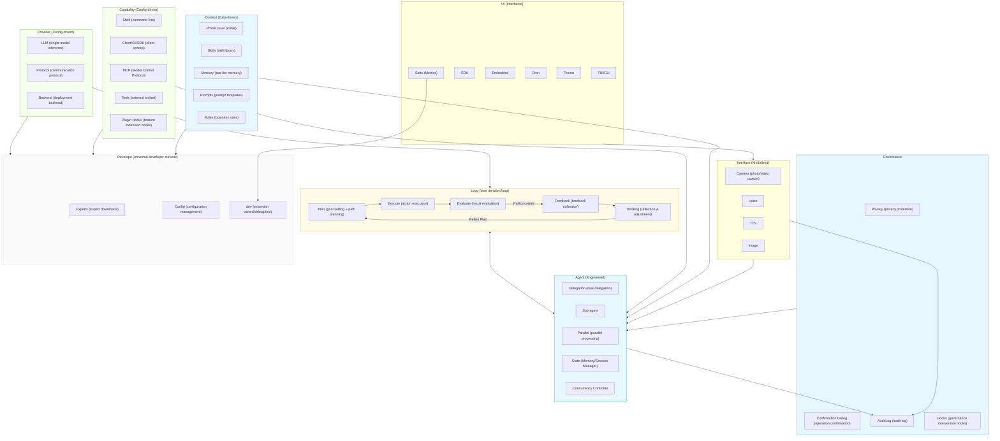

# AgenticX 1.0 User Guide

[English](user-guide.md) | [中文](user-guide_zh.md) | [README](README.md)

This document contains the detailed configuration, command, tool, and Runtime
reference moved out of the README. It describes DashScope AgenticX `1.0.1`.
Start with the
[quick start](README.md#quick-start), and review [security](SECURITY.md)
and [migration](migration-to-1.0.md) before installing extensions. Historical
version notes are kept only in [CHANGELOG.md](CHANGELOG.md).

## First Startup

The default TUI and `--cli` use the same first-run `/setup` wizard. A new
workspace starts setup when it has no `.agenticx/config.toml` and is missing
an API key or still uses the default provider/model. An existing workspace,
or a globally configured non-default provider/model with an API key, skips
automatic setup; run `/setup` whenever you want to personalize it.
Automatic setup runs before launching the TUI, as in the original startup
flow. Manual setup remains available inside the application.

Expert templates are optional role profiles, not a prerequisite for startup.
Initialization composes the same provider, capability and Expert handlers used
by the individual commands, without asking you to type those commands:

1. **Username**, then **configuration mode**: `[1] Default — Alibaba/Bailian`
   or `[2] Custom`. The China general preset has been removed.
   The menu previews the default username, provider, model, protocol, resolved
   API base URL, key status and capabilities. Press Enter for the username and
   mode to accept the default model and capabilities. Experts are selected
   separately afterwards in both modes; press Enter to skip without downloading.
   Default mode reuses existing credentials or defers missing ones without
   prompting for keys; an API Key is still required for model requests.
2. **Provider and model**: choose an existing provider, or enter a new name
   and confirm registration. New providers collect protocol, a valid HTTP(S)
   API base URL, default model and credentials once. Other models and storage
   scope are advanced options; setup defaults to workspace storage. Existing
   providers offer optional advanced endpoint/protocol settings.
3. **API Key** (Custom): resolved keys and no-auth providers are skipped during setup.
   Otherwise enter a hidden key (stored in the OS keyring), use an environment
   variable, or defer configuration. Built-in providers use their standard
   environment variable; new providers can declare no authentication.
4. **Capabilities and required credentials**: Custom mode offers multi-select
   capabilities; the default preset uses its selected capabilities. Shared
   credentials are requested only once. Incomplete capabilities are listed
   as pending and are not activated during this setup.
5. **Experts** (optional, both modes): choose a template or press Enter to skip. Nothing
   is downloaded without a selection. Templates preserve your user, connection
   settings and existing provider definitions; additional extension declarations
   are merged. Existing files require confirmation and are backed up; Enter
   declines conflicting changes.
6. **Final save and summary**: save the workspace configuration once, rebuild
   the current runtime's provider/tools/skills and refresh workspace instructions.
   Templates applied during setup take effect without restarting, and existing
   conversation history is preserved. Deferring a key does not start another
   credential wizard immediately afterward.

Cancelling initialization restores its unsaved configuration changes. Provider
registrations and credential writes already completed by a command step are
kept; copied template files are also not rolled back.

`agenticx expert download basic-chat` downloads from the public
`dashscope/dashscope-agenticx-experts` GitHub repository by default. A
downloaded profile that includes workspace configuration skips automatic
`/setup` on subsequent startup. Use `/setup` to personalize that
profile if needed. `--repo` and the global `expert_repo` configuration
override the default download source.

The welcome panel shows `Expert: <name>`. Downloads record this identity in
`.agenticx/expert.toml`; restoring a merge backup also restores the previous
identity, or removes the record if there was none. Existing manually created
or older profiles without this record show `Expert: (not recorded)`; AgenticX
does not guess the role from their contents.

`/expert` and `agenticx expert` list, download, and restore Expert profiles.

## Terminal Output

The TUI renders Markdown replies, numbered turns, collapsible tool details,
and expandable per-turn/session statistics. Use `Ctrl+O` for tool details and
`Ctrl+G` for statistics. macOS uses `Cmd+C` to copy; Windows/Linux use `Ctrl+C`.
The bottom Copy button copies the complete captured selection. Selecting and
normal copying are silent; copy failures still report a warning. On macOS,
`Ctrl+C` clears/cancels/quits and never copies a selection. `/copy` copies the
latest reply source; `--cli` provides native terminal scrollback.

## Configuration

AgenticX uses a **layered configuration** design:

- **Global configuration** (the platform-standard `AgenticX` app directory): API Keys (independent slot per Provider) + voice/TTS settings, shared across projects
- **Workspace configuration** (`./.agenticx/config.toml`): Provider, model, platform capabilities, MCP services, username

Priority: Workspace config > Global config > Environment variables (only fill empty slots) > Interactive input

### Global Configuration `~/.config/AgenticX/config.toml`

The global directory is resolved by `platformdirs` with app name `AgenticX`;
`~/.config/AgenticX` is the usual Linux location. Set `AGENTICX_HOME` to
override it on any platform.

Each Provider's API Key is stored in a separate slot, so switching does not overwrite one another. New saves store secrets in the OS keyring under the `dashscope-agenticx` service and write only references in TOML.

```toml
tongyi_api_key    = "KEYRING:v1:..."
anthropic_api_key = "KEYRING:v1:..."
openai_api_key    = "KEYRING:v1:..."
```

Upgrade compatibility: the legacy single `api_key = "..."` line is automatically migrated to the slot corresponding to the current `provider` on first launch. Keyring reads fall back to the legacy `agenticcli` service, and legacy `ENC:` values remain readable for migration. New secrets are not dual-written to legacy services.

### Workspace Configuration `./.agenticx/config.toml`

```toml
user_name = "agenticx"
model = "qwen3.8-flash"
provider = "tongyi"
fallback_providers = "openai,anthropic"        # When the primary provider fails, fall back in order (comma-separated string)
enabled_capabilities = "bailian.mcp,bailian.cli"
custom_models = "tongyi:qwen-3-max"   # Written by /dev model add
tui = false                            # TUI mode by default; set to false to run the inline CLI REPL instead — this leaves the alternate screen, so terminal-native selection, Cmd+C and unlimited scrollback all work
tui_mouse = false                      # The TUI captures the mouse so the wheel scrolls the output area (on by default, including Windows); set to false to hand the mouse to the terminal for native selection — still on the alternate screen, so off-screen lines remain uncopiable
max_turns = 100                        # Maximum tool-call turns per conversation, default 50; only written when explicitly overridden
session_persist = false                # Turn off cross-session history persistence (on by default)
user_directives = ["Don't push after each commit", "Update the README whenever code is changed"]  # Written by /rule
delegation = { max_concurrent = 5, default_timeout = 120, allow_nested = false }  # Delegation tool configuration; allow_nested has no effect for now (sub-agents are always forbidden from delegating further)

[[mcp_servers]]
service = "time"
```

### Environment Variables

> **Note**: API-Key environment variables only take effect when the corresponding key is not set in the configuration files (they fill empty slots). `AGENTICX_PROVIDER` / `AGENTICX_MODEL` always override.

| Variable | Description |
|------|------|
| `DASHSCOPE_API_KEY` | Tongyi Qianwen / Bailian API Key |
| `ANTHROPIC_API_KEY` | Claude API Key |
| `OPENAI_API_KEY` | OpenAI API Key |
| `OPENAI_BASE_URL` | Custom OpenAI-compatible endpoint |
| `AGENTICX_PROVIDER` | Force the Provider (takes precedence over configuration) |
| `AGENTICX_MODEL` | Force the model (takes precedence over configuration) |
| `AGENTICX_MCP_SERVERS` | Pre-connect MCP services (comma-separated) |
| `AGENTICX_MEMORY_USER_ID` | User identifier for profile isolation |
| `AGENTICX_MEMORY_LIBRARY_ID` | Bailian profile library ID |
| `AGENTICX_COMMAND_TIMEOUT` | Seconds a `run_command` call gets before it is killed (default 600) |

### Supported Providers

At runtime, only 3 protocol implementation classes are built in, corresponding to 3 out-of-the-box Providers:

| Provider | Protocol | Implementation Class | Default Model | Available Models |
|----------|------|--------|----------|----------|
| `tongyi` | `dashscope` | `TongyiProvider` | `qwen3.8-flash` | `qwen3.8-max`, `qwen3.7-max`, `qwen3.7-plus`, `qwen3.5-plus`, `qwen3.5-flash`, `qwen3-max`, `qwen-max`, `qwen-plus`, `qwen-turbo`, `qwen-vl-max`, `qwen-vl-plus`, `qwen-omni-turbo` |
| `anthropic` | `anthropic` | `AnthropicProvider` | `claude-sonnet-4-20250514` | `claude-opus-4-20250514`, `claude-haiku-4-5-20251001` |
| `openai` | `openai` | `OpenAIProvider` | `gpt-4o` | `gpt-4o-mini`, `gpt-4-turbo`, `o1`, `o3-mini` |

DeepSeek, Zhipu, Kimi, ideatalk, etc. are no longer hard-coded; simply declare them via `~/.config/AgenticX/custom-extensions.toml` or `./.agenticx/custom-extensions.toml` to use them (the project already ships with example configurations). Custom providers are likewise connected through `[[providers]]` blocks, with no code changes needed: fill them in interactively via `/dev provider add`, or refer to [Runtime Extensions (/dev)](#runtime-extensions-dev).

Reasoning models (models that return `reasoning_content`, such as `qwen-*-thinking`) are supported: the model's reasoning_content is passed through to the next round of the request, avoiding 400 errors like "thinking mode must be passed back" from DashScope and the like. If a custom provider uses a non-standard field name, it can be declared via `reasoning_field` (see the example below).

#### Custom Providers (`custom-extensions.toml`)

Declare `[[providers]]` blocks in `~/.config/AgenticX/custom-extensions.toml` (global) or `./.agenticx/custom-extensions.toml` (workspace, higher priority):

```toml
[[providers]]
name          = "my-ollama"          # Identifier used in the /provider wizard and config.provider
base_url      = "http://localhost:11434/v1"
default_model = "llama3"
models        = ["llama3", "mistral", "codestral"]
protocol      = "openai"             # openai / openai_compatible / anthropic / dashscope
auth          = false                # No API Key required (local deployment)

# If the provider puts reasoning content in a non-standard field, declare it with reasoning_field
# reasoning_field = "reasoning_content"

# Example of a cloud provider (key stored in an environment variable, no plaintext on disk)
# [[providers]]
# name          = "my-cloud"
# base_url      = "https://api.example.com/v1"
# api_key_env   = "MY_CLOUD_API_KEY"   # Preferred; read from the shell environment
# # api_key     = "KEYRING:v1:..."      # Alternative: OS keyring reference written by the wizard
# default_model = "my-model-v1"
# models        = ["my-model-v1", "my-model-v2"]
# vision_models = ["my-model-v2"]
# protocol      = "openai_compatible"  # Equivalent to openai
```

A `workspace` entry overrides a global entry with the same `name`; for a minimal template see the basic-chat Expert (run `agenticx expert download basic-chat` and then look at `.agenticx/custom-extensions.toml`).

**base_url configuration entry points and resolution precedence**

A new provider's endpoint (base_url) can be configured in several ways:

| Entry point | How | Use case |
|---|---|---|
| `[[providers]]` in `custom-extensions.toml` | `base_url = "https://..."` (see example above) | Custom / extension providers (recommended) |
| `config.toml` | `base_url = "https://..."` (global `~/.config/AgenticX/config.toml` or workspace `./.agenticx/config.toml`) | Override the **current primary provider's** endpoint |
| Environment variable | `export OPENAI_BASE_URL="https://..."` | Temporary / CI override, highest priority |
| `/dev provider add` | Interactive wizard: fill in name / protocol / base_url / default model / credentials, auto-written to `custom-extensions.toml` | No hand-written TOML |
| SDK / embedded API | `run(base_url=...)`, `create_agent(base_url=...)` | Programmatic integration |

Resolution precedence (for the primary provider): env var `OPENAI_BASE_URL` > `base_url` in `config.toml` > `base_url` of the matching `[[providers]]` in `custom-extensions.toml` > built-in default endpoint (tongyi / anthropic / openai).

Notes:

- `base_url` in `config.toml` applies only to the **primary provider**; fallback providers always use their own `[[providers]]` base_url or the built-in default.
- The `/provider` wizard can set base_url in its optional advanced connection step; switching providers clears the previous `config.toml` base_url override.
- To see the currently effective base_url: `/provider` (shows Base URL), `/dev provider list`, or the endpoint line in the startup banner.

### API Key Management

Each Provider has an independent key slot (`tongyi_api_key`, `anthropic_api_key`, `openai_api_key`); when switching Providers, each is preserved and none overwrites the others. Keys are entered after the model and optional connection settings in the `/provider` wizard (no terminal echo; press Enter to keep the existing key or skip).

```bash
agenticx> /provider
...
API Key
  [1] Enter key (OS keyring)
  [2] Environment variable
  [0] Configure later
Key source [1]: 1
API Key [Enter to skip]:
✓ Provider: tongyi/qwen3.8-flash
```

Built-in key slots: `tongyi`, `anthropic`, `openai`. Keys for extension Providers (such as DeepSeek / Zhipu / Kimi / ideatalk) are configured in `custom-extensions.toml` via `api_key_env` or an `api_key = "KEYRING:v1:..."` reference, and can likewise be entered through the `/provider` wizard. The wizard saves the secret to the OS keyring under `dashscope-agenticx` and writes only the reference to the `<name>_api_key` slot of the global configuration. Resolution order: slot key entered via the wizard > environment variable pointed to by `api_key_env` > keyring reference in TOML. Legacy `ENC:` values remain readable for migration but are not written for new secrets.

---

## Commands

Commands are organized into four tiers: Session → Configuration → Capability → Development. `/help` and the startup banner also present them in this order.

### Session

| Command | Description |
|------|------|
| `/help` | Show help (lists all commands by category) |
| `/clear` | Clear the conversation history (and persist the empty history to `./.agenticx/session/<topic>/history.json`) |
| `/stats` | View session statistics (token usage, prompt composition, API calls, tool call counts, session duration) |
| `/info` | View current runtime information (provider / model / protocol / base URL / capabilities / privacy status / config file path) |
| `/v` | Voice input (shortcut `Ctrl+T`): record → ASR transcription → send to the model |
| `/voice [subcmd]` | Voice input management: on (start recording) / off (cancel) / model [name] (switch ASR model) / silence `<s>` (pause threshold) / max `<s>` (maximum duration) / threshold `<rms>` (silence RMS) |
| `/tts [subcmd]` | Voice output (TTS) toggle and settings: on / off / model [name] / voice [name] / speed `<0.5-2.0>` / say `<text>` (read aloud immediately) / last (read the previous reply aloud) |
| `/camera capture [file]` | Take a photo with the camera; after saving, use `@file` to send it to a vision model for analysis |
| `/camera record [duration] [file]` | Record video with the camera, default 5 seconds, saved as mp4 |
| `/copy` | Copy the last AI reply to the clipboard (supports pbcopy/xclip/clip) |
| `/save [path]` | Save the last AI reply to a file (defaults to `agenticx_output_<time>.md`) |
| `/json on\|off` | Toggle JSON output mode (when enabled, Agent replies are forced into JSON format, passing `response_format` through to the Provider) |
| `/compress` | Compress the conversation context (replace history with an LLM summary to save tokens) |
| `/summarize` | Manually summarize the current task (LLM extracts key steps and lessons) and store it in experience memory; also triggered automatically for long tasks (>=6 messages) |
| `/history [subcmd]` | Conversation history management (stats for statistics / list [n] to list / search `<keyword> [limit]` full-text search / export `<file> [--format json\|md\|html]` to export / clear to clear) |
| `/undo` | Undo the most recent file write/delete (write_file / delete_file snapshot automatically to `.agenticx/checkpoints/` before mutating) |
| `/session [subcmd]` | Session topic management (new [name] / list / switch `<name>` / rename `<old> <new>` / fork `<new> [src]` / remove `<name>` / scene memory) |
| `/feedback good\|bad` | Mark task satisfaction (stored in experience memory) |
| `/report` | Generate and display a trace data performance report (LLM call count, tool success rate, average response time) |
| `/log [subcmd]` | View the complete LLM prompts recorded in debug mode (requires `/debug on` first; data comes from the session trace): `tail [n]` the most recent n entries (default 3) / `search <keyword>` to search / `clear` to clear; paged through less in CLI mode, shown inline with truncation in the TUI |
| `/trace [subcmd]` | View the execution trace (LLM call duration/token usage, tool calls and their durations, decision points; lightweight events are always recorded, full prompts require `/debug on`): `tail [n]` the most recent n entries (default 5) / `search <keyword>` to search / `clear` to clear; paged through less in CLI mode, shown inline with truncation in the TUI |
| `/exit` | Exit (aliases `/quit` / `/q`) |

Example `/stats` output:

```
📊 Session Stats
  Provider: tongyi
  Model:     qwen3.8-flash
  Token usage: 2700 (input: 1800, output: 900, cached: 1200)
  Prompt composition: 15230 chars
    system → 6100 (40%)
    user → 320 (2%)
    assistant → 1450 (9%)
    tools → 7360 (48%)
  API calls: 2
  Tool calls: 5
  Tool breakdown:
    run_command → 3
    read_file → 2
  Skill usage: 3
  Skill breakdown:
    text-generation → 2
    cli → 1
  Session duration: 3m12s
```

##### `/tts` — Voice Output (Text-to-Speech)

When enabled, the Agent automatically synthesizes speech with DashScope CosyVoice and plays it after every reply. TTS settings are saved to both the global configuration (`~/.config/AgenticX/config.toml`) and the Workspace configuration, remaining effective across directories/sessions.

```bash
agenticx> /tts on                       # Enable automatic voice output
agenticx> /tts off                      # Disable
agenticx> /tts model                    # View the current TTS model
agenticx> /tts model cosyvoice-v2       # Switch model
agenticx> /tts voice                    # View the current voice
agenticx> /tts voice longxiaochun_v2    # Switch voice
agenticx> /tts speed                    # View the current speech rate
agenticx> /tts speed 0.9                # Set speech rate (0.5–2.0, 1.0 is normal)
```

- Requires `pip install dashscope-agenticx[voice]` (includes `sounddevice`, `numpy`)
- Auto-playback timing: in CLI mode, sentences are streamed in as they are generated (played while generating, `StreamingTTSFeeder`); in TUI mode, the entire reply is fed in after completion
- Playback is truly streaming: as soon as the WAV header is received, it is decoded and output via `sounddevice.OutputStream`, without waiting for the entire synthesis to finish
- The speech rate maps directly to the DashScope `speech_rate` float parameter and takes effect immediately

### Configuration

| Command | Description |
|------|------|
| `/setup` | Interactive Workspace initialization (username, Provider, model, capabilities) |
| `/capability [subcmd]` | Capability toggles (list/enable/disable/reload/config) |
| `/subagents [subcmd]` | Subagent management (list/reload/enable/disable/config) |
| `/provider` | Q&A-style configuration wizard: Provider → model → optional connection settings → API Key |
| `/model [name]` | Switch the model within the current provider; without an argument, shows the current model |
| `/trust [subcmd]` | Tool trust/denial cache for the current conversation (automatically cleared at the end of each turn; asked again in the next turn) |
| `/rule [subcmd]` | User long-lived operation rules (list / add `"<text>"` / rm N / clear); enabled rules are injected into the system prompt every turn |
| `/theme [subcmd]` | Theme settings (list / set `<name>` / custom colors); built-in dark / light / monokai / dracula / nord / solarized |
| `/privacy [on\|off\|status]` | Privacy mode |
| `/debug [on\|off\|status]` | Debug mode: when enabled, the complete prompt (sanitized) finally sent to the LLM each turn is written to the session trace `.agenticx/traces/<session>.jsonl` as an `llm_call` event; view it with `/log` or `/trace` |
| `/directives` | View / accept Directives auto-learning proposals |

##### `/setup` — Interactive Workspace Initialization

Runs the ordered initialization flow described in [First Startup](#first-startup),
automatically for new workspaces or manually to reconfigure the current one.
The individual command handlers are reused internally, but command names are
not shown as extra instructions. Both modes offer Experts last, independently
of the model configuration, and finish with a single saved summary.

```text
Workspace setup
Username [anonymous]: alex
Configuration mode
  [1] Default — Alibaba/Bailian
  [2] Custom
Choice [1]: 2
Available providers:
Choose (number or name) [tongyi]:
Available models:
Choose (number or name) [qwen3.8-flash]:
Advanced connection settings? [y/N]:
API Key
Key source [1]: 0
Capabilities (optional)
Capabilities [0]: 0
Experts (optional)
Expert [0]:
✓ Setup complete — config saved to .agenticx/config.toml
```

##### `/provider` — Q&A-Style Configuration Wizard

The same provider handler is used by initialization and the standalone command:
**Provider → model → optional advanced connection settings → API Key**.
Choose a numbered item or type a name. Switching providers resets the previous
endpoint override and selects the new provider's default model/protocol.

The model menu shows at most two entries per modality (text, vision, audio or
multimodal), with the current model retained. Type any other model name to use
it. Model names are stripped of surrounding whitespace and lowercased on input
and configuration loading, including default, vision, audio and custom models.

For an unlisted provider, confirm registration and supply **protocol → API base
URL → default model → optional advanced models → key source**. The endpoint
must be an absolute HTTP(S) URL without embedded credentials, query parameters
or a fragment. Setup stores new providers in the current workspace by default;
advanced options expose the storage scope. After registration, its model and
API Key are used directly, without asking again.

API keys are hidden during entry. Existing keys can be kept by pressing Enter
in the standalone wizard; setup skips already resolved keys. A missing key can
be entered into the OS keyring, sourced from an environment variable, or deferred.
A new provider may explicitly use no authentication. No plaintext key is written
to TOML. EOF or Ctrl+C cancels the current wizard rather than accepting defaults.

Advanced connection settings allow overriding the primary provider's base URL
and protocol. Enter keeps the current value. Configuration changes rebuild the
provider immediately while preserving conversation history. Use `/model <name>`
for a model-only switch; custom model registration/removal remains available via
`/dev model add|list|rm`.

##### `/model` — Quick Model Switch

`/model <name>` switches the model under the current provider directly, without the wizard; without an argument it shows the current model and usage. A name outside the preset list is registered as a custom model (same rule as the wizard's model step). Switching provider, API key, or protocol still goes through `/provider`. The switch rebuilds the Provider instance immediately and preserves the current conversation history.

**Specifying the protocol at CLI startup**:

```bash
agenticx --protocol anthropic     # Use the Anthropic protocol directly at startup
agenticx --protocol openai        # Use the OpenAI protocol directly at startup (default)
```

Other main CLI options:

```bash
agenticx -c "Summarize this project"  # Run one prompt, then exit
agenticx --dry-run                    # Preview loaded configuration without starting
agenticx --max-turns 20               # Override the configured conversation turn limit
```

**How protocol conversion works**:

| Direction | Conversion content |
|------|---------|
| Request (Anthropic → OpenAI) | `system` parameter extracted into a system message, `input_schema` → `parameters`, content blocks → text |
| Response (OpenAI → Anthropic) | `content` → content blocks, `tool_calls` → `tool_use` blocks, `finish_reason` → `stop_reason` |

### Capability

Commands corresponding to capabilities that are not enabled are intercepted by the gateway with a hint on how to enable them, instead of reaching the underlying API and failing with credential errors.

| Command | Associated capability | Description |
|------|---------|------|
| `/profile [subcmd]` | — | User profile (list/search/add/remove(rm)/clear) |
| `/memory [subcmd]` | — | Conversation history (list/search/remove(rm)/clear) |
| `/mcp [subcmd]` | `bailian.mcp` | MCP services (add/remove/list); requires `/capability enable bailian.mcp` first |
| `/skill` | — | List all available skills (single-file + packages, including MCP dependency status) |
| `/skill <name> [args]` | — | Invoke a preset Prompt |
| `/skill install <local-dir\|git-url\|tar.gz-url\|name[@version]>` | — | Install a skill package (local path / git / tar.gz URL / registry name) |
| `/skill link <local-dir>` | — | Symlink a local skill package (development mode) |
| `/skill update <name>` | — | Update an installed skill package |
| `/skill update --all` | — | Update all installed skill packages |
| `/skill uninstall <name>` | — | Uninstall a skill package |
| `/skill search <query>` | — | Search installed packages + registry |
| `/skill publish <local-dir>` | — | Validate and package a skill package into tar.gz |
| `/skill reload` | — | Rescan the skills directory |
| `/skill enable <name>` | — | Force-enable a skill package |
| `/skill disable <name>` | — | Force-disable a skill package |
| `/app list` | — | List installed versioned App Bundles |
| `/app info <name>` | — | Show publisher, permissions, Runtime range, and checksum |
| `/app install <path>` | — | Install an App and display its permission diff |
| `/app update <name>` | — | Update an App from its recorded source and recalculate permissions |
| `/app verify <name>` | — | Verify App checksum and Runtime compatibility |
| `agenticx serve [--host <host>] [--port <port>] --token <token>` | — | Start the Client API for Runs, Sessions, Artifacts, and Traces (default: 127.0.0.1:8765) |
| `/cron [subcmd]` | — | Scheduled tasks (add/list/remove/pause/resume), supporting intervals, specific times, and cron expressions |
| `/privacy on\|off` | — | Privacy mode toggle (forces local storage, disables cloud capabilities and cron tasks) |
| `/audit [subcmd]` | — | Audit log (recent/clear/query), records user input and tool decisions, automatically sanitized in privacy mode |
| `/directives [subcmd]` | — | Custom directives (bare command lists; add/rm N/clear) and auto-learning proposals (proposals/accept `<id>`/reject `<id>`) |
| `/feedback good\|bad` | — | Mark task satisfaction (stored in experience memory) |

### Development

| Command | Description |
|------|------|
| `/dev model [subcmd]` | Register models at runtime (add / rm / list) |
| `/dev provider [subcmd]` | Extend Providers (add / list / rm) |
| `/dev capability [subcmd]` | Extend HTTP tool groups (add / list / rm) |
| `/dev skill [subcmd]` | Extend Skills (add / list / rm) |
| `/dev tool [subcmd]` | Extend Shell tools (add / list / rm) |
| `/dev debug [subcmd]` | Debugging (tools / schema / call / prompt) |
| `/dev test provider <name>` | Test Provider connectivity |
| `/dev reload` | Hot-reload custom-extensions.toml |
| `/dev log` | View tool registration statistics |
| `/expert [list]` | List available Expert templates |
| `/expert download <name>` | Initialize the workspace: merge the Expert into `./.agenticx/` (automatic backup on conflicts) |
| `/expert restore` | Undo the most recent merge (restore `.agenticx/backup/`) |

## Tools

The three permission tiers correspond to different confirmation behaviors:
- **Auto**: no prompt, the LLM calls it directly
- **Confirm**: pops up `[y]es / [n]o / [a]lways (let this tool pass directly for the current conversation) / [s]top (abort the current turn of conversation and return to agenticx>)`
- **Dangerous**: only accepts `y` / `n`, with no "always" shortcut — destructive operations are asked about every time; the security model does not allow the cache to be broken

### Filesystem

| Tool | Permission | Description |
|------|------|------|
| `read_file` | Auto | Read file contents (supports line offset and limit) |
| `write_file` | Confirm | Write a file, returns a unified diff |
| `list_directory` | Auto | List directory contents (including file types and sizes) |
| `create_directory` | Confirm | Create a directory (including nested parents) |
| `delete_file` | Dangerous | Delete a file (irreversible) |
| `delete_directory` | Dangerous | Delete a directory and all its contents (irreversible) |
| `search_files` | Auto | Search files by glob pattern |
| `move_file` | Confirm | Move / rename a file or directory |

### Shell

| Tool | Permission | Description |
|------|------|------|
| `run_command` | Confirm | Execute a Shell command; dangerous-mode commands are intercepted, read-only commands are classified automatically. A `timeout` argument (seconds, default 600, `AGENTICX_COMMAND_TIMEOUT`) caps the run; on expiry the whole process group is killed, so a pipeline does not outlive the timeout |

### Network

| Tool | Permission | Description |
|------|------|------|
| `web_search` | Auto | DuckDuckGo web search, returns titles, URLs, and snippets |
| `scrape_web` | Auto | Scrape the plain text of a web page with a Playwright headless browser (supports JS dynamically rendered SPAs) |
| `scrape_web_html` | Auto | Scrape the rendered HTML source with a Playwright headless browser |
| `scrape_web_screenshot` | Auto | Take a screenshot of a web page with a Playwright headless browser and save it as an image file |

### Camera

| Tool | Permission | Description |
|------|------|------|
| `camera_capture` | Confirm | Take a photo with the camera (the LLM can invoke it proactively) |
| `camera_record` | Confirm | Record video with the camera (the LLM can invoke it proactively) |

### Session / Configuration

Built-in, always available.

| Tool | Permission | Description |
|------|------|------|
| `switch_model` | Auto | Switch the current LLM model |
| `switch_provider` | Auto | Switch the current Provider |
| `list_models` | Auto | List available models of all Providers |
| `capability_list` | Auto | List all capabilities and their enablement status |
| `capability_enable` | Confirm | Enable the specified capability (e.g. bailian.mcp) |
| `capability_disable` | Confirm | Disable the specified capability |
| `mcp_list_services` | Auto | List available MCP cloud services |
| `mcp_connect` | Confirm | Connect to an MCP service and register its tools |
| `mcp_disconnect` | Confirm | Disconnect from an MCP service |
| `create_plan` | Auto | Create a multi-step execution plan for complex tasks |
| `complete_step` | Auto | Mark a plan step as complete by index |
| `get_plan_status` | Auto | View the current plan progress |

### Subagents

Available after the `local.subagent` / `local.delegate` capability is enabled.

| Tool | Permission | Description |
|------|------|------|
| `subagent_invoke` | Auto | Spawn an isolated subagent to handle an independent subtask, returning only the final result |
| `review_code` | Auto | Code review subagent (Bug / security / performance / style) |
| `write_tests` | Auto | Test engineering subagent, generates pytest test cases |
| `generate_docs` | Auto | Documentation engineering subagent, generates Markdown / docstring documentation |
| `delegate` | Auto | Delegate a single subtask, supporting tool whitelists, context files, timeouts, and system prompt overrides |
| `delegate_parallel` | Auto | Delegate multiple subtasks concurrently, with configurable maximum concurrency |

### Platform (bailian.cli)

Dynamically registered after the `bailian.cli` capability is enabled. Tool names follow the `bailian_<command_path>` format (e.g. `bailian_text_chat`, `bailian_image_generate`). Read operations (list/get/status/search) have **Auto** permission, while write operations (generate/upload/delete, etc.) have **Confirm** permission. Schemas are read from `bl config export-schema` and cached in `~/.config/AgenticX/bl-schemas.json` (TTL 24 hours).

---

## Architecture

> **Implementation note:** The Mermaid diagram below is the long-term conceptual map. The ASCII module diagrams that follow describe the current runtime. Roadmap-only nodes such as a standalone structured LoopEngine, Dual-LLM router, historical MetricsCollector, and Web dashboard are not active in this build; legacy config values now emit an explicit warning.



### Module File Tree

```
src/dashscope_agenticx/
├── cli/                # CLI entry layer (REPL main loop + slash command dispatch + all command handlers)
│   ├── repl.py         # REPL main loop (input reading, completion, history)
│   ├── dispatch.py     # Slash command dispatch (routing to handlers)
│   ├── handlers_*.py   # Command handlers (config/capability/provider/session/device/skill/…)
│   ├── completer.py    # Context-aware completion + sanitized storage/retrieval of command history
│   ├── multimodal.py   # @file/directory reference expansion + image/audio multimodal content assembly
│   ├── mcp.py          # CLI-side MCP client management (connect/reconnect/tool injection)
│   ├── expert.py       # /expert Expert management
│   ├── constants.py    # CLI constants and configuration data
│   ├── startup.py      # Startup initialization (provider checks, welcome message)
│   ├── streaming.py    # Streaming output rendering
│   └── runners.py      # one-shot / interactive run entry points
├── agent.py            # Agent Loop (multi-turn tool calls + PromptPipeline system prompt injection)
├── prompt_pipeline.py  # Pluggable prompt section system (PromptSection protocol + 10 built-in sections + assembly pipeline)
├── session.py          # Multi-topic session management (SessionManager: create/switch/rename/remove topic)
├── audit.py            # Audit log (JSONL event stream + privacy-mode sanitization + query/replay)
├── permission.py       # Permission policies (PermissionPolicy rule engine + global policy storage)
├── config.py           # Layered config (global/workspace) + independent key slot per Provider + keyring references + SubagentConfig
├── commands.py         # Slash command definitions shared by CLI/TUI + UI-agnostic utilities
├── dev.py              # Runtime model registration (custom_models) + provider/platform/tool/skill extension guides
├── executor.py         # Safe execution layer (permission levels + audit log integration)
├── hooks.py            # Event hook bus (governance-first dispatch: block/confirm/alert > run/warn/log)
├── extensions.py       # custom-extensions.toml loading + custom provider/capability/skill/shell-tool
├── scheduler.py        # Scheduled task scheduling (interval/specific time/cron expression recurring execution + privacy-mode awareness)
├── prompt.py           # Project instruction auto-discovery + safe preprocessing + stable/ephemeral prompt splitting
├── compression.py      # Token budget compression based on model context window (soft/hard dual thresholds + intra-turn guard)
├── deliverable.py      # Detection and automatic display of tool-generated file paths
├── mcp_server.py       # MCP Server mode (exposes AgenticX tools to external MCP clients via JSON-RPC stdio)
├── sdk.py              # Programmatic SDK (run_once / run_stream / create_agent / run_interactive)
├── capabilities/       # Capability implementation layer (platform-independent capabilities such as local Memory)
│   └── local_memory.py # LocalMemoryCapability (local memory capability implementation)
├── utils/              # Utility function library (secret storage/paths/text/templates/validation and other common utilities)
│   ├── crypto.py       # Legacy ENC: read compatibility
│   ├── secret_store.py # OS keyring storage, KEYRING:v1 references, and legacy fallback
│   ├── paths.py        # Path utilities
│   ├── messages.py     # Message text extraction and tool scaffolding filtering (shared by compression/memory)
│   └── …               # text / template / sanitizer / validation / spinner etc.
├── ui/                 # User interface layer (Entry Channels)
│   ├── tui.py          # Textual rich UI mode (default)
│   ├── embedded.py     # Embedded mode API (external CLIs reuse the full AgenticX interaction loop)
│   ├── voice.py        # Voice input (real-time streaming ASR + VAD auto-stop)
│   ├── tts.py          # Voice output (true streaming TTS playback)
│   └── camera.py       # Camera photo capture + video recording (opencv / imagesnap / ffmpeg)
├── memory/             # State and context management layer (Context Management + State Store)
│   ├── manager.py      # MemoryManager unified interface (two-tier memory coordination + sub-agent derived isolation)
│   ├── experience.py   # Experience memory (learns from task outcomes, reuses successful strategies across sessions)
│   ├── plan.py         # Planning layer (multi-step plan declaration and progress tracking, TTL auto-expiry)
│   ├── reflection.py   # Reflection mechanism (detects consecutive failures, injects strategy adjustment hints)
│   ├── directives_learning.py # Directive auto-learning (proposes rules from user behavior patterns)
│   ├── skill_evolution.py # Skill evolution (generates new skills from successful trajectories)
│   ├── tool_chains.py  # Tool chain composition (predefined common workflow patterns, injected by query matching)
│   └── trace.py        # Execution trace log (records LLM calls, tool executions, decision points)
├── eval/               # Evaluation framework (A/B Provider comparison + eval case suites)
│   └── __init__.py     # EvalCase + EvalRunner (4-dimension scoring) + ProviderComparator + load_eval_suite
├── agents/             # Multi-agent coordination layer (Multi-agent Coordination)
│   ├── subagent.py     # Sub-agent execution framework (isolated context + dedicated system prompt + derived session memory)
│   ├── subagents.py    # Sub-agent management (discover/enable/disable/config + /subagents command)
│   └── delegate.py     # delegate / delegate_parallel tool implementations (derived isolated session memory)
├── skills/             # Built-in skills (Prompt templates)
│   ├── base.py         # Skill dataclass + register() + list/render + .md file loading
│   ├── manager.py      # Skill package management (load/enable/disable/activation rules)
│   ├── package.py      # Skill package directory parsing + tools.py import and namespace
│   └── store.py        # Skill registry (install/search/publish)
├── platforms/          # Platform capability abstraction layer (includes multiple vendor subpackages)
│   ├── base.py         # Protocol interfaces + shared dataclasses
│   ├── __init__.py     # Factory functions (create provider instances based on config)
│   ├── bailian/        # Bailian platform
│   │   ├── mcp.py      # MCP Client (Streamable HTTP + JSON-RPC)
│   │   └── cli.py      # `bl` binary wrapper (subprocess + JSON-Schema → batch tool registration)
│   └── local/          # Local implementations
│       ├── history.py  # Conversation history persistence
│       └── memory.py   # Local Memory capability (LocalMemoryCapability)
├── providers/          # LLM Provider layer (3 protocol implementations + config-driven dispatch)
│   ├── base.py         # LLM abstract interface (includes reasoning_content / delta_reasoning_content)
│   ├── adapter.py      # Anthropic ↔ OpenAI protocol conversion adapter
│   ├── profile.py      # ProviderProfile registry + ordered failover chain
│   ├── hardening.py    # Provider retry, empty-response recovery, streaming error tolerance wrapper
│   ├── tongyi.py       # dashscope protocol implementation (DashScope OpenAI-compatible endpoint via httpx)
│   ├── anthropic.py    # anthropic protocol implementation (Anthropic SDK)
│   └── openai.py       # openai protocol implementation (GPT / Azure / vLLM / Moonshot / Deepseek / Zhipu / Ollama …)
└── tools/
    ├── registry.py     # Tool registry (permission levels)
    ├── platform.py     # Platform capability → tool registration (filtered by enabled_capabilities)
    ├── session.py      # Session/config tools (switch_model / mcp_connect / capability_* etc.)
    ├── filesystem.py   # File operation tools
    ├── shell.py        # Shell execution tools (includes auto-allow classifier for read-only commands)
    ├── web_search.py   # Web search tool (DuckDuckGo/DDGS, no key required)
    ├── camera.py       # Camera tool registration (photo capture + video recording)
    └── browser.py      # Playwright headless browser tools (scrape_web / scrape_web_html / scrape_web_screenshot, with SSRF protection)
```

### Model Provider Architecture

```
+-------------------------------------------------------------+
|                         agent.py                            |
|  Agent Loop: chat/stream + tool calls + Skill catalog injection |
+--------------------------+-+--------------------------------+
|                  providers/__init__.py                      |
|  get_provider_chain(config) -> ProviderChain                |
|  get_provider(name, model, key, base_url, protocol)         |
+--------------------------+-+--------------------------------+
|                    providers/profile.py                     |
|  ProviderProfile registry + ordered fallback chain          |
+-------------------------------------------------------------+
|                   providers/hardening.py                    |
|  HardenedProvider: retry + empty-response recovery          |
+-------------------+-------------------+-------------------+
|  tongyi           |  anthropic        |  openai           |
|  -----------      |  -----------      |  ----------       |
|  DashScope        |  Anthropic        |  OpenAI-          |
|  OpenAI-          |  SDK              |  compatible       |
|  compatible       |                   |                   |
|  + adapter        |                   |                   |
+-------------------+-------------------+-------------------+
|                   providers/adapter.py                      |
|  Anthropic ↔ OpenAI protocol conversion (request/response/streaming) |
+-------------------------------------------------------------+
|                      providers/base.py                      |
|  Protocol: LLMProvider (chat / chat_stream)                 |
|  Dataclass: LLMResponse, LLMChunk, ToolCall                 |
+-------------------------------------------------------------+
```

- `get_provider_chain(config)` returns a `ProviderChain` that automatically fails over in the order of `fallback_providers`
- `HardenedProvider` wraps each provider: retries transient errors, automatic recovery from empty responses, tolerance of streaming exceptions
- tongyi: DashScope OpenAI-compatible protocol, supports Anthropic protocol conversion (select anthropic at the protocol step of the `/provider` wizard)
- anthropic: Anthropic SDK, Claude series
- openai: OpenAI-compatible protocol (GPT / Azure / vLLM / Ollama)
- Other providers (DeepSeek / Zhipu / Kimi / ideatalk etc.) are configured as extensions via `custom-extensions.toml`, reusing one of the 3 protocol implementations above

### Platform Capability Architecture

```
+-------------------------------------------------------------+
|                    tools/platform.py                        |
|  register tools based on config.enabled_capabilities        |
+--------------------------+----------------------------------+
|                   platforms/__init__.py                     |
|  get_memory_provider / get_cli_provider                     |
+---------------+-------------+-------------------------------+
|  bailian/     |  local/     |  (extensible)                 |
|  -----------  |  ---------  |  ---------------------------  |
|  mcp          |  history    |  Custom platform subpackages  |
|  cli          |  memory     |  via custom-extensions.toml   |
+---------------+-------------+-------------------------------+
|                    platforms/base.py                        |
|  Protocol: MemoryProvider, KBProvider, DataProvider,        |
|  PromptProvider, SearchProvider, ContextProvider            |
+-------------------------------------------------------------+
```

- `bailian.mcp`: MCP cloud tools (Streamable HTTP + JSON-RPC)
- `bailian.cli`: Bailian CLI toolset (`bl` binary wrapper)
- `local.history`: Local conversation history persistence (functional storage: store/list/search/export)
- `local.memory`: Local Memory storage (LocalMemoryClient, file persistence)

### UI Architecture

```
cli/__init__.py (program entry dashscope_agenticx.cli:main)
    │
    ├── ui/tui.py ────── AgenticXApp ── full-screen TUI (/theme hot switching, CSS variables come from config.theme)
    │
    ├── cli/repl.py ──── interactive REPL main loop
    │      ├── cli/runners.py ─── orchestration of a single turn (streaming/tool confirmation wiring)
    │      ├── cli/dispatch.py ── slash command routing (/help /stats /theme ...)
    │      └── cli/streaming.py ─ LLM chunk → terminal rendering (incremental Markdown)
    │
    ├── sdk.py ───────── create_agent / run_stream / run_once (library mode reuses the same engine)
    │
    ├── ui/embedded.py ─ run() embedded entry point (one-line integration for host applications)
    │
    └── cli/scheduler.py ── Scheduler / CronJob (~/.config/AgenticX/cron_jobs.json;
                            privacy mode skips cloud tasks)
```

- `/stats` (dispatch.py) → Executor.get_stats: tool call counts/durations, token usage.

### Multimodal Input Architecture

```
User input
    │
    ├── cli/multimodal.py ── @path expansion: text read directly / image→data-URL / audio
    │                        (size limits in cli/constants.py)
    ├── ui/voice.py ──────── real-time ASR + VAD voice input (/v, /voice)
    ├── ui/tts.py ────────── CosyVoice streaming speech synthesis playback (/tts)
    ├── ui/camera.py + tools/camera.py ── photo capture / video recording (device control)
    └── utils/images.py ──── common processing such as image encoding/scaling
```

### Agent Engine Architecture

```
agent.py ── ReAct main loop (asyncio.gather parallelism for multiple tools within a single turn)
    │
    ├── agents/delegate.py ── delegate / delegate_parallel
    │      └── asyncio.gather fan-out + semaphore rate limiting
    │          (derived isolated session memory, see below)
    ├── agents/subagent.py ── subagent_invoke
    │      └── isolated context: dedicated system prompt + derived session memory
    ├── agents/subagents.py ── sub-agent discovery / enabling / configuration
    └── memory/manager.py + memory/session.py
           └── state: two-tier memory + multi-topic sessions
```

### Governance Architecture

```
permission.py ── PermissionPolicy: allow / deny / confirm rule matching (permissions.toml)
    │
executor.py ── confirmation protocol: y(yes)/n(no)/u(skip input)/a(always)/s(session trust, /trust cache)
    │
audit.py ── JSONL audit log (~/.config/AgenticX/audit.log, privacy sanitization)
    │
hooks.py ── HookBus: governance actions (block/confirm/alert)
             take precedence over plugin actions (run/warn/log)
    │
config.py ── privacy_mode, three enforcement points:
             scheduler skips cloud tasks / audit sanitization / capabilities disable cloud
```

### Context Architecture

```
prompt.py ── 7 instruction file discovery locations + PromptAssembly
    │
prompt_pipeline.py ── 10 built-in sections (all ephemeral, assembled per turn)
    │
compression.py ── token budget compression based on model context window (soft/hard dual thresholds + intra-turn guard)
    │
memory/ various Trackers (plan / experience / reflection / tool_chains /
    directives_learning) + platforms/local/memory.py
```

### Tools and Capabilities Architecture

```
tools/registry.py ── @tool decorator / PermissionLevel /
                     keyword filtering to_schema_list
    │
    ├── tools/ built-in: filesystem / shell / web_search / browser / camera /
    │                 session
    ├── extensions.py ── declarative extensions via custom-extensions.toml
    │                    (HTTP/vision tools, provider, skill)
    ├── tools/platform.py ── capabilities registered according to enabled_capabilities
    └── MCP bidirectional: platforms/bailian/mcp.py (client, calls external MCP Servers)
                  mcp_server.py (server, exposes AgenticX tools to the outside)
```

### Iteration Loop Architecture

```
User input
  → memory/plan.py (create_plan task decomposition)
  → executor.py (execution) ── eval/ (EvalRunner / ProviderComparator evaluation)
  → /feedback (user feedback)
  → memory/reflection.py (3+ consecutive failures trigger reflection)
  → back to plan
TraceLogger records every decision and tool call throughout the process.
```

---

## Modules

### Context

The context capabilities are spread across four collaborating modules: `prompt.py` handles automatic discovery of project instructions (7 file types, priority matching), `prompt_pipeline.py` handles sectioned assembly of the system prompt (stable/ephemeral separation), `compression.py` handles token budget compression (soft/hard dual thresholds), and the various Trackers under `memory/` provide experience/plan/reflection/tool-chain context. For component details and data structures see [Memory and Context](#memory-and-context).

### Custom System Prompt

Place a Markdown file at `.agenticx/system-prompt.md` (workspace takes priority) or `~/.config/AgenticX/system-prompt.md` (global), and AgenticX will use it as the **base** of the Agent system prompt at startup, replacing the built-in default base prompt.

```bash
# workspace level (only effective for the current project)
cat > .agenticx/system-prompt.md << 'EOF'
You are a code assistant focused on Python backends.
Follow PEP 8, prefer async/await, and use pytest for tests.
EOF

# global level (shared across all projects)
cat > ~/.config/AgenticX/system-prompt.md << 'EOF'
You are a concise and efficient development assistant. Keep replies short.
EOF
```

Priority: workspace `.agenticx/system-prompt.md` > global `~/.config/AgenticX/system-prompt.md` > built-in default prompt.

**Note**: `system-prompt.md` replaces the base; `PromptPipeline` still appends its various sections after it. The final system prompt injected into the LLM is assembled in the following order:

```
[base prompt / system-prompt.md]          ← your custom one or the built-in default
[Project instructions]                    ← .agenticx/rules.jsonl / prompt.md etc. (see next section)
─── everything above is the stable prefix (byte-identical for the whole session, prompt-cache friendly) ───
[Skills templates]                        ← .agenticx/skills/*.md
[Skill Packages rules]                    ← active skill packages
[Disabled capabilities notice]            ← generated dynamically based on enabled_capabilities
[Long-lived operation rules]              ← user_directives (written via /rule, injected every turn)
[Current execution plan]                  ← PlanTracker active steps
[Semantic experience recall]              ← the 3 most relevant historical experiences
[Tool chain context]                      ← tool chains relevant to this session
[Directives learning proposals]           ← behavior rule suggestions pending confirmation
[Environment info]                        ← current username, provider, model
─── everything above is the ephemeral suffix (recomputed every turn) ───
```

Therefore there is no need to redundantly declare tool usage, rules, or identity information in `system-prompt.md`—these are injected automatically by the pipeline.

### Project Instruction Auto-Discovery

In addition to `system-prompt.md`, AgenticX also automatically discovers and loads project-level instruction files (first-match wins, searching upward from the current directory):

| File | Description |
|------|------|
| `.agenticx/rules.jsonl` | Project rules (highest priority, structured JSONL format, each line `{"text": "...", "enabled": true}`) |
| `.agenticx/prompt.md` / `.agenticx/prompt` | Project prompt |
| `.agenticx/instructions.md` | Project instructions |
| `.cursorrules` | Cursor-style rules |
| `.claude.md` / `CLAUDE.md` | Claude-style rules |

During loading, YAML frontmatter is automatically stripped, redundant blank lines are merged, and overly long files are truncated by head-to-tail ratio (default limit 8000 characters), preventing project files from blowing up the prompt.

### Long-lived Operation Rules (`/rule`)

The second type of memory, parallel to the "user profile" (facts/preferences, semantic recall): **operation rules**, injected **unconditionally** at the top of the system prompt every turn. Suitable for expressing "ways of doing things"; the trigger condition is that the agent itself just performed some action (commit / edit / push), rather than the semantics of the user's current message.

| Command | Behavior |
|---|---|
| `/rule` or `/rule list` | List all rules in the current workspace (numbered from 1, showing enabled/disabled status) |
| `/rule add "<text>"` | Append a rule (quotes recommended to preserve spaces) |
| `/rule remove <number>` | Delete by number (alias: `rm`) |
| `/rule edit` | Edit the rules file directly with `$EDITOR` |
| `/rule edit <number> <new content>` | Modify the text of a specific rule |
| `/rule enable <number>` | Enable a rule (re-injected into the prompt) |
| `/rule disable <number>` | Disable a rule (kept but not injected into the prompt) |
| `/rule clear` | Clear all rules |

Storage location: workspace `.agenticx/rules.jsonl`, one JSON object per line: `{"text": "...", "enabled": true}`. Each enabled rule is injected into the prompt verbatim—once there are more than 15 rules, a hint suggests trimming them (tokens keep growing).

```
agenticx> /rule add "Do not push after each commit; wait until the user explicitly says to push"
✓ Rule added: Do not push after each commit; wait until the user explicitly says to push

agenticx> /rule add "After modifying code, update README.md accordingly to keep it consistent"
✓ Rule added: After modifying code, update README.md accordingly to keep it consistent

agenticx> /rule list
Workspace rules:
  ✓ 1. Do not push after each commit; wait until the user explicitly says to push
  ✓ 2. After modifying code, update README.md accordingly to keep it consistent

agenticx> /rule disable 1
✓ Rule #1 disabled

agenticx> /rule rm 2
✓ Rule removed: After modifying code, update README.md accordingly to keep it consistent
```

### `/rule` vs `/profile`: When to Use Which

| Dimension | `/profile` | `/rule` |
|---|---|---|
| Content | Identity/preferences/tech stack/project background (facts) | Operation rules, working habits, process constraints |
| Trigger | **Keyword recall**, injected only on relevant turns | **Enabled rules only**, injected every turn |
| Storage | Local file (`.agenticx/memory/<user_id>.json`) | Local workspace `.agenticx/rules.jsonl` |
| When to use | "I'm a backend developer", "The project uses Python 3.11" | "Don't push after commit", "Update README when changing code" |
| Not suitable for | Using it the other way around: operation rules placed in profile won't be recalled because keywords don't match | Using it the other way around: stuffing lots of identity facts wastes tokens |

Simple rule of thumb: **use `/profile` for "who I am"; use `/rule` for "how things should be done".**

### Directives Auto-Learning

AgenticX observes tool call sequences in the background; when the same adjacent tool pair appears more than 3 times, it automatically proposes solidifying it into a long-lived rule:

```bash
/directives proposals          # View directive proposals pending review
/directives accept <id>        # Accept → added to custom directives, takes effect immediately
/directives reject <id>        # Reject
/directives                    # View custom directives
```

**How it works**:

- After each turn's tool calls succeed, the tool call sequence for that turn is recorded to `.agenticx/memory/behavior_patterns.json`
- Once 5 or more have accumulated, automatic analysis kicks in, finding adjacent tool pairs that appear 3 or more times
- Built-in heuristic rules: `run_command→git commit` proposes "auto push", `read_file→write_file` proposes "overwrite directly", `write_file→run_command` proposes "run tests after editing", etc.
- Confidence = `min(occurrence count / 10, 1.0)`; at most 2 proposals pending review are shown at a time (to avoid disturbing the main conversation)

### Memory and Context

**Everything is memory**: AgenticX's context system consists of 5 subsystems, providing complete context support for the Agent — they are essentially different forms of memory, continuously accumulating and evolving through use:

| Component | Responsibility | Implementation |
|------|------|------|
| **Profile** | User/environment profile | Username, current model, Provider info; injected into the system prompt every turn |
| **Skills** | Skill library index | `.agenticx/skills/*.md` + built-in skills; a summary list is injected into the prompt every turn |
| **Memory** | Two-tier memory + working context | Conversation messages (Agent.messages) / Session / Persistent, see table below |
| **Prompts** | Prompt assembly | PromptPipeline's 10 sections + stable/ephemeral separation |
| **Rules** | Business rules | Auto-discovery of 7 kinds of project instruction files + user-defined directives |

**Two-tier memory + working context**:

| Tier | Content | Lifecycle |
|------|------|---------|
| **Working (conversation messages)** | The current conversation message list (Agent.messages). Token budget compression is done according to the model context window (`MODEL_CONTEXT_WINDOWS` prefix table, default 128k): the soft threshold triggers LLM summarization of old messages, the hard threshold forces truncation, and there is an additional safety guard within each turn; summaries retain the most recent tail of the conversation | Within session |
| **Mid-term (Session Memory)** | Plan progress (PlanTracker, TTL auto-expiry), reflection hints (ReflectionTracker), tool chain patterns (ToolChainLibrary) | Within session |
| **Long-term (Persistent Memory)** | Cross-session experience learning (ExperienceTracker JSONL, CJK-aware retrieval) | Across sessions |

**Session and scene memory**: Session is the isolation unit of memory—each topic owns an independent working memory (`.agenticx/session/<topic>/history.json`); topics do not interfere with each other and each starts from a blank slate, while long-term memories such as Profile / Skills / Rules / Experience are shared across topics. Each topic can also carry a piece of **scene memory** (`scene.md`): persistent scene summaries/conventions that are automatically injected into the system prompt whenever you switch back to that topic—ideal for Q&A workflows that frequently switch scenes.

```
agenticx> /session scene Context: data platform project, Python 3.11, pytest only
agenticx> /session scene Also: deploys via AoneCI, no direct prod DB access   # append
agenticx> /session scene set A brand-new context description                    # replace
agenticx> /session scene clear                                                # clear
```

**Experience memory**: records task outcomes (success/failure) and tool usage patterns, learns across sessions, avoids repeating mistakes, and reuses successful strategies. `/summarize` manually triggers a task summary; long tasks (>= 6 messages) are summarized automatically and stored in `experiences.jsonl`; `/feedback good|bad` manually labels satisfaction.

```
agenticx> Help me refactor src/auth.py, extract the JWT verification logic
[read_file] → src/auth.py (245 lines)
[write_file] → src/jwt_verify.py (65 lines)
[run_command] → pytest tests/test_auth.py -v
...
Long task detected (8 messages), summarizing automatically...
✓ Task summary recorded
```

**Prompt assembly pipeline**: `PromptPipeline` splits the system prompt into pluggable sections. The stable prefix contains only the base prompt + project instructions and stays byte-identical for the entire session, maximizing the provider-side prefix cache hit rate; all 10 built-in sections (Skills / SkillPackages / DisabledCaps / Directives / Scene / Plan / Experience / ToolChains / DirectivesLearning / Environment) are recomputed every turn as the ephemeral suffix—Skills / SkillPackages come first in the suffix (they change with MCP connection state and activation by the current input), followed by dynamic content such as scene memory, experience, plan, and reflection.

**Project instruction auto-discovery**: searches upward from the CWD, priority-matching 7 kinds of files—`.agenticx/rules.jsonl` > `.agenticx/prompt.md` > `.agenticx/prompt` > `.agenticx/instructions.md` > `.cursorrules` > `.claude.md` > `CLAUDE.md`. The first match wins; YAML frontmatter is automatically removed, and files are truncated with a 60/40 head/tail ratio (limit 8000 characters).

**Memory enhancement mechanisms**:

- **Reflection**: after 3+ consecutive tool failures, injects a strategy adjustment hint, guiding the LLM to try a different approach, try alternatives, or confirm requirements with the user
- **Experimental skill evolution**: available only with the experimental pack and `AGENTICX_EXPERIMENTAL=1`; Core does not generate skills or learn directives in the background by default
- **Directive learning**: records tool usage sequences, discovers high-frequency adjacent tool pairs (>= 3 times), and recommends user-defined rules (`user_directives`)
- **Trace log**: every LLM call and tool execution is written to `.agenticx/traces/<session>.jsonl`, including timestamps and durations, for debugging and evaluation

### User Profile `/profile`

Automatically extracts key information related to "me" from conversations (e.g., "I like Python", "I prefer a concise style"), stores it in `.agenticx/memory/<user_id>.json`, and automatically injects it into the context in the next conversation to achieve personalized answers.

| Command | Description |
|------|------|
| `/profile` | Show profile status |
| `/profile list` | View all profile entries |
| `/profile search <keyword>` | Keyword search |
| `/profile add <content>` | Add manually |
| `/profile remove <number>` | Remove a specific entry (alias: `rm`) |
| `/profile clear` | Clear the profile |

### Conversation History `/memory`

Automatically stores a summary of each conversation and supports cross-session recall of "what was done before". Stored in `.agenticx/memory/history.json`.

| Command | Description |
|------|------|
| `/memory` | Show statistics |
| `/memory list [n]` | View the most recent n records (default 20) |
| `/memory search <keyword>` | Search history |
| `/memory remove <id\|number>` | Remove a specific record (alias: `rm`) |
| `/memory clear` | Clear all history |

### Agent

### Sub-agent (`local.subagent`)

With `local.subagent` enabled (it is already included when everything is enabled by default), the LLM gets a `subagent_invoke` tool—it can spin up a second-level agent with an **isolated context** to run a subtask, and only a one-line summary comes back; **the intermediate tool calls do not pollute the main conversation**.

```
agenticx> Help me go through src/dashscope_agenticx/cli.py as a whole and find the dead code that still depends on _prune_unsatisfiable...
[subagent_invoke] → ...
```

The main agent calls `subagent_invoke(prompt="Scan src/dashscope_agenticx/cli.py line by line and see where _prune_* is still used", system_prompt="You are a strict code reviewer; only use read_file / list_directory and output a bullet report")`; the sub-agent does a bunch of read/grep in its own context and hands back a summary at the end, so the main conversation's messages only gain one tool result.

Parameters:

| Field | Default | Description |
|---|---|---|
| `prompt` | required | What the sub-agent should do; equivalent to a single user message |
| `system_prompt` | empty | Optional; overrides the sub-agent's system prompt to constrain the role (reviewer / researcher / ...) |
| `max_turns` | 10 (cap 50) | Maximum turns of the sub-loop, to prevent runaway execution |

By design the sub-agent **shares** the main agent's provider / executor / tool table / MemoryManager (plan progress, reflection hints) + `/rule` long-lived rules + `/capability` disabled notices, but does **not share** `session_path`—a sub-agent is disposable and does not go into session/history.json.

**Expert sub-agents**: enabling `local.subagent` also registers 3 preconfigured expert tools, each with a fixed system prompt:

| Tool | Role | Description |
|---|---|---|
| `review_code` | Code reviewer | Reviews bugs, security issues, performance, style |
| `write_tests` | Test engineer | Generates pytest test cases |
| `generate_docs` | Documentation engineer | Generates API documentation and usage examples |

### Delegation

After enabling the `local.delegate` capability, the Agent gains two tools, `delegate` and `delegate_parallel`, which can split complex tasks **in parallel** across multiple sub-agents with isolated contexts, then aggregate the results.

```
agenticx> Help me check all markdown files under docs/: find spelling errors, dead links, outdated API references
[delegate_parallel] → 3 subtasks running in parallel
  ├─ subagent-1: check spelling errors
  ├─ subagent-2: check dead links
  └─ subagent-3: check outdated API references
[delegate] → aggregate and output the report
```

`delegate` suits sequential splitting: hand one large prompt to a single sub-agent and return its full result.
`delegate_parallel` suits parallel splitting: send multiple `(name, prompt)` tasks at once, wait for all of them to finish, then join them into a summary text as `name: result` and hand it to the main Agent.

Parameters:

| Field | Required | Description |
|---|---|---|
| `task` | Yes | Description of the task for the sub-agent to perform |
| `system_prompt` | No | Overrides the sub-agent's system prompt to constrain the role (e.g., "strict code reviewer") |
| `tools` | No | Whitelist of tools the sub-agent is allowed to use (e.g., `["read_file", "search_files"]`); if empty, inherits the main Agent's tool table |
| `context_files` | No | List of file paths to pass in; their contents are prepended to the subtask |
| `max_turns` | No | Maximum turns for the sub-agent, default 10, cap 50 (also configurable in subagents config) |
| `timeout` | No | Timeout for a single subtask (seconds), default 120 |
| `model` | No | Model name for the sub-agent; inherits from the main agent by default |

Sub-agents are **always forbidden from delegating further** (sub-agents are created with `allow_delegate=False` and cannot see delegate / subagent_invoke in their tool table), preventing infinite cascades. The `allow_nested` field in the `delegation` config is parsed and stored, but currently has no effect:

```toml
delegation = { max_concurrent = 5, default_timeout = 120 }
```

`max_concurrent` controls the global concurrency semaphore, and `default_timeout` is the default timeout when none is specified. Sub-agents share the parent Agent's MemoryManager (plan progress, reflection hints), but with `session_path=None` they do not write history; when no `tools` whitelist is specified, they inherit the main Agent's tool table.

### Event Hooks

Use `.agenticx/hooks.toml` to insert custom behavior at key lifecycle points of the Agent run: intercept dangerous tools, print warnings, call external scripts for auditing, or ask the user for confirmation.

Supported events:

| Event | When it fires |
|---|---|
| `before_tool_call` | Just before a tool is executed |
| `after_tool_call` | After a tool execution completes |
| `on_error` | When a tool raises an exception or a sub-agent fails |
| `on_message` | When a user message is received |
| `on_response` | When an LLM response is received |

Hooks fall into two categories by action; during dispatch **governance actions run first**, and a `block` hit short-circuits and stops all subsequent hooks:

| Category | Action | Behavior |
|---|---|---|
| Governance | `block` | Blocks the current operation and returns a custom message to the Agent |
| Governance | `confirm` | Continues only after user confirmation |
| Governance | `alert` | Prints a red alert; escalates when a tool fails |
| Extension | `run` | Executes a shell command (requires the `run = "..."` field) |
| Extension | `warn` | Prints a yellow warning |
| Extension | `log` | Writes to the log (not printed to the terminal) |

Full field reference:

| Field | Description |
|---|---|
| `match` | Tool name glob (e.g., `"write_file"` / `"*"`), default `"*"` |
| `condition` | File path glob (matched after extracting the path from tool arguments) |
| `content_pattern` | Content glob (`on_error`/`on_response` check the result; tool calls check the arguments JSON) |
| `action` | See the action table above, default `"run"` |
| `run` | Executable argument array (recommended) or command string, only used with `action = "run"` |
| `message` | Message template, used by `block`/`confirm`/`warn`/`alert`/`log` |
| `on_fail` | Policy when the `run` command fails: `warn` (default) / `alert` / `block` |
| `silent` | When `true`, the stdout of `run` is not printed to the terminal |

```toml
# .agenticx/hooks.toml
[[hooks.before_tool_call]]
match = "write_file"
condition = "*.py"
action = "confirm"
message = "About to write {filename}, confirm?"

[[hooks.before_tool_call]]
match = "run_command"
content_pattern = "*rm -rf*"
action = "block"
message = "Dangerous command detected, blocked"

[[hooks.after_tool_call]]
match = "write_file"
condition = "*.py"
action = "run"
run = ["python", "-m", "py_compile", "{path}"]
on_fail = "warn"
silent = true

[[hooks.after_tool_call]]
match = "write_file"
action = "log"
message = "{tool_name} {filename} {timestamp}"
```

Run hooks pass template values as literal process arguments, without a shell.
Command strings containing variables are parsed before substitution; shell
operators such as pipes and redirection are rejected. Use an argument array
and a trusted executable script for complex hooks. The executable cannot be
templated; templated hooks cannot invoke shell interpreters or interpolate
Python code/module names. Windows targets must not be `.bat` or `.cmd` files.
Only constant command strings retain shell execution. This argument boundary
does not sandbox a script that explicitly evaluates its arguments as code.

Template variables:

| Variable | Description |
|---|---|
| `{tool_name}` | Tool name |
| `{args}` | Tool arguments JSON |
| `{result}` | Tool result (first 1000 characters) |
| `{error}` | Error message on failure (first 1000 characters) |
| `{path}` | File path from the tool arguments |
| `{filename}` | File name |
| `{filename_stem}` | File name (without extension) |
| `{content}` | Content of `write_file` (first 500 characters) |
| `{exit_code}` | Exit code of `run_command` |
| `{timestamp}` | Current time (`YYYY-MM-DDTHH:MM:SS`) |

If no condition is written, the hook fires for all occurrences of that event. Skill packages can register hooks that apply only to that Skill in `.agenticx/skills/<name>/hooks.toml`, mounted onto the same HookBus.

### Scheduled Tasks `/cron`

Runs one or more Skills on a schedule; by default each Skill runs in its own isolated sub-agent (so it does not pollute the main conversation context). Supports three scheduling modes and conditional execution; tasks persist across sessions (`~/.config/AgenticX/cron_jobs.json`).

```
# Check the weather every 5 minutes
agenticx> /cron add every 5m skill weather Hangzhou

# Search for the morning briefing at 14:30 every day (one-shot, automatically disabled after execution)
agenticx> /cron add at 14:30 skill search AI morning briefing

# Search for the morning briefing at 9:00 on weekdays (cron expression)
agenticx> /cron add cron "0 9 * * 1-5" skill search morning briefing

# Run multiple skills at the same time
agenticx> /cron add every 1h skill weather Beijing skill search tech news

# With a condition (only runs if the shell command exits 0)
agenticx> /cron add every 10m skill search service alerts condition "curl -sf http://health"

# Run in the main conversation (no sub-agent)
agenticx> /cron add every 5m skill weather Hangzhou no-subagent
```

Management commands:

```
agenticx> /cron list              # List all tasks (ID, schedule, status, run count)
agenticx> /cron pause <id>        # Pause
agenticx> /cron resume <id>       # Resume
agenticx> /cron remove <id>       # Remove
```

Note: `at` mode is a one-shot task and is automatically disabled after execution; each run has a 300-second timeout; cron tasks do not run while privacy mode is enabled.

### Governance

### Security Model

The default is `confirm_mode = "all"`: writes and CONFIRM tools require
approval. Explicit `deny` rules always win, including AUTO tools and
`auto_approve` runs. Parallel delegates receive a read-only tool allowlist;
the allowlist is enforced during execution, not only hidden from the model.
Children do not inherit the parent's cached approvals.

App install/update previews new permissions before copying files. Expert
templates cannot install `skills/**/tools.py`, Shell tools, or executable
run hooks, even with `--force`. Use trusted App Bundles for executable
extensions. Permission metadata and checksums are not OS/filesystem/network
isolation or a publisher signature.

Tools fall into three permission levels, each with different confirmation behavior:

| Level | Example tools | Behavior |
|---|---|---|
| **Auto** (AUTO) | `read_file`, `list_directory`, `search_files`, `web_search` | No prompt; the LLM calls them directly |
| **Confirm** (CONFIRM) | `write_file`, `run_command`, `move_file`, `mcp_connect` | Pops a four-choice prompt |
| **Dangerous** (DANGEROUS) | `delete_file`, `delete_directory` | Only accepts `y`/`n`, never cached |

Confirmation mode options:
- `y` allow once; `n` deny once, and the agent receives "operation cancelled" and moves on
- `a` throws the tool name into this turn's trust set, so subsequent calls of the same-named tool pass through directly; only effective within **the current turn** (one `run_stream` call), automatically cleared at the end of the turn
- `s` raises `UserAbortedTurn`, the agent loop ends immediately, and control returns to the `agenticx>` prompt
- Mid-turn trust can be inspected at any time with `/trust`, and cleared immediately with `/trust clear`
- Dangerous level has no `a` shortcut—delete-type operations ask every time; the security model does not allow caching

`run_command` (shell execution) has an extra read-only classification layer: known **read-only** commands such as `grep` / `ls` / `find` / `cat` / `wc` / `git status` / `git log` / `git diff` / `pip list` / `docker ps` are auto-allowed (a green `→ <cmd>` line is printed in the terminal as a trace), with no confirmation prompt; as soon as the command contains any "write" signal such as `rm` / `mv` / `cp` / `chmod` / `sudo` / `pip install` / `make` / redirection `>` / command substitution `$(…)`, it falls back to the `[y/n/a/s]` flow. The classifier lives at `src/dashscope_agenticx/tools/shell.py:is_safe_readonly`; to extend the allow list, edit `_SAFE_BINS` / `_SUBCMD_SAFE` directly.

Additional protection layers (always active, independent of permission level):
- **Sensitive path interception**: reads and writes of sensitive files/directories such as `.ssh`, `.aws`, `.gnupg`, `.env`, `.npmrc`, `shadow` are always rejected (`src/dashscope_agenticx/utils/paths.py:SENSITIVE_NAMES`)
- **Hard-blocked commands**: destructive shell commands such as `rm -rf /`, `mkfs`, `dd if=`, `> /dev/sd`, `chmod -R 777 /` are rejected outright, without going through the confirmation flow (`src/dashscope_agenticx/tools/shell.py:BLOCKED_PATTERNS`)
- **Policy engine** (`PermissionPolicy`): administrators can preset per-tool / per-command-prefix `allow`/`deny`/`confirm` rules in `~/.config/AgenticX/permissions.toml` (global) or `./.agenticx/permissions.toml` (workspace, overrides global on the same key); these take precedence over interactive confirmation; command rules match by longest prefix, e.g., when `git = allow` and `git push = deny` coexist, push is still denied (`src/dashscope_agenticx/permission.py`)

```toml
# .agenticx/permissions.toml
[tools]
delete_file = "deny"

[commands]
"git status" = "allow"
"git push" = "deny"
```

### Privacy Mode

```bash
agenticx> /privacy on      # Enable privacy mode
agenticx> /privacy off
agenticx> /privacy status  # View current status and scope of impact
```

Once enabled:

| Effect | Description |
|---|---|
| Cloud capabilities disabled | Cloud capabilities such as `bailian.*` are treated as not enabled (e.g., `/mcp` is intercepted by the gateway); local memory and local storage are unaffected |
| Scheduled tasks paused | cron tasks do not run; `last_result` is marked "skipped due to privacy mode" |
| Audit log sanitization | Tool arguments (content/command/query etc.) and user input are truncated to 20 characters |

**Note**: privacy mode does not block LLM API calls—conversation content is still sent to the model provider. For fully offline use, switch to a local provider such as `ollama`.

### Audit Log

AgenticX appends all key operations in JSONL format to `./.agenticx/audit.log` (workspace level, separate per project), one event record per line:

```jsonc
{
  "timestamp": "2025-07-23T10:00:00Z",  // ISO-8601 UTC
  "source":    "agent",                  // user / agent / scheduler / system
  "action":    "tool_call",              // input / tool_call / permission / cron / mcp
  "subject":   "run_command",            // tool name, input preview, task ID, etc.
  "decision":  "approved",               // approved / denied / executed / skipped / auto
  "reason":    "",
  "details":   { "args": { "command": "git status" } }
}
```

Common commands:

```bash
/audit recent          # View the most recent 20 records
/audit recent 50       # View the most recent 50
/audit query tool_call # Filter by action
/audit clear           # Clear the log file
```

**Sanitization rules under privacy mode**: parameter values such as `content`, `command`, `query`, `text`, `prompt`, `url`, `path`, `file` are truncated to 20 characters with `…(redacted)` appended; tool names and the decision field are always preserved.

### Stats

The `/stats` command shows usage statistics for the current session (from `Executor.get_stats()`):

| Field | Description |
|------|------|
| `provider` / `model` | The provider and model currently in use |
| `api_calls` | Number of LLM API calls in this session |
| `usage_calls` | Completed API calls with provider-reported token usage (may be fewer than `api_calls`) |
| `total_tool_calls` | Total number of tool calls |
| `tool_counts` | Call count breakdown per tool |
| `skill_calls` / `skill_counts` | Total Skill activations and breakdown per skill |
| `token_usage` | Token usage (`input_tokens` / `output_tokens` / `cached_tokens` / `total_tokens`) |
| `prompt_composition` | Prompt composition (cumulative character lengths and proportions by system / user / assistant / tools; tools includes tool results, tool call arguments, and tools schema) |
| `prompt_details` | Cumulative character counts split into tool results, tool arguments, and tool schema; these are already included in the `tools` bucket |
| `errors` | Number of runtime errors |
| `session_duration` | Session duration (seconds) |

For cross-session historical statistics (session count, cumulative turns, etc.), see `/history`.

TUI mode additionally has **per-turn real-time statistics** (status line at the bottom of the output area + summary line at the end of each turn), complementing the session-level accumulation of `/stats`: turn duration, input/output tokens (estimated when usage is missing), number of LLM API calls, this turn's prompt composition (character counts for sys/usr/asst/tools), number of tool calls (MCP tools listed separately), number of activated skills, number of spawned sub-agents.

```bash
/stats          # View metrics for the current session
```

---

### Capability

AgenticX organizes pluggable features in the `platform.capability` format, divided into two categories: local capabilities (`local.*`) and cloud capabilities (`bailian.*`). 5 are built in:

| Platform.Capability | Description | Required configuration |
|-----------|------|-----------|
| `local.subagent` | Sub-agent—completes subtasks independently in an isolated context | None |
| `local.delegate` | Delegation—dispatches multiple sub-agents in parallel | None |
| `local.memory` | Long-term memory—registers the `memory_search/store/delete` tools, shares storage with `/profile` | None |
| `bailian.mcp` | Cloud tool extension (MCP protocol) | DASHSCOPE_API_KEY |
| `bailian.cli` | Full Bailian CLI set (`bl` binary, 27 commands onboarded at once) | `bl` on PATH (authentication completed via `bl auth login`) |

Commands corresponding to disabled capabilities are intercepted by the gateway with a hint on how to enable them, instead of falling through to the underlying API and failing with credential errors.

### Capability Management `/capability`

Capabilities are named `platform.capability` (e.g., `bailian.mcp`, `local.subagent`). Only after enabling does the corresponding tool get registered into the Agent's tool table; when disabled, calls to related commands are intercepted by the gateway with a hint on how to enable them.

```bash
# View all capabilities and their enabled status
agenticx> /capability list
  ✓ local.subagent           — Sub-agent (isolated context)
  ✓ local.delegate           — Delegation (parallel sub-agents)
  ✓ local.memory             — Long-term memory (memory_search/store)
  ✓ bailian.mcp              — Cloud tool extension
  ✗ bailian.cli              — Full Bailian CLI set (bl)

# Enable a capability (missing credentials are prompted for interactively)
agenticx> /capability enable bailian.mcp
  Please enter tongyi_api_key: ********
  ✓ Enabled: bailian.mcp (3 tools registered)

# Disable a capability (its registered tools are automatically revoked)
agenticx> /capability disable bailian.cli
  ✗ Disabled: bailian.cli (27 tools revoked)

# Reload custom-extensions.toml so extension capabilities take effect immediately (no restart needed)
agenticx> /capability reload
  ✓ Capability registry reloaded

# Configuration of sub-agent-type capabilities is delegated to /subagents config
agenticx> /capability config local.subagent max_turns 15
  ✓ Updated local.subagent.max_turns = 15
```

**Onboarding extension capabilities**: declare `[[capabilities]]` in the workspace's `custom-extensions.toml`, run `/capability reload`, and it will show up in `/capability list`, ready to be enabled with `/capability enable <cap>`. See [Extension System](#extensions) below for details.

### Sub-agent Management `/subagents`

Sub-agents are a special form of local capability: they are not tools for the main Agent to call directly, but workers that can receive delegation and complete tasks independently in an isolated context. Two are built in: `local.subagent` (single delegation) and `local.delegate` (parallel delegation); remote sub-agents (e.g., Coze workflow) can be added via `custom-extensions.toml`.

| Subcommand | Description |
|--------|------|
| `list` | List all discovered sub-agents (built-in + extensions), including enabled status and config overrides |
| `reload` | Rescan `custom-extensions.toml` and refresh the sub-agent registry (no restart needed) |
| `enable <name>` | Enable a specific sub-agent (equivalent to `/capability enable <name>`) |
| `disable <name>` | Disable a specific sub-agent (equivalent to `/capability disable <name>`) |
| `config <name> [key value]` | View or set sub-agent parameters (`model` / `temperature` / `max_turns`). Only `max_turns` takes effect today |

```bash
# View all sub-agents
agenticx> /subagents list
Available sub-agents:
==================================================
  ✓ local.subagent              — Sub-agent (isolated context)
     local.subagent  [built-in/local]
  ✓ local.delegate              — Delegation (parallel sub-agents)
     local.delegate  [built-in/local]

# Enable/disable
agenticx> /subagents enable local.subagent
  ✓ Enabled: local.subagent
agenticx> /subagents disable local.subagent
  ✗ Disabled: local.subagent (0 tools revoked)

# Set sub-agent parameters (override the main agent's defaults)
agenticx> /subagents config local.subagent max_turns 20
  ✓ Updated local.subagent.max_turns = 20
agenticx> /subagents config local.subagent model qwen-max
  ✓ Updated local.subagent.model = qwen-max (stored, not applied)
agenticx> /subagents config local.subagent temperature 0.3
  ✓ Updated local.subagent.temperature = 0.3 (stored, not applied)

# View a single sub-agent's configuration
agenticx> /subagents config local.subagent
local.subagent config:
  model: qwen-max (stored, not applied)
  temperature: 0.3 (stored, not applied)
  max_turns: 20
```

`model` and `temperature` are accepted, validated and persisted, but nothing reads them: a sub-agent shares the main agent's provider, whose model and sampling parameters are fixed when it is constructed. Only `max_turns` takes effect — same situation as `delegation.allow_nested` above.

Sub-agent configuration is persisted to the `[[subagents]]` block of the workspace `.agenticx/config.toml` and read automatically when running the `delegate` / `delegate_parallel` tools. By default `local.subagent` **shares** the main agent's provider / executor / tool table + `/rule` long-lived rules + `/capability` disabled notices, but does **not share** `memory` and `session_path`.

### MCP Integration `/mcp`

AgenticX supports both MCP **client** and **server** modes.

**Client mode**: connects to MCP services over SSE transport, dynamically fetching tools and registering them as `mcp_<service>_<tool>`. Once the `bailian.mcp` capability is enabled, you can connect to the Alibaba Cloud Bailian MCP marketplace; any third-party/local MCP service compatible with SSE is also supported.

| Command | Description |
|------|------|
| `/mcp` | List currently connected services and their tools |
| `/mcp list` | View the list of available services in the Bailian MCP marketplace |
| `/mcp add <service> [url]` | Connect to a service; when `url` is omitted, the Bailian default endpoint is used |
| `/mcp remove <service>` | Disconnect a service and revoke its registered tools |

```bash
# 1. First enable the bailian.mcp capability (requires DASHSCOPE_API_KEY)
agenticx> /capability enable bailian.mcp

# 2. View available MCP services on Bailian
agenticx> /mcp list
Available services on Bailian MCP:
----------------------------------------
  time                 Time service — get current time, timezone conversion
  code-interpreter     Code interpreter — execute Python code
  doc-analysis         Document parsing — parse content of PDF/Word and other documents

# 3. Add a service (all tools under the service are registered automatically)
agenticx> /mcp add time
  Connected to time, discovered 1 tool

agenticx> /mcp add code-interpreter
  Connected to code-interpreter, discovered 1 tool

# 4. View connected services
agenticx> /mcp
  Connected MCP services:
    time — 1 tool
      • get_current_time: get current time
    code-interpreter — 1 tool
      • execute_python: execute Python code

# 5. Remove a service
agenticx> /mcp remove code-interpreter
  Removed code-interpreter
```

**Connecting to non-Bailian MCP services**: as long as the service implements MCP SSE transport, you can connect with a custom URL.

```bash
agenticx> /capability enable bailian.mcp            # The MCP framework capability itself still needs to be enabled
agenticx> /mcp add my-local-server http://localhost:3000/sse
  Connected to my-local-server, discovered 4 tools
```

Connection information is automatically written to the `[[mcp_servers]]` block of the workspace `.agenticx/config.toml` and reconnected automatically on the next startup. If a third-party service does not require a Bailian key, `tongyi_api_key` can be left empty; if the service itself requires authentication, handle it through the SSE endpoint yourself for now (e.g., carry a token in the URL or configure it on the server side).

> **Current limitation**: AgenticX's MCP client is based on SSE over HTTP and does not support stdio transport yet. For a local stdio-type MCP server, you can first wrap it as a tool using `[[shell_tools]]` or `[[capabilities.tools]]` in `custom-extensions.toml`.

**Server mode**: AgenticX can also act as an MCP Server, exposing its registered tools to other MCP-compatible agents. It runs over stdio transport (JSON-RPC over stdin/stdout):

```bash
agenticx mcp-server
```

The server supports two methods: `tools/list` (enumerate all registered tools) and `tools/call` (invoke a tool by name), protocol version `2024-11-05`. Note: the server executes tools in `auto_approve` mode (no interactive confirmation), so only expose it to trusted clients.

### Full Bailian CLI Set (`bailian.cli`)

After enabling `bailian.cli`, AgenticX calls `bl config export-schema` once to fetch the full command list and registers all 27 subcommands as native function-call tools; the model calls them directly as needed, with no need for the user to type commands.

```bash
# Prerequisite: bl is on PATH and authentication has been completed via bl auth login
agenticx> /capability enable bailian.cli       # Enable (takes effect after restart)
```

Tool names follow the schema as-is: `bailian_text_chat`, `bailian_image_generate`, `bailian_video_ref`, `bailian_memory_search`, etc. Parameter schemas directly reuse the JSON Schema self-reported by bl; camelCase fields are automatically converted to `--kebab-case` flags at call time (e.g., `enableThinking=True` → `--enable-thinking`).

Permissions: automatically tiered by subcommand verb—
- **AUTO**: `chat / list / get / status / retrieve / describe / recognize / search / show`
- **CONFIRM**: `generate / edit / upload / add / delete / update / create / call / synthesize / download` and other operations that consume quota or produce files

> On the capability side, `bailian.cli` sits alongside `bailian.mcp`; using one is enough, and combining them does not conflict (tool names do not collide). Underlying authentication: `bl` manages its own `auth` state, and AgenticX conveniently passes `config.tongyi_api_key` through as `--api-key`, so users only need to configure it in one place.

---

## Development

### Skills System

Preset prompt templates invoked in one step via `/skill`. There are two forms: single file (`.md`) and directory package (`skill.toml` + `prompt.md` + optional tools/hooks). At startup, `~/.config/AgenticX/skills/` and `.agenticx/skills/` are scanned automatically; a same-named skill in the workspace overrides the global one.

**Single-file Skill (`.md`)**

Place a `.md` file in the skills directory; the YAML frontmatter defines metadata and the body is the prompt template, supporting `{arg}` placeholder substitution:

```markdown
# .agenticx/skills/review.md
---
name: review
description: Code review with improvement suggestions
arguments: [file]
---
Please perform a code review of the following file, focusing on:
1. Potential bugs
2. Performance issues
3. Readability

File: {file}
```

```markdown
# .agenticx/skills/commit-msg.md
---
name: commit-msg
description: Generate a commit message from the diff
mcp_service:
arguments: []
---
Please generate a commit message conforming to the Conventional Commits spec based on the current git diff.
First run git diff --cached with run_command, then provide the suggestion.
```

Once loaded, invoke with `/skill review src/main.py` or `/skill commit-msg`.

**Directory-package Skill**

When you need to carry custom Python tools or dedicated hooks, use the directory package form:

```
.agenticx/skills/my-review/
├── skill.toml       # Metadata, activation rules
├── prompt.md        # Prompt template
├── tools.py         # Optional: custom tools (registered as my-review_<tool>)
└── hooks.toml       # Optional: hooks that apply only to this skill
```

Fields supported by `skill.toml`:

```toml
name = "my-review"
version = "1.0.0"
description = "Custom code review with a complexity check tool"
author = "your-name"
always_active = false
triggers = ["*review*", "*audit*"]
```

- `always_active: true`: the skill's prompt is injected into the system prompt every turn
- `triggers`: list of glob patterns; the skill is automatically activated when the user message matches any pattern
- `version` / `author`: shown in the results of `/skill list` and `/skill search`

`tools.py` exposes tools through the standard registration API; tool names are automatically prefixed with the package name (`my-review_check_complexity`):

```python
from dashscope_agenticx.tools.registry import PermissionLevel, ToolDefinition

async def check_complexity(path: str) -> str:
    ...

def register(registry):
    registry.register(ToolDefinition(
        name="check_complexity",
        description="Check the cyclomatic complexity of a file",
        func=check_complexity,
        permission=PermissionLevel.AUTO,
        parameters={"type": "object", "properties": {"path": {"type": "string"}}, "required": ["path"]},
    ))
```

**Management and Lifecycle**

```bash
agenticx> /skill list                    # List all skills (single file + packages)
agenticx> /skill reload                  # Rescan the skills directory
agenticx> /skill enable my-review        # Force enable (ignore triggers)
agenticx> /skill disable my-review       # Force disable

# Install: local path / git / tar.gz URL / registry name
agenticx> /skill install ./my-review
agenticx> /skill install git+https://github.com/agenticx/skills/code-review.git
agenticx> /skill install https://example.com/dist/code-review-1.2.0.tar.gz
agenticx> /skill install code-review
agenticx> /skill install code-review@1.2.0

# Development mode: symlink; after code changes, /skill reload takes effect immediately
agenticx> /skill link ./my-review

# Update / uninstall
agenticx> /skill update code-review
agenticx> /skill update --all
agenticx> /skill uninstall code-review

# Search (installed + registry)
agenticx> /skill search review

# Publish: validate and package into tar.gz, output to the .dist/ subdirectory of the package's directory
agenticx> /skill publish ./my-review
```

Installation information is recorded in `.agenticx/skills/.agenticx-skills.json`; `update` uses it to decide whether to `git pull`, re-download the URL package, copy the local source, or validate the symlink. Packages installed from URLs undergo tar path traversal validation (including link targets) and a 50MB size limit.

**Registry Configuration**

A registry is a static TOML/JSON/YAML index file, with no server dependency:

```toml
# index.toml
[[skills]]
name = "code-review"
version = "1.2.0"
description = "Code review (security+style+performance)"
author = "agenticx-community"
source = "git+https://github.com/agenticx/skills/code-review.git"
tags = ["python", "review"]
```

Configure the index address in `.agenticx/config.toml`:

```toml
skill_registry = "https://example.com/skills/index.toml"
# Or a local file: skill_registry = ".agenticx/skills/registry.toml"
```

When not configured, `/skill install <name>` requires a local path or git URL; `/skill search` only searches installed packages.

**Model visibility**: before each turn's request, Tools (including MCP-derived tools) are injected as function-call schemas so the model can call them directly; single-file `.md` Skills are injected into the system prompt as a compact catalog (each entry includes args / desc / MCP dependency status, in the format `[MCP:service(connected|mcp_connect required)]`); directory-package Skills inject `prompt.md` into the system prompt when the user message matches `triggers` or `always_active=true`. MCP connection state is inferred from the `mcp_<service>_*` prefix in the tool registry and refreshes automatically on the next turn after connecting/disconnecting services.

### Plugin Directory

> **Deprecated**: the `.agenticx/plugins/` auto-loading mechanism has been removed. Please use instead:
> - **Layer-1 TOML** (`[[shell_tools]]` / `[[capabilities.tools]]` in `custom-extensions.toml`) to register tools—no code required
> - **Hooks** (`~/.config/AgenticX/hooks.toml`) to mount shell scripts on Agent lifecycle events
> - **Layer-2 Python modules** (the guide printed by `/dev tool`) to register real Python tools

### Programmatic SDK

SDK convenience calls close their owning Runtime automatically. When
stopping an async stream early, use `contextlib.aclosing()` or explicitly
await its `aclose()`. Keep reusable Agents/Runtimes in async context
managers. Closing one Runtime affects its Agents, not other Runtime clients.
The event protocol includes `reasoning.delta`, `plan.updated`,
`compression.completed`, and `provider.switched`. Payload redaction covers
recognized secrets, not arbitrary confidential data or every split fragment.

AgenticX can be embedded as a library into other applications (scripts, CI, IDE plugins, etc.), providing stable SDK interfaces:

```python
import asyncio
import dashscope_agenticx

# Single non-interactive call, returns the full text result
result = dashscope_agenticx.run_once_sync("Summarize the key points of README.md")
print(result)

# Async streaming call
async def stream():
    async for chunk in dashscope_agenticx.sdk.run_stream("Analyze the complexity of main.py"):
        print(chunk, end="")

asyncio.run(stream())
```

Available interfaces:

| Interface | Description |
|------|------|
| `dashscope_agenticx.run_once_sync(prompt, ...)` | Synchronous single call, returns a string |
| `dashscope_agenticx.sdk.run_once(prompt, ...)` | Async single call |
| `dashscope_agenticx.sdk.run_stream(prompt, ...)` | Async streaming return of chunks |
| `dashscope_agenticx.sdk.create_agent(config, ...)` | Create an `Agent` instance |
| `dashscope_agenticx.sdk.load_config(...)` | Load a `Config` with overrides |
| `dashscope_agenticx.sdk.run_interactive(...)` | Start the full interaction loop |

The `session_id` parameter can specify the session directory (`.agenticx/session/<session_id>/history.json`), enabling cross-script session persistence.

### Embedded Mode

To reuse the full CLI interaction loop (completion, slash commands, shortcuts, /skill menu, etc.) with a customized identity:

```python
from dashscope_agenticx.ui.embedded import run

run(
    system_prompt="You are an assistant focused on data analysis.",
    app_name="DataBot",
    default_model="qwen3.8-flash",
    default_provider="tongyi",
    api_key="sk-...",              # Optional; if omitted, loaded from AgenticX config/environment variables
    prompt_symbol="data> ",
)
```

One-shot mode is supported (suitable for pipelines/scripts):

```python
run(
    system_prompt="You are a code assistant.",
    app_name="CodeBot",
    command="Analyze the complexity of main.py",    # Exit after one execution
)
```

**Parameter reference:**

| Parameter | Default | Description |
|------|--------|------|
| `system_prompt` | None | Custom system prompt; when None, loaded from `.agenticx/system-prompt.md` |
| `app_name` | "Agent" | Application name shown in the startup banner |
| `default_model` | "qwen3.8-flash" | Default model (user workspace config takes priority) |
| `default_provider` | "tongyi" | Default Provider (user workspace config takes priority) |
| `api_key` | None | API Key; if omitted, uses AgenticX config or environment variables |
| `base_url` | None | Custom Provider endpoint |
| `command` | None | When provided, runs in one-shot mode and exits after execution |
| `prompt_symbol` | "You> " | Input prompt symbol |
| `sdk_index` | None | List of preloaded SDK index file names (e.g., `["python-sdk", "python-cli"]`), injected into the system prompt |
| `tui` | None | Overrides `config.tui`; when `None`, keeps the value from the config file |

Configuration priority: user workspace/global config > defaults passed by the caller > class defaults. This way the user's personalized settings in `.agenticx/config.toml` are not overridden by the embedding party.

### Experts (workspace initialization) — build your own Agent with a single command

**`/expert download` is AgenticX's most important personalization capability**: all of AgenticX's intelligence—persona, skills, knowledge index, provider—lives in the `.agenticx/` configuration, not in the code. Therefore "customizing an Agent" requires no Python code at all: `agenticx expert download <name>` merges a complete, ready-to-use `.agenticx/` configuration (Agent persona, provider declarations, skill templates, knowledge index) into `./.agenticx/` in the current directory; tweak a few files and you have your own scenario-specific Agent. This is also the recommended starting point for configuring a new Agent—first download the closest Expert, then gradually adapt it to your scenario; much faster than writing configuration from scratch.

- **Configuration is the Agent**: each Expert = `.agenticx/` configuration + README, with no bootstrap code whatsoever; after downloading, simply run `agenticx` and you get the Agent defined by the Expert. Edit `system-prompt.md` to change the persona, edit `skills/` to change skills, edit `custom-extensions.toml` to change providers
- **Merged into `./.agenticx/`**: does not pollute the project root. The Expert's own `.agenticx/` tree is merged as-is, and root-level files (README, build scripts, etc.) are also collected into `.agenticx/`; the root `.gitignore` dedicated to the Expert repository is skipped
- **Overwrite safety**: same-named files are first backed up to `.agenticx/backup/` (single rolling backup, only the most recent one is kept), and `/expert restore` undoes the merge with one command—restoring overwritten original files and removing files added by the Expert. You can iterate safely as many times as you like

```bash
agenticx expert                         # List available Experts
agenticx expert download basic-chat     # Initialize the current workspace (merged into ./.agenticx/)
agenticx                                 # Start — already the Agent defined by the Expert
```

Customization path after downloading: `.agenticx/system-prompt.md` defines the role and behavior rules → `.agenticx/skills/*.md` adds/removes task templates → `.agenticx/references/*.md` holds always-on domain knowledge → `.agenticx/custom-extensions.toml` declares providers/tools. Every step is plain text editing and takes effect immediately.

> Profiles are downloaded from `apps/<name>/` in `dashscope/dashscope-agenticx-experts` on GitHub. Only the 1.0 App Catalog layout is supported; top-level legacy Expert directories are not searched. The default branch is `main`. To use another source, override the platform-standard AgenticX global configuration or pass `--repo`:
> ```toml
> expert_repo = "https://github.com/dashscope/dashscope-agenticx-experts.git"
> expert_branch = "main"   # Optional, defaults to main
> ```

#### basic-chat — General-purpose chat Agent (minimal viable configuration)

A general-purpose chat Agent with web search capability, demonstrating the minimal way to write `custom-extensions.toml`. It is the starting point for customizing scenario-specific Agents—first get it running, then add providers, skills, and capabilities as needed.

**Directory structure:**

```
apps/basic-chat/
└── .agenticx/
    ├── config.toml              # Default provider/model
    ├── custom-extensions.toml   # Declares the tongyi provider (minimal viable + commented template)
    ├── hooks.toml              # Commented template for event hooks (before/after_tool_call, on_error, etc.)
    ├── system-prompt.md         # General assistant persona and tool usage rules
    └── skills/
        ├── research-topic.md   # Web-search a topic and produce a briefing with URLs
        ├── explain-code.md     # Explain code logic
        ├── translate.md        # Chinese-English translation
        └── write-poem.md       # Write a seven-character quatrain (pure prompt template demo)
```

**Installation and download:**

```bash
pip install dashscope-agenticx
export DASHSCOPE_API_KEY="sk-xxx"

agenticx expert download basic-chat    # Initialize the workspace: merged into ./.agenticx/ (conflicts backed up automatically)

# Edit .agenticx/custom-extensions.toml —— uncomment to enable other providers (anthropic / openai etc.)
# Edit .agenticx/system-prompt.md      —— define the Agent persona
# Add your own skill templates under .agenticx/skills/

agenticx                                # Interactive REPL
agenticx --tui                          # Full-screen TUI
agenticx -c "What's the weather in Shanghai today?"   # one-shot (will invoke web_search)
```

See the README of the basic-chat Expert for details (after `agenticx expert download basic-chat`, see `.agenticx/README.md`).

#### dashscope-sdk-expert — DashScope SDK technical Q&A

A domain-expert Agent demonstrating how to drive an SDK Q&A assistant with a "Grounded Knowledge First" workflow using configuration.

**Featured capabilities:**

- **SDK knowledge index**: `build_sdk_index.py` parses the DashScope Python/Java SDK source code and automatically generates structured API reference documents (`.agenticx/references/python-sdk.md`, `python-cli.md`, `java-sdk.md`), injected into the system prompt automatically at startup
- **Always-on knowledge mechanism**: division of labor between `references/*.md` and `skills/*.md`—the former is always in the prompt (knowledge index), the latter is invoked on demand (task templates)
- **SDK index refresh**: `/skill update-sdk` rescans the SDK source and updates the index with one command (use after SDK upgrades; takes effect after restart)
- **7 skill templates**: code example generation, API documentation lookup, error diagnosis, error code explanation, SDK code explanation, Chinese-English translation, etc.

**Directory structure:**

```
apps/dashscope-sdk-expert/
├── build_sdk_index.py        # SDK source parser (AST + regex, outputs 3 index files)
└── .agenticx/
    ├── config.toml            # Provider/model/username configuration
    ├── custom-extensions.toml # Provider declaration (tongyi)
    ├── hooks.toml             # Commented template for event hooks
    ├── system-prompt.md       # Agent persona and Grounded Knowledge First rules
    ├── references/            # Always-on knowledge (injected into the system prompt automatically at startup)
    │   ├── python-sdk.md      # Python SDK API index (auto-generated)
    │   ├── python-cli.md      # Python CLI command index (auto-generated)
    │   └── java-sdk.md        # Java SDK API index (auto-generated)
    └── skills/
        ├── update-sdk.md      # Skill for refreshing the SDK index
        ├── sdk-example.md     # Generate runnable SDK code examples
        ├── api-doc.md         # Look up API parameter documentation
        ├── diagnose.md        # Diagnose SDK call errors
        ├── error-code.md      # Explain error codes
        ├── explain-code.md    # Explain code logic
        └── translate.md       # Chinese-English translation
```

**Install from the App Catalog:**

```bash
python -m pip install "dashscope-agenticx>=1.0.1,<2"
git clone https://github.com/dashscope/dashscope-agenticx-experts.git
cd dashscope-agenticx-experts
agenticx app install ./apps/dashscope-sdk-expert
agenticx app info dashscope-sdk-expert
agenticx app verify dashscope-sdk-expert
```

`app install` installs and registers a managed, versioned App under the current
workspace's `.agenticx/apps/`, but does not activate its profile. After the `cd`
above, the cloned repository is that workspace. `app info` shows the publisher,
permissions, Runtime compatibility range, and checksum; `app verify` checks the
installed content checksum and Runtime compatibility. To actually run the Expert,
merge its profile into the workspace and start AgenticX:

```bash
pip install dashscope-agenticx
export DASHSCOPE_API_KEY="sk-xxx"

agenticx expert download dashscope-sdk-expert   # Initialize the workspace: merged into ./.agenticx/ (conflicts backed up automatically)
# Edit system-prompt.md / skills/ to customize your Agent
agenticx                                          # Interactive REPL
agenticx --tui                                    # Full-screen TUI
agenticx -c "How do I use Generation.call?"       # one-shot
```

Expert downloads are not registered as Apps and cannot be managed with `app
list` or `app update`. `app update` reinstalls from the source recorded during
installation; run `git pull` in the clone before updating a locally cloned App.

View available Expert templates: `agenticx expert`

**Reuse pattern:** use `agenticx expert download <name>` to initialize your project workspace, edit `.agenticx/system-prompt.md` to define your Agent's role, replace the skill templates under `.agenticx/skills/`, and use `.agenticx/build_sdk_index.py` as a starting point to build your own domain knowledge index (placed in `.agenticx/references/`). All the intelligence lives in the `.agenticx/` configuration; just run `agenticx` to start.

Each Expert is a pure configuration directory: `.agenticx/` configuration + README documentation, with no Python bootstrap code whatsoever.

---

### Runtime Extensions (/dev)

`/dev` packages "onboarding something new" into three tiers: runtime model registration, **Layer-1 configuration as program** (most common), and Layer-2 writing real Python modules.

#### Registering New Models at Runtime

No code changes needed; once registered, it can be switched to immediately in the `/provider` wizard; written to the workspace config `custom_models` and restored automatically on the next startup.

```bash
agenticx> /dev model list                       # View selectable models for all providers
agenticx> /dev model add tongyi qwen-3-max      # Register (persisted to ./.agenticx/config.toml)
agenticx> /provider                             # Select qwen-3-max at the model step of the wizard
agenticx> /dev model rm tongyi qwen-3-max      # Remove
```

#### Layer-1: Configuration as Program (`custom-extensions.toml`)

Most new LLMs are OpenAI / Anthropic protocol-compatible (Moonshot / Yi / Step / new Zhipu versions…), and most cloud tools are just REST APIs. These scenarios **require no code**—fill in a TOML file, and AgenticX automatically registers it as a Provider or tool at startup.

Providers are dispatched by the `protocol` field to 3 implementations: `openai` (OpenAIProvider, default), `anthropic` (AnthropicProvider), `dashscope` (TongyiProvider, DashScope-compatible endpoint). Local providers without auth (such as ollama) use `auth = false`, and api_key is automatically filled with a placeholder value.

```bash
# Provider
agenticx> /dev provider add                     # Interactively register an extension LLM Provider (including protocol selection)
agenticx> /dev provider list                    # What is currently registered
agenticx> /dev provider rm moonshot             # Remove

# Capability (HTTP tool group)
agenticx> /dev capability add                   # Write a capability template for editing
agenticx> /dev capability list
agenticx> /dev capability rm moonshot.web

# Skill (Prompt template, no code required)
agenticx> /dev skill add                        # Interactively create a custom Skill
agenticx> /dev skill list
agenticx> /dev skill rm my-skill

# Shell Tool (wrap a command as an LLM-callable tool)
agenticx> /dev tool add                         # Interactively create a Shell tool
agenticx> /dev tool list
agenticx> /dev tool rm check_port
```

Parameterized Shell tools pass `{{name}}` values as literal process arguments,
even when the placeholder is quoted. Parameterized pipelines, redirections,
shell interpreters and executable Python code/module names are rejected.
For complex workflows, call a trusted executable script with literal arguments.
Constant commands without parameters retain their explicit shell behavior.

Write locations (workspace takes priority over global; both are merged with the cumulative logic of "for same-named entries, the latter overrides the former"):
- `~/.config/AgenticX/custom-extensions.toml` — shared globally
- `./.agenticx/custom-extensions.toml` — current workspace

Written files are **automatically chmod 600** (readable only by the current user).

**API Key data security**—new configurations use environment variables or OS keyring references and **forbid plaintext**:

| Form | Recommendation | Description |
|---|---|---|
| `api_key_env = "FOO_API_KEY"` | ★★★ | The toml only stores the env var **name**; the value comes from the shell. The toml can be committed to git |
| `api_key = "KEYRING:v1:..."` | ★★★ | References a secret in the OS keyring under `dashscope-agenticx`; written automatically by `/dev provider add` or `/provider` |
| `api_key = "ENC:..."` | Legacy only | Existing values remain readable for migration; new secrets are not saved in this reversible format |
| `api_key = "sk-plain"` | ❌ | The loader errors out directly and suggests switching to an environment variable or keyring reference |
| `auth = false` | — | Local providers without auth (such as ollama), no key needed |

**Complete toml example**:

```toml
# Moonshot / Kimi —— OpenAI compatible
[[providers]]
name = "moonshot"
base_url = "https://api.moonshot.cn/v1"
api_key_env = "MOONSHOT_API_KEY"
default_model = "kimi-k2"
models = ["kimi-k1"]
protocol = "openai"

# Access Qwen via the Anthropic protocol proxy (bailian-anthropic gateway)
[[providers]]
name = "bailian-anthropic"
base_url = "https://example.com/apps/anthropic"
api_key_env = "DASHSCOPE_API_KEY"
default_model = "qwen3.7-max"
protocol = "anthropic"

# Ollama local without auth (api_key is automatically filled with a placeholder value)
[[providers]]
name = "ollama"
base_url = "http://localhost:11434/v1"
default_model = "llama3"
protocol = "openai"
auth = false

# A custom tool group: Moonshot web search
[[capabilities]]
key = "moonshot.web"
display = "Moonshot web search"
auth = "bearer:$MOONSHOT_API_KEY"

[[capabilities.tools]]
name = "web_search"
description = "Web search for real-time information"
endpoint = "https://api.moonshot.cn/v1/tools/web_search"
http_method = "POST"
permission = "auto"                    # auto / confirm / dangerous
params = [
  {name="query", type="string", required=true, description="Search keywords"},
  {name="count", type="integer", default=10, description="Number of results"},
]
body_template = '{"query": {{query}}, "count": {{count}}}'
result_jsonpath = "data.results"        # Optional; if omitted, the whole response is returned
```

Supported auth formats: `bearer:$ENV`, `apikey-header:HeaderName:$ENV`, `none`.
Body templates use Mustache `{{var}}` placeholders (values are JSON-encoded before substitution); results are extracted with simple dot-path expressions (e.g., `data.results.0.title`).

Full field reference for `[[capabilities.tools]]`:

| Field | Type | Default | Description |
|------|------|------|------|
| `name` | string | — | Tool name (required) |
| `description` | string | — | Tool description visible to the LLM (required) |
| `endpoint` | string | — | HTTP endpoint (required when `type="http"`) |
| `http_method` | string | `"POST"` | HTTP method |
| `permission` | string | `"auto"` | `auto` / `confirm` / `dangerous` |
| `params` | array | `[]` | Parameter definitions (`name`, `type`, `required`, `default`, `description`) |
| `body_template` | string | `""` | Mustache request body template |
| `result_jsonpath` | string | `""` | Response extraction path (e.g., `data.results`) |
| `auth` | string | `""` | Overrides the capability-level auth (inherited if omitted) |
| `headers` | table | `{}` | Extra request headers (e.g., `headers = {"X-Custom" = "val"}`) |
| `type` | string | `"http"` | `"http"` (REST call) or `"vision"` (vision LLM call) |
| `provider` | string | `""` | Provider name referenced when `type="vision"` |
| `model` | string | `""` | Vision model name used when `type="vision"` |

When `type = "vision"`, `endpoint` / `body_template` are ineffective; the tool sends an LLM chat request containing image content blocks to the specified provider + model (suitable for image understanding scenarios, e.g., the `tongyi.vision` example uses qwen-vl-max).

**Ready-to-use toml template: Coze sub-agent** (cloud agent, Workflow Run API)

`/v3/chat` is asynchronous and requires polling, so it is not suitable for Layer-1; use **Workflow Run** (`/v1/workflow/run`), which returns **synchronously** and works with a single HTTP call:

```toml
[[capabilities]]
key = "coze.workflow"
display = "Coze workflow (cloud agent / sub-agent)"
auth = "bearer:$COZE_API_TOKEN"

[[capabilities.tools]]
name = "run"
description = """\
Invoke a workflow (agent / sub-agent) pre-built on Coze.
Suitable for: multi-step reasoning, RAG over your Coze knowledge base, calling multiple external APIs then synthesizing.
The workflow's workflow_id is obtained from the Coze console; it must be published before running.\
"""
endpoint = "https://api.coze.cn/v1/workflow/run"
http_method = "POST"
permission = "auto"
params = [
  {name="workflow_id", type="string", required=true, description="Coze workflow ID"},
  {name="parameters", type="object", required=true, description="Workflow input parameters (a JSON object matching the workflow definition)"},
]
body_template = '{"workflow_id": {{workflow_id}}, "parameters": {{parameters}}}'
result_jsonpath = "data"
```

**Usage**—no need to `export`; when enabling, AgenticX asks for the token once and stores it in the OS keyring, writing only a reference to TOML:

```
agenticx> /capability enable coze.workflow
  Missing credentials (env COZE_API_TOKEN not set; no keyring reference in toml either)
  Enter it now? (saved to the OS keyring, used automatically next time) [Y/n]: y
  coze.workflow credentials (value of env COZE_API_TOKEN, input hidden): ********
  ✓ Saved to the OS keyring; reference written to ~/.config/AgenticX/custom-extensions.toml
  ✓ Enabled: coze.workflow (1 tool registered)

agenticx> Use Coze workflow wf-abc123 to analyze this requirement …
```

You can also explicitly change the token: re-run `/capability enable coze.workflow` (when credentials are missing or need updating, the same entry flow pops up again).

After storage, the field is `api_key = "KEYRING:v1:..."`, which references the secret in the OS keyring instead of embedding it in TOML. The env var still takes priority (in deployment/container scenarios, a one-line export overrides it); existing legacy `ENC:` values remain readable during migration.

The LLM sees `coze_workflow_run(workflow_id, parameters)` and assembles the arguments itself to call it once. You can use Coze workflows as "remote sub-agents"—heavy work, things needing visual orchestration, things needing long-term memory, let Coze run; keep the light work in `local.subagent`.

#### Layer-2: Writing Real Python Modules (guides printed by `/dev <type>`)

For things Layer-1 cannot express (SDK-proprietary protocols, streaming tool_call exceptions, complex authentication), write code following the guide. Most new LLM providers can be handled via Layer-1 (3 protocols + TOML); only when the protocol is not among openai/anthropic/dashscope do you need to write Python here.

| Command | What it adds |
|------|--------|
| `/dev platform` | Add a new Platform capability (cloud SDK wrapper + exposed as `<vendor>.<cap>`) |
| `/dev tool` | Add a new local tool (`@tool` decorator, schema automatically derived from annotations) |
| `/dev skill` | Add a new preset Skill (Prompt template, invoked with one command via `/skill <name>`) |

> The Platform / Tool / Skill layers are all *convention + registration*: the conventional interfaces live in `*/base.py`, and registration relies on module import side effects or factory branches. Each step in the guide spells out exactly which file to add what to.

#### Debugging and Testing

```bash
agenticx> /dev debug tools                      # List all registered tools (name, permission)
agenticx> /dev debug schema read_file           # View a tool's parameter JSON Schema
agenticx> /dev debug call kb_list {}            # Manually invoke a tool for testing (without going through the LLM)
agenticx> /dev debug prompt                     # View the current full system prompt
agenticx> /dev test provider tongyi             # Test provider connectivity
agenticx> /dev reload                           # Hot-reload custom-extensions.toml
agenticx> /dev log                              # View tool registration statistics
```

```bash
pip install -e ".[dev]"
pytest
```

### Evaluation Framework (EvalRunner)

`dashscope_agenticx.eval` provides LLM response quality evaluation and A/B Provider comparison capabilities, suitable for regression testing and model selection.

#### EvalCase — Test Case

```python
from dashscope_agenticx.eval import EvalCase, EvalRunner, ProviderComparator, load_eval_suite

case = EvalCase(
    name="git-status",
    input="Help me check the current git status",
    expected_keywords=["git", "status"],   # Keywords that must appear in the response
    expected_tools=["run_command"],         # Tools that must be called
    must_not_contain=["Error", "错误"],     # Content that must not appear in the response
    max_turns=5,
)
```

#### Scoring Rules

| Dimension | Weight | Description |
|------|------|------|
| Keyword coverage | 0.4 | Hit ratio of `expected_keywords` |
| Tool call coverage | 0.3 | Hit ratio of `expected_tools` |
| No forbidden content | 0.2 | None of `must_not_contain` appears |
| No runtime errors | 0.1 | No exceptions thrown |

**Pass condition**: `score ≥ 0.7` and no errors.

#### Running Evaluations

```python
runner = EvalRunner(agent_factory=lambda: my_agent)

# Single case
result = await runner.run_case(case)
print(result.passed, result.score)

# Batch (loaded from a JSON file)
cases = load_eval_suite("eval_suite.json")
results = await runner.run_suite(cases)
```

`eval_suite.json` format: `[{"name": "...", "input": "...", "expected_keywords": [...], ...}]`

#### A/B Provider Comparison

```python
comp = ProviderComparator(runner=runner)
report = await comp.compare(cases, agent_a, agent_b, label_a="tongyi", label_b="anthropic")

print(report["winner"])          # "tongyi" / "anthropic" / "tie"
print(report["avg_score_a"])     # average score of agent_a
print(report["pass_rate_b"])     # pass rate of agent_b
```

---
