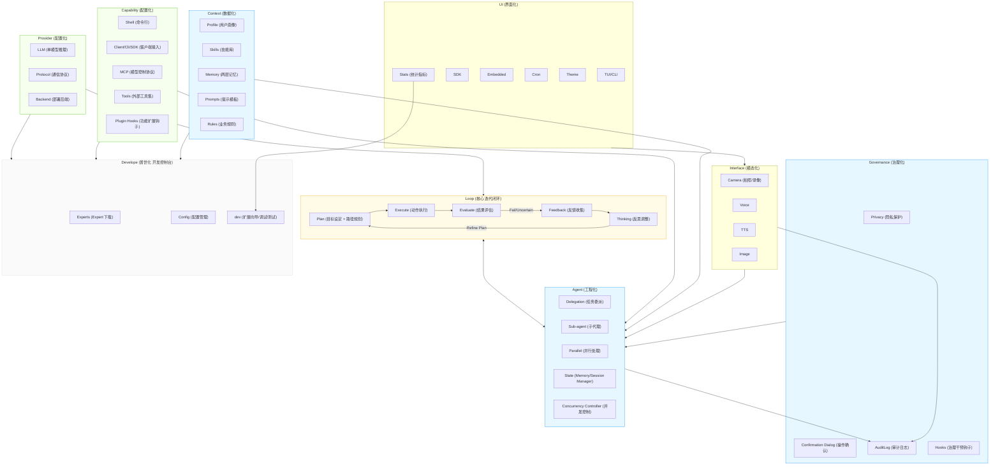

# AgenticX 1.0 使用手册

[English](user-guide.md) | [中文](user-guide_zh.md) | [README](README_zh.md)

本手册承接原 README 的详细配置、命令、工具与 Runtime 参考，面向
DashScope AgenticX `1.0.1`。首次使用请先阅读
[快速开始](README_zh.md#快速开始)，安装扩展前检查[安全策略](SECURITY.md)
和[迁移指南](migration-to-1.0.md)。版本更新记录统一保留在
[CHANGELOG.md](CHANGELOG.md)，不放入使用手册。

## 首次启动

默认 TUI 和 `--cli` 使用相同的首次 `/setup` 向导：当前目录没有
`.agenticx/config.toml`，且缺少 API Key 或仍使用默认 Provider/模型时，
启动会自动进入初始化。已有 workspace 配置，或全局已有非默认
Provider/模型和 API Key 时跳过自动初始化；随时可运行 `/setup` 个性化配置。
首次自动初始化恢复为启动 TUI 前执行；也可在应用内手动启动向导。

下载 Expert 是可选的场景模板，不是启动的前置条件。
初始化内部复用 Provider、能力和 Expert 的相关子命令处理流程，
界面不要求用户额外输入子命令名称：

1. **用户名、配置模式**：`[1] Default — Alibaba/Bailian` 或 `[2] Custom`，
   原 China general 预设已移除。
   菜单展示默认用户名、Provider、模型、协议、实际 API base URL、密钥状态、
   能力。用户名、配置模式回车可使用默认模型和能力；两种模式都在模型配置后
   单独选择 Expert，回车跳过，不联网下载。默认模式复用已有凭据，缺少时延后
   配置，不弹出密钥问题；
   真正请求模型时仍需 API Key。
2. **Provider 与模型**：选择已注册 Provider，或输入新名称并确认添加。
   新 Provider 依次配置协议、有效 HTTP(S) API base URL、默认模型和凭证，
   只询问一次；其他模型和保存范围放在高级选项中，初始化默认保存到当前
   workspace。已有 Provider 可选择高级连接设置，修改端点与协议。
3. **API Key**（Custom）：初始化跳过已有可解析凭证及无需认证的 Provider。缺少时
   可隐藏输入并存入 OS keyring、使用环境变量，或稍后配置。
   内置 Provider 使用标准环境变量；新 Provider 可明确选择无需认证。
4. **能力及所需凭证**：Custom 模式可多选能力，默认模式使用预选能力。
   共享凭证只询问一次；未完成配置的能力列为待配置，本次不激活。
5. **Experts**（两种模式均可选）：选择模板下载，回车跳过；未选择时不联网下载。
   模板保留刚配置的用户名、连接设置和已有 Provider 定义，合并新增扩展。
   冲突文件需要确认并备份，直接回车不覆盖。
6. **最终保存与摘要**：统一保存 workspace 配置，刷新当前运行时的
   Provider、工具、技能和指令。初始化中下载的模板即时生效，无需重启，
   保留当前对话历史；跳过 API Key 后不会立即再次启动凭证向导。

取消初始化会恢复尚未保存的配置变更；相关子命令已完成的 Provider 注册、
凭证写入以及已经复制的模板文件会保留，不回滚这些已完成操作。

`agenticx expert download basic-chat` 默认从公开 GitHub 仓库
`dashscope/dashscope-agenticx-experts` 下载。如果下载的 profile 自带 workspace
配置，下一次启动不会再次自动进入 `/setup`；需要时手动运行 `/setup`
修改人设和配置。`--repo` 和全局 `expert_repo` 配置可覆盖默认下载来源。

欢迎页显示 `Expert: <名称>`。下载时将身份记录到 `.agenticx/expert.toml`；
恢复合并备份时也会还原之前的身份，之前没有记录则移除新增记录。
手工创建或旧版下载的 profile 若没有这份记录，显示 `Expert: (not recorded)`，
不会根据配置内容猜测 Expert 名称。

统一入口为 `/expert` 和 `agenticx expert`，用于列出、下载和恢复 Expert Profile。

## 终端输出

TUI 提供 Markdown 正文、轮次分组、折叠工具详情和可展开的轮次/会话统计。
`Ctrl+O` 切换工具详情，`Ctrl+G` 展开统计。macOS 用 `Cmd+C` 复制，
Windows/Linux 用 `Ctrl+C`；底部 Copy 按钮复制完整选区快照。框选和正常复制
不弹出提示，仅失败时警告。macOS 的 `Ctrl+C` 只负责清空、取消和退出，不复制。
`/copy` 复制最近回复原文；需要终端原生回滚时使用 `--cli`。

## 配置

AgenticX 采用**分层配置**设计：

- **全局配置**（平台标准的 `AgenticX` 应用目录）：API Key（每 Provider 独立槽位）+ 语音/TTS 设置，跨项目共享
- **Workspace 配置** (`./.agenticx/config.toml`)：Provider、模型、平台能力、MCP 服务、用户名

优先级：Workspace 配置 > 全局配置 > 环境变量（仅补空位）> 交互输入

### 全局配置 `~/.config/AgenticX/config.toml`

全局目录由 `platformdirs` 按应用名 `AgenticX` 解析；`~/.config/AgenticX`
是常见的 Linux 路径。在任何平台都可通过 `AGENTICX_HOME` 覆盖该位置。

每个 Provider 的 API Key 单独存槽位，切换不会互相覆盖。新保存的密钥写入
OS keyring 的 `dashscope-agenticx` 服务，TOML 中仅保存引用。

```toml
tongyi_api_key    = "KEYRING:v1:..."
anthropic_api_key = "KEYRING:v1:..."
openai_api_key    = "KEYRING:v1:..."
```

升级兼容：旧版的单一 `api_key = "..."` 行会在首次启动时自动迁移到当前
`provider` 对应的槽位。Keyring 读取可回退到旧 `agenticcli` 服务，
旧 `ENC:` 值仍可用于迁移读取；新密钥不会双写到旧服务。

### Workspace 配置 `./.agenticx/config.toml`

```toml
user_name = "agenticx"
model = "qwen3.8-flash"
provider = "tongyi"
fallback_providers = "openai,anthropic"        # 主 provider 失败时按顺序 fallback（逗号分隔字符串）
enabled_capabilities = "bailian.mcp,bailian.cli"
custom_models = "tongyi:qwen-3-max"   # 由 /dev model add 写入
tui = false                            # 默认 TUI 模式；设为 false 则改跑内联 CLI REPL——这会离开备用屏，终端原生框选、Cmd+C、无限回滚全部可用
tui_mouse = false                      # TUI 捕获鼠标，滚轮只滚动输出区（默认开，Windows 同样开）；设为 false 则把鼠标交给终端，用终端原生选择复制——但仍在备用屏上，滚出屏幕的行还是复制不到
max_turns = 100                        # 单次对话最大工具调用轮次，默认 50；只在显式覆写时写入
session_persist = false                # 关掉跨会话历史持久化（默认开）
user_directives = ["每次 commit 后不要 push", "改代码后同步更新 README"]  # /rule 写入
delegation = { max_concurrent = 5, default_timeout = 120, allow_nested = false }  # 委托工具配置；allow_nested 暂不生效（子 agent 始终禁止再委托）

[[mcp_servers]]
service = "time"
```

### 环境变量

> **注意**：API Key 类环境变量仅在配置文件未设置对应 key 时生效（补空位）。`AGENTICX_PROVIDER` / `AGENTICX_MODEL` 始终覆盖。

| 变量 | 说明 |
|------|------|
| `DASHSCOPE_API_KEY` | 通义千问 / 百炼 API Key |
| `ANTHROPIC_API_KEY` | Claude API Key |
| `OPENAI_API_KEY` | OpenAI API Key |
| `OPENAI_BASE_URL` | 自定义 OpenAI 兼容端点 |
| `AGENTICX_PROVIDER` | 强制指定 Provider（优先于配置） |
| `AGENTICX_MODEL` | 强制指定模型（优先于配置） |
| `AGENTICX_MCP_SERVERS` | 预连接 MCP 服务（逗号分隔） |
| `AGENTICX_MEMORY_USER_ID` | 档案隔离的用户标识 |
| `AGENTICX_MEMORY_LIBRARY_ID` | 百炼档案库 ID |
| `AGENTICX_COMMAND_TIMEOUT` | `run_command` 被强制终止前的秒数（默认 600） |

### 支持的 Provider

运行时只内置 3 个协议实现类，对应 3 个开箱即用的 Provider：

| Provider | 协议 | 实现类 | 默认模型 | 可选模型 |
|----------|------|--------|----------|----------|
| `tongyi` | `dashscope` | `TongyiProvider` | `qwen3.8-flash` | `qwen3.8-max`, `qwen3.7-max`, `qwen3.7-plus`, `qwen3.5-plus`, `qwen3.5-flash`, `qwen3-max`, `qwen-max`, `qwen-plus`, `qwen-turbo`, `qwen-vl-max`, `qwen-vl-plus`, `qwen-omni-turbo` |
| `anthropic` | `anthropic` | `AnthropicProvider` | `claude-sonnet-4-20250514` | `claude-opus-4-20250514`, `claude-haiku-4-5-20251001` |
| `openai` | `openai` | `OpenAIProvider` | `gpt-4o` | `gpt-4o-mini`, `gpt-4-turbo`, `o1`, `o3-mini` |

DeepSeek、智谱 Zhipu、Kimi、ideatalk 等不再硬编码，通过 `~/.config/AgenticX/custom-extensions.toml` 或 `./.agenticx/custom-extensions.toml` 声明即可使用（项目已自带示例配置）。自定义 provider 同样通过 `[[providers]]` 块接入，无需改代码：`/dev provider add` 交互式填写，或参考 [扩展开发](#扩展开发)。

推理模型（返回 `reasoning_content` 的模型，如 `qwen-*-thinking`）已支持：会把模型的 reasoning_content 透传到下一轮请求，避免 DashScope 等报「thinking mode must be passed back」400。自定义 provider 如果使用非标字段名，可通过 `reasoning_field` 声明（见下方示例）。

#### 自定义 Provider（`custom-extensions.toml`）

在 `~/.config/AgenticX/custom-extensions.toml`（全局）或 `./.agenticx/custom-extensions.toml`（workspace，优先级更高）中声明 `[[providers]]` 块：

```toml
[[providers]]
name          = "my-ollama"          # /provider 向导、config.provider 中使用的标识符
base_url      = "http://localhost:11434/v1"
default_model = "llama3"
models        = ["llama3", "mistral", "codestral"]
protocol      = "openai"             # openai / openai_compatible / anthropic / dashscope
auth          = false                # 无需 API Key（本地部署）

# 若 provider 把推理内容放在非标字段，用 reasoning_field 声明
# reasoning_field = "reasoning_content"

# 云端 provider 示例（key 存环境变量，不落盘明文）
# [[providers]]
# name          = "my-cloud"
# base_url      = "https://api.example.com/v1"
# api_key_env   = "MY_CLOUD_API_KEY"   # 优先；从 shell 环境读取
# # api_key     = "KEYRING:v1:..."      # 备选：由向导写入的 OS keyring 引用
# default_model = "my-model-v1"
# models        = ["my-model-v1", "my-model-v2"]
# vision_models = ["my-model-v2"]
# protocol      = "openai_compatible"  # 等价于 openai
```

`workspace` 覆盖全局同名 `name` 条目；最小模板见 basic-chat Expert（`agenticx expert download basic-chat` 后查看 `.agenticx/custom-extensions.toml`）。

**base_url 的配置入口与解析优先级**

新 provider 的端点（base_url）有以下几种配置方式：

| 入口 | 写法 | 适用场景 |
|---|---|---|
| `custom-extensions.toml` 的 `[[providers]]` | `base_url = "https://..."`（见上方示例） | 自定义/扩展 provider（推荐） |
| `config.toml` | `base_url = "https://..."`（全局 `~/.config/AgenticX/config.toml` 或工作区 `./.agenticx/config.toml`） | 覆盖**当前主 provider** 的端点 |
| 环境变量 | `export OPENAI_BASE_URL="https://..."` | 临时 / CI 覆盖，优先级最高 |
| `/dev provider add` | 交互式向导，依次填 name / protocol / base_url / default model / credentials，自动写入 `custom-extensions.toml` | 免手写 TOML |
| SDK / 嵌入 API | `run(base_url=...)`、`create_agent(base_url=...)` | 程序化集成 |

解析优先级（对主 provider）：环境变量 `OPENAI_BASE_URL` > `config.toml` 的 `base_url` > `custom-extensions.toml` 对应 `[[providers]]` 的 `base_url` > 内置默认端点（tongyi / anthropic / openai）。

注意：

- `config.toml` 里的 `base_url` 只对**主 provider** 生效；fallback（备用）provider 始终使用自己 `[[providers]]` 的 base_url 或内置默认值。
- `/provider` 向导可在高级连接设置中修改 base_url；切换 Provider 会清空旧 `config.toml` 端点覆盖。
- 查看当前生效的 base_url：`/provider`（显示 Base URL）、`/dev provider list`、或启动横幅的 endpoint 行。

### API Key 管理

每个 Provider 有独立的 key 槽位（`tongyi_api_key`、`anthropic_api_key`、`openai_api_key`），切换 Provider 时各自保留，互不覆盖。Key 在 `/provider` 向导的模型与可选连接设置之后录入（终端不回显，回车保持现有 key 或跳过）。

```bash
agenticx> /provider
...
API Key
  [1] Enter key (OS keyring)
  [2] Environment variable
  [0] Configure later
Key source [1]: 1
API Key [Enter to skip]:
✓ Provider: tongyi/qwen3.8-flash
```

内置 key 槽位：`tongyi`、`anthropic`、`openai`。扩展 Provider（如 DeepSeek / Zhipu / Kimi / ideatalk）的 key 在 `custom-extensions.toml` 中通过 `api_key_env` 或 `api_key = "KEYRING:v1:..."` 引用配置，同样可在 `/provider` 向导中录入。向导将密钥保存到 OS keyring 的 `dashscope-agenticx` 服务，并仅在全局配置的 `<name>_api_key` 槽位写入引用。解析顺序：向导录入的槽位 key > `api_key_env` 指向的环境变量 > TOML 中的 keyring 引用。旧 `ENC:` 值仍可用于迁移读取，但新密钥不再写入这种格式。

---

## 命令

命令按四档分类：会话 → 配置 → 能力 → 开发。`/help` 与启动 banner 也按这个顺序展示。

### 会话

| 命令 | 说明 |
|------|------|
| `/help` | 显示帮助（按分类列出所有命令） |
| `/clear` | 清空对话历史（并持久化空历史到 `./.agenticx/session/<topic>/history.json`） |
| `/stats` | 查看会话统计（Token 使用、Prompt 组成、API 调用、工具调用次数、会话时长） |
| `/info` | 查看当前运行信息（provider / model / 协议 / base URL / 能力 / 隐私状态 / 配置文件路径） |
| `/v` | 语音输入（快捷键 `Ctrl+T`），录音 → ASR 转写 → 发送给模型 |
| `/voice [subcmd]` | 语音输入管理：on（开始录音）/ off（取消）/ model [name]（切换 ASR 模型）/ silence `<s>`（停顿阈值）/ max `<s>`（最大时长）/ threshold `<rms>`（静音 RMS） |
| `/tts [subcmd]` | 语音输出（TTS）开关与设置：on / off / model [name] / voice [name] / speed `<0.5-2.0>` / say `<text>`（立即朗读）/ last（朗读上条回复） |
| `/camera capture [file]` | 摄像头拍照，保存后可用 `@file` 发给视觉模型分析 |
| `/camera record [duration] [file]` | 摄像头录像，默认 5 秒，保存为 mp4 |
| `/copy` | 复制上一条 AI 回复到剪贴板（支持 pbcopy/xclip/clip） |
| `/save [path]` | 保存上一条 AI 回复到文件（默认 `agenticx_output_<时间>.md`） |
| `/json on\|off` | JSON 输出模式开关（开启后 Agent 回复强制 JSON 格式，透传 `response_format` 到 Provider） |
| `/compress` | 压缩对话上下文（LLM 摘要后替换历史，节省 token） |
| `/summarize` | 手动总结当前任务（LLM 提取关键步骤与教训），存入经验记忆；长任务（>=6 条消息）也会自动触发 |
| `/history [subcmd]` | 对话历史管理（stats 统计 / list [n] 列出 / search `<关键词> [limit]` 全文检索 / export `<file> [--format json\|md\|html]` 导出 / clear 清空） |
| `/undo` | 撤销最近一次文件写入/删除（write_file / delete_file 改动前自动快照到 `.agenticx/checkpoints/`） |
| `/session [subcmd]` | 会话主题管理（new [name] / list / switch `<name>` / rename `<old> <new>` / fork `<new> [src]` / remove `<name>` / scene 场景记忆） |
| `/feedback good\|bad` | 标注任务满意度（存入经验记忆） |
| `/report` | 生成并展示 trace 数据性能报告（LLM 调用次数、工具成功率、平均响应时间） |
| `/log [subcmd]` | 查看调试模式记录的完整 LLM prompt（需先 `/debug on`，数据来自会话 trace）：`tail [n]` 最近 n 条（默认 3）/ `search <关键词>` 搜索 / `clear` 清空；CLI 模式经 less 分页，TUI 内联截断显示 |
| `/trace [subcmd]` | 查看执行 trace（LLM 调用耗时/token 用量、工具调用及耗时、决策点；轻量事件始终记录，完整 prompt 需 `/debug on`）：`tail [n]` 最近 n 条（默认 5）/ `search <关键词>` 搜索 / `clear` 清空；CLI 模式经 less 分页，TUI 内联截断显示 |
| `/exit` | 退出（别名 `/quit` / `/q`） |

`/stats` 输出示例：

```
📊 会话统计
  Provider: tongyi
  模型:     qwen3.8-flash
  Token 使用: 2700 (输入: 1800, 输出: 900, 缓存: 1200)
  Prompt 组成: 15230 字符
    system → 6100 (40%)
    user → 320 (2%)
    assistant → 1450 (9%)
    tools → 7360 (48%)
  API 调用: 2 次
  工具调用: 5 次
  工具明细:
    run_command → 3 次
    read_file → 2 次
  Skill 使用: 3 次
  Skill 明细:
    text-generation → 2 次
    cli → 1 次
  会话时长: 3分12秒
```

##### `/tts` — 语音输出（文字转语音）

开启后，Agent 每次回复完会自动用 DashScope CosyVoice 合成语音并播放。TTS 设置会同时保存到全局配置（`~/.config/AgenticX/config.toml`）和 Workspace 配置，跨目录/跨会话保持生效。

```bash
agenticx> /tts on                       # 开启自动语音输出
agenticx> /tts off                      # 关闭
agenticx> /tts model                    # 查看当前 TTS 模型
agenticx> /tts model cosyvoice-v2       # 切换模型
agenticx> /tts voice                    # 查看当前发音人
agenticx> /tts voice longxiaochun_v2    # 切换发音人
agenticx> /tts speed                    # 查看当前语速
agenticx> /tts speed 0.9                # 设置语速（0.5–2.0，1.0 为正常）
```

- 依赖 `pip install dashscope-agenticx[voice]`（包含 `sounddevice`、`numpy`）
- 自动播报时机：CLI 模式按句流式送入（边生成边播，`StreamingTTSFeeder`）；TUI 模式在回复完成后整段送入
- 播放采用真流式：收到 WAV 头后立即通过 `sounddevice.OutputStream` 解码输出，不必等整段合成完成
- 语速直接对应 DashScope `speech_rate` 浮点参数，设置后立即生效

### 配置

| 命令 | 说明 |
|------|------|
| `/setup` | 交互式 Workspace 初始化（用户名、Provider、模型、能力） |
| `/capability [subcmd]` | 能力开关 (list/enable/disable/reload/config) |
| `/subagents [subcmd]` | 子代理管理 (list/reload/enable/disable/config) |
| `/provider` | 问答式配置向导：Provider → 模型 → 可选连接设置 → API Key |
| `/model [name]` | 切换当前 Provider 下的模型；不带参数显示当前模型 |
| `/trust [subcmd]` | 本次对话工具授信/拒绝缓存（每轮结束自动清空，下一轮重新问） |
| `/rule [subcmd]` | 用户长效操作规则（list / add `"<text>"` / rm N / clear）；每轮将**已启用**的规则注入 system prompt |
| `/theme [subcmd]` | 主题设置（list / set `<name>` / 自定义颜色）；内置 dark / light / monokai / dracula / nord / solarized |
| `/privacy [on\|off\|status]` | 隐私模式 |
| `/debug [on\|off\|status]` | 调试模式：开启后每轮最终发送给 LLM 的完整 prompt（脱敏后）随 `llm_call` 事件写入会话 trace `.agenticx/traces/<session>.jsonl`，用 `/log` 或 `/trace` 查看 |
| `/directives` | 查看 / 接受 Directives 自动学习提议 |

##### `/setup` — 交互式 Workspace 初始化

自动初始化和手动重新配置都使用[首次启动](#首次启动)中的有序流程，
内部复用各相关子命令处理逻辑，不显示额外的子命令操作提示。
默认和 Custom 模式都在最后提供 Expert 选择，与模型配置分开。
两种模式都统一保存并输出最终摘要。

```text
Workspace setup
Username [anonymous]: alex
Configuration mode
  [1] Default — Alibaba/Bailian
  [2] Custom
Choice [1]: 2
Available providers:
Choose (number or name) [tongyi]:
Available models:
Choose (number or name) [qwen3.8-flash]:
Advanced connection settings? [y/N]:
API Key
Key source [1]: 0
Capabilities (optional)
Capabilities [0]: 0
Experts (optional)
Expert [0]:
✓ Setup complete — config saved to .agenticx/config.toml
```

##### `/provider` — 问答式配置向导

初始化与独立命令使用同一个 Provider 处理流程：
**Provider → 模型 → 可选高级连接设置 → API Key**。
可以输入编号或名称；切换 Provider 会清空旧端点覆盖，并使用新 Provider
的默认模型和协议。

模型菜单每种模态（文本、视觉、音频、多模态）最多展示两个选项，并保留
当前模型；其他模型可直接输入名称。所有模型名称在输入和加载配置时自动
去除首尾空白并转为小写，包括默认模型、视觉/音频模型及自定义模型。

未列出的 Provider 确认添加后，依次填写**协议 → API base URL → 默认模型
→ 可选高级模型 → 凭证来源**。端点必须是 HTTP(S) 绝对 URL，不能含内嵌
用户名/密码、查询参数或 fragment。初始化默认保存到当前 workspace，
高级选项可选择保存范围。注册后直接沿用默认模型与凭证，不重复询问。

API Key 输入不回显。独立向导中已有凭证可回车保留，初始化则直接跳过
已解析凭证。缺少时可隐藏录入并存入 OS keyring、使用环境变量，或稍后
配置；新 Provider 也可明确选择无需认证。TOML 不保存明文密钥。
EOF 或 Ctrl+C 会取消向导，不会当作接受默认值继续。

高级连接设置可覆盖主 Provider 的 base URL 和协议，回车保留当前值。
配置完成后立即重建 Provider，保留对话历史。只改模型用 `/model <name>`；
自定义模型注册/删除仍通过 `/dev model add|list|rm` 管理。

##### `/model` — 快速切换模型

`/model <name>` 在当前 Provider 下直接切换模型，不走向导；不带参数时显示当前模型并提示用法。模型名未在预置列表时按自定义模型注册（同向导模型步的规则）。Provider、API Key、协议的切换仍走 `/provider`。切换后立即重建 Provider 实例生效，保留当前对话历史。

**CLI 启动时指定协议**：

```bash
agenticx --protocol anthropic     # 启动时直接使用 Anthropic 协议
agenticx --protocol openai        # 启动时直接使用 OpenAI 协议（默认）
```

其他主要 CLI 参数：

```bash
agenticx -c "概述当前项目"      # 执行一次请求后退出
agenticx --dry-run              # 预览已加载配置，不启动 Agent
agenticx --max-turns 20         # 覆盖配置中的对话轮次上限
```

**协议转换原理**：

| 方向 | 转换内容 |
|------|---------|
| 请求（Anthropic → OpenAI） | `system` 参数提取为 system message、`input_schema` → `parameters`、content blocks → text |
| 响应（OpenAI → Anthropic） | `content` → content blocks、`tool_calls` → `tool_use` blocks、`finish_reason` → `stop_reason` |

### 能力

未启用的能力对应的命令会被网关拦截并提示启用方式，不会落到底层 API 报凭证错。

| 命令 | 关联能力 | 说明 |
|------|---------|------|
| `/profile [subcmd]` | — | 用户档案 (list/search/add/remove(rm)/clear) |
| `/memory [subcmd]` | — | 对话历史 (list/search/remove(rm)/clear) |
| `/mcp [subcmd]` | `bailian.mcp` | MCP 服务 (add/remove/list)；需先 `/capability enable bailian.mcp` |
| `/skill` | — | 列出所有可用 skill（单文件 + 包，含 MCP 依赖状态） |
| `/skill <name> [args]` | — | 调用预置 Prompt |
| `/skill install <local-dir\|git-url\|tar.gz-url\|name[@version]>` | — | 安装 skill 包（本地路径 / git / tar.gz URL / registry 名称） |
| `/skill link <local-dir>` | — | 软链接本地 skill 包（开发模式） |
| `/skill update <name>` | — | 更新已安装的 skill 包 |
| `/skill update --all` | — | 更新所有已安装的 skill 包 |
| `/skill uninstall <name>` | — | 卸载 skill 包 |
| `/skill search <query>` | — | 搜索已安装包 + registry |
| `/skill publish <local-dir>` | — | 验证并打包 skill 包为 tar.gz |
| `/skill reload` | — | 重新扫描 skills 目录 |
| `/skill enable <name>` | — | 强制启用某个 skill 包 |
| `/skill disable <name>` | — | 强制禁用某个 skill 包 |
| `/app list` | — | 列出已安装的版本化 App Bundle |
| `/app info <name>` | — | 查看 App 发布者、权限、Runtime 兼容范围与校验和 |
| `/app install <path>` | — | 安装 App，并显示权限差异 |
| `/app update <name>` | — | 从已记录来源更新 App，重新计算权限差异 |
| `/app verify <name>` | — | 验证 App 校验和和 Runtime 兼容性 |
| `agenticx serve [--host <host>] [--port <port>] --token <token>` | — | 启动 Client API（Run / Session / Artifact / Trace），默认监听 127.0.0.1:8765 |
| `/cron [subcmd]` | — | 定时任务 (add/list/remove/pause/resume)，支持间隔、指定时间、cron 表达式 |
| `/privacy on\|off` | — | 隐私模式开关（强制本地存储，禁用云端能力与 cron 任务） |
| `/audit [subcmd]` | — | 审计日志 (recent/clear/query)，记录用户输入与工具决策，隐私模式下自动脱敏 |
| `/directives [subcmd]` | — | 自定义指令（裸命令列出；add/rm N/clear）与自动学习提议（proposals/accept `<id>`/reject `<id>`） |
| `/feedback good\|bad` | — | 标注任务满意度（存入经验记忆） |

### 开发

| 命令 | 说明 |
|------|------|
| `/dev model [subcmd]` | 运行时注册模型（add / rm / list） |
| `/dev provider [subcmd]` | 扩展 Provider（add / list / rm） |
| `/dev capability [subcmd]` | 扩展 HTTP 工具组（add / list / rm） |
| `/dev skill [subcmd]` | 扩展 Skill（add / list / rm） |
| `/dev tool [subcmd]` | 扩展 Shell 工具（add / list / rm） |
| `/dev debug [subcmd]` | 调试（tools / schema / call / prompt） |
| `/dev test provider <name>` | 测试 Provider 连通性 |
| `/dev reload` | 热重载 custom-extensions.toml |
| `/dev log` | 查看工具注册统计 |
| `/expert [list]` | 列出可用 Expert 模板 |
| `/expert download <name>` | 初始化 workspace：合并 Expert 到 `./.agenticx/`（冲突自动备份） |
| `/expert restore` | 撤销最近一次合并（恢复 `.agenticx/backup/`） |

## 工具

权限三档对应不同确认行为：
- **自动**：无提示，LLM 直接调
- **确认**：弹 `[y]es / [n]o / [a]lways (本次对话该工具直接放行) / [s]top (中止本轮对话，回到 agenticx>)`
- **危险**：只接受 `y` / `n`，没有「always」捷径——删除类操作每次都问，安全模型不让缓存破

### 文件系统

| 工具 | 权限 | 说明 |
|------|------|------|
| `read_file` | 自动 | 读取文件内容（支持行偏移与限制） |
| `write_file` | 确认 | 写入文件，返回 unified diff |
| `list_directory` | 自动 | 列出目录内容（含文件类型与大小） |
| `create_directory` | 确认 | 创建目录（含嵌套父级） |
| `delete_file` | 危险 | 删除文件（不可逆） |
| `delete_directory` | 危险 | 删除目录及其所有内容（不可逆） |
| `search_files` | 自动 | 按 glob 模式搜索文件 |
| `move_file` | 确认 | 移动 / 重命名文件或目录 |

### Shell

| 工具 | 权限 | 说明 |
|------|------|------|
| `run_command` | 确认 | 执行 Shell 命令；危险模式命令被拦截，只读命令自动分类。可用 `timeout` 参数（秒，默认 600，`AGENTICX_COMMAND_TIMEOUT`）限制单次运行时长；超时后杀死整个进程组，管道不会比超时活得更久 |

### 网络

| 工具 | 权限 | 说明 |
|------|------|------|
| `web_search` | 自动 | DuckDuckGo 联网搜索，返回标题、URL 与摘要 |
| `scrape_web` | 自动 | Playwright 无头浏览器抓取网页纯文本（支持 JS 动态渲染 SPA） |
| `scrape_web_html` | 自动 | Playwright 无头浏览器抓取渲染后 HTML 源码 |
| `scrape_web_screenshot` | 自动 | Playwright 无头浏览器对网页截图并保存为图片文件 |

### 摄像头

| 工具 | 权限 | 说明 |
|------|------|------|
| `camera_capture` | 确认 | 摄像头拍照（LLM 可主动调用） |
| `camera_record` | 确认 | 摄像头录像（LLM 可主动调用） |

### 会话 / 配置

内置，始终可用。

| 工具 | 权限 | 说明 |
|------|------|------|
| `switch_model` | 自动 | 切换当前 LLM 模型 |
| `switch_provider` | 自动 | 切换当前 Provider |
| `list_models` | 自动 | 列出所有 Provider 的可用模型 |
| `capability_list` | 自动 | 列出所有能力及启用状态 |
| `capability_enable` | 确认 | 启用指定能力（如 bailian.mcp） |
| `capability_disable` | 确认 | 禁用指定能力 |
| `mcp_list_services` | 自动 | 列出可用 MCP 云端服务 |
| `mcp_connect` | 确认 | 连接 MCP 服务并注册其工具 |
| `mcp_disconnect` | 确认 | 断开 MCP 服务连接 |
| `create_plan` | 自动 | 为复杂任务创建多步执行计划 |
| `complete_step` | 自动 | 按索引标记计划步骤完成 |
| `get_plan_status` | 自动 | 查看当前计划进度 |

### 技能进化（Experimental Pack）

不属于 Core 默认能力。需安装/启用 experimental pack，并显式设置 `AGENTICX_EXPERIMENTAL=1` 才注册工具。自动指令学习另需 `AGENTICX_EXPERIMENTAL_LEARNING=1`。

| 工具 | 权限 | 说明 |
|------|------|------|
| `evolve_skill` | 自动 | 分析本轮工具调用轨迹，生成可复用的 Skill 文件 |

### 子代理

`local.subagent` / `local.delegate` 能力启用后可用。

| 工具 | 权限 | 说明 |
|------|------|------|
| `subagent_invoke` | 自动 | 派生隔离子代理处理独立子任务，只返回最终结果 |
| `review_code` | 自动 | 代码审查子代理（Bug / 安全 / 性能 / 风格） |
| `write_tests` | 自动 | 测试工程子代理，生成 pytest 测试用例 |
| `generate_docs` | 自动 | 文档工程子代理，生成 Markdown / docstring 文档 |
| `delegate` | 自动 | 委派单个子任务，支持工具白名单、上下文文件、超时、system prompt 覆盖 |
| `delegate_parallel` | 自动 | 并发委派多个子任务，可配置最大并发数 |

### 平台（bailian.cli）

`bailian.cli` 能力启用后动态注册。工具名遵循 `bailian_<command_path>` 格式（如 `bailian_text_chat`、`bailian_image_generate`）。读操作（list/get/status/search）权限为**自动**，写操作（generate/upload/delete 等）权限为**确认**。Schema 从 `bl config export-schema` 读取并缓存到 `~/.config/AgenticX/bl-schemas.json`（TTL 24 小时）。

---


## 架构

> **实现说明：** 下方 Mermaid 是长期概念图；其后的 ASCII 模块图才描述当前运行时。独立 Structured LoopEngine、Dual-LLM Router、Historical MetricsCollector、Web Dashboard 等路线图节点在当前版本未启用；遗留配置项设置非默认值时会明确告警，不再静默假装生效。



### 模块文件树

```
src/dashscope_agenticx/
├── cli/                # CLI 入口层（REPL 主循环 + 斜杠命令分发 + 所有命令 handler）
│   ├── repl.py         # REPL 主循环（输入读取、补全、历史）
│   ├── dispatch.py     # 斜杠命令分发（路由到各 handler）
│   ├── handlers_*.py   # 命令 handler（config/capability/provider/session/device/skill/…）
│   ├── completer.py    # 上下文感知补全 + 命令历史脱敏存取
│   ├── multimodal.py   # @文件/目录引用展开 + 图片/音频多模态内容组装
│   ├── mcp.py          # CLI 侧 MCP 客户端管理（连接/重连/工具注入）
│   ├── expert.py       # /expert Expert 管理
│   ├── constants.py    # CLI 常量与配置数据
│   ├── startup.py      # 启动初始化（provider 检查、欢迎语）
│   ├── streaming.py    # 流式输出渲染
│   └── runners.py      # one-shot / interactive 运行入口
├── agent.py            # Agent Loop（多轮工具调用 + PromptPipeline 注入 system prompt）
├── prompt_pipeline.py  # 可插拔 Prompt 段落系统（PromptSection protocol + 10 内置段 + 组装流水线）
├── session.py          # 多主题会话管理（SessionManager: create/switch/rename/remove topic）
├── audit.py            # 审计日志（JSONL 事件流 + 隐私模式脱敏 + 查询/回放）
├── permission.py       # 权限策略（PermissionPolicy 规则引擎 + 全局策略存取）
├── config.py           # 分层配置（全局/workspace）+ 每 Provider 独立 key 槽 + keyring 引用 + SubagentConfig
├── commands.py         # CLI/TUI 共用的斜杠命令定义与 UI 无关工具
├── dev.py              # 运行时模型注册（custom_models）+ provider/platform/tool/skill 扩展指南
├── executor.py         # 安全执行层（权限分级 + 审计日志集成）
├── hooks.py            # 事件钩子总线（治理优先分发: block/confirm/alert > run/warn/log）
├── extensions.py       # custom-extensions.toml 加载 + 自定义 provider/capability/skill/shell-tool
├── scheduler.py        # 定时任务调度（间隔/指定时间/cron 表达式循环执行 + 隐私模式感知）
├── prompt.py           # 项目指令自动发现 + 安全预处理 + 稳定/动态 prompt 拆分
├── compression.py      # 按模型上下文窗口的 token 预算压缩（软/硬双阈值 + 轮内守卫）
├── deliverable.py      # 工具生成文件路径检测与自动展示
├── mcp_server.py       # MCP Server 模式（将 AgenticX 工具暴露给外部 MCP 客户端 via JSON-RPC stdio）
├── sdk.py              # 程序化 SDK（run_once / run_stream / create_agent / run_interactive）
├── capabilities/       # 能力实现层（本地 Memory 等平台无关能力）
│   └── local_memory.py # LocalMemoryCapability（本地内存能力实现）
├── utils/              # 工具函数库（密钥存储/路径/文本/模板/校验等通用工具）
│   ├── crypto.py       # 旧 ENC: 值的迁移读取兼容
│   ├── secret_store.py # OS keyring 存储、KEYRING:v1 引用与旧服务回退
│   ├── paths.py        # 路径工具
│   ├── messages.py     # 消息文本提取与工具脚手架过滤（压缩/记忆共用）
│   └── …               # text / template / sanitizer / validation / spinner 等
├── ui/                 # 用户界面层（Entry Channels）
│   ├── tui.py          # Textual 富 UI 模式（默认）
│   ├── embedded.py     # 嵌入模式 API（外部 CLI 复用 AgenticX 完整交互循环）
│   ├── voice.py        # 语音输入（实时流式 ASR + VAD 自动停止）
│   ├── tts.py          # 语音输出（TTS 真流式播放）
│   └── camera.py       # 摄像头拍照 + 录像（opencv / imagesnap / ffmpeg）
├── memory/             # 状态与上下文管理层（Context Management + State Store）
│   ├── manager.py      # MemoryManager 统一接口（两层记忆协调 + 子代理派生隔离）
│   ├── experience.py   # 经验记忆（从任务结果学习，跨会话复用成功策略）
│   ├── plan.py         # 规划层（多步骤计划声明与进度追踪，TTL 自动过期）
│   ├── reflection.py   # 反思机制（检测连续失败，注入策略调整提示）
│   ├── directives_learning.py # 指令自动学习（从用户行为模式提议规则）
│   ├── skill_evolution.py # 技能进化（从成功轨迹生成新技能）
│   ├── tool_chains.py  # 工具链组合（预定义常见工作流模式，按查询匹配注入）
│   └── trace.py        # 执行追踪日志（LLM 调用、工具执行、决策点记录）
├── eval/               # 评估框架（A/B Provider 对比 + 评测用例集）
│   └── __init__.py     # EvalCase + EvalRunner（4 维评分）+ ProviderComparator + load_eval_suite
├── agents/             # 多智能体协调层（Multi-agent Coordination）
│   ├── subagent.py     # 子代理执行框架（隔离上下文 + 专用 system prompt + 派生 session 记忆）
│   ├── subagents.py    # 子代理管理（discover/enable/disable/config + /subagents 命令）
│   └── delegate.py     # delegate / delegate_parallel 工具实现（派生隔离 session 记忆）
├── skills/             # 预置技能（Prompt 模板）
│   ├── base.py         # Skill dataclass + register() + list/render + .md 文件加载
│   ├── manager.py      # Skill 包管理（加载/启用/禁用/激活规则）
│   ├── package.py      # Skill 包目录解析 + tools.py 导入与命名空间
│   └── store.py        # Skill 注册表（install/search/publish）
├── platforms/          # 平台能力抽象层（含多个厂商子包）
│   ├── base.py         # Protocol 接口 + 共用 dataclass
│   ├── __init__.py     # 工厂函数（按配置创建 provider 实例）
│   ├── bailian/        # 百炼平台
│   │   ├── mcp.py      # MCP Client（Streamable HTTP + JSON-RPC）
│   │   └── cli.py      # `bl` 二进制包装（subprocess + JSON-Schema → 工具批量注册）
│   └── local/          # 本地实现
│       ├── history.py  # 对话历史持久化
│       └── memory.py   # 本地 Memory 能力（LocalMemoryCapability）
├── providers/          # LLM Provider 层（3 协议实现 + 配置化分发）
│   ├── base.py         # LLM 抽象接口（含 reasoning_content / delta_reasoning_content）
│   ├── adapter.py      # Anthropic ↔ OpenAI 协议转换适配器
│   ├── profile.py      # ProviderProfile 注册表 + 有序故障转移链
│   ├── hardening.py    # Provider 重试、空回复恢复、流式错误容错包装
│   ├── tongyi.py       # dashscope 协议实现（DashScope OpenAI 兼容端点 via httpx）
│   ├── anthropic.py    # anthropic 协议实现（Anthropic SDK）
│   └── openai.py       # openai 协议实现（GPT / Azure / vLLM / Moonshot / Deepseek / Zhipu / Ollama …）
└── tools/
    ├── registry.py     # 工具注册表（权限分级）
    ├── platform.py     # 平台能力 → 工具注册（按 enabled_capabilities 过滤）
    ├── session.py      # 会话/配置类工具（switch_model / mcp_connect / capability_* 等）
    ├── filesystem.py   # 文件操作工具
    ├── shell.py        # Shell 执行工具（含只读命令自动放行分类器）
    ├── web_search.py   # 联网搜索工具（DuckDuckGo/DDGS，免 key）
    ├── evolution.py    # 技能进化工具（evolve_skill，从成功轨迹提炼 Skill）
    ├── camera.py       # 摄像头工具注册（拍照 + 录像）
    └── browser.py      # Playwright 无头浏览器工具（scrape_web / scrape_web_html / scrape_web_screenshot，含 SSRF 防护）
```

### 模型供应架构

```
+-------------------------------------------------------------+
|                         agent.py                            |
|  Agent Loop: chat/stream + tool calls + Skill 目录注入      |
+--------------------------+-+--------------------------------+
|                  providers/__init__.py                      |
|  get_provider_chain(config) -> ProviderChain                |
|  get_provider(name, model, key, base_url, protocol)         |
+--------------------------+-+--------------------------------+
|                    providers/profile.py                     |
|  ProviderProfile registry + ordered fallback chain          |
+-------------------------------------------------------------+
|                   providers/hardening.py                    |
|  HardenedProvider: retry + empty-response recovery          |
+-------------------+-------------------+-------------------+
|  tongyi           |  anthropic        |  openai           |
|  -----------      |  -----------      |  ----------       |
|  DashScope        |  Anthropic        |  OpenAI-          |
|  OpenAI-          |  SDK              |  compatible       |
|  compatible       |                   |                   |
|  + adapter        |                   |                   |
+-------------------+-------------------+-------------------+
|                   providers/adapter.py                      |
|  Anthropic ↔ OpenAI 协议转换（请求/响应/流式）              |
+-------------------------------------------------------------+
|                      providers/base.py                      |
|  Protocol: LLMProvider (chat / chat_stream)                 |
|  Dataclass: LLMResponse, LLMChunk, ToolCall                 |
+-------------------------------------------------------------+
```

- `get_provider_chain(config)` 返回 `ProviderChain`，按 `fallback_providers` 顺序自动故障转移
- `HardenedProvider` 包装每个 provider：重试临时错误、空回复自动恢复、流式异常容错
- tongyi: DashScope OpenAI 兼容协议，支持 Anthropic 协议转换（`/provider` 向导协议步选 anthropic）
- anthropic: Anthropic SDK, Claude series
- openai: OpenAI-compatible protocol (GPT / Azure / vLLM / Ollama)
- 其他 provider（DeepSeek / Zhipu / Kimi / ideatalk 等）通过 `custom-extensions.toml` 配置为扩展，复用上述 3 个协议实现之一

### 平台能力架构

```
+-------------------------------------------------------------+
|                    tools/platform.py                        |
|  register tools based on config.enabled_capabilities        |
+--------------------------+----------------------------------+
|                   platforms/__init__.py                     |
|  get_memory_provider / get_cli_provider                     |
+---------------+-------------+-------------------------------+
|  bailian/     |  local/     |  (extensible)                 |
|  -----------  |  ---------  |  ---------------------------  |
|  mcp          |  history    |  自定义 platform 子包          |
|  cli          |  memory     |  via custom-extensions.toml   |
+---------------+-------------+-------------------------------+
|                    platforms/base.py                        |
|  Protocol: MemoryProvider, KBProvider, DataProvider,        |
|  PromptProvider, SearchProvider, ContextProvider            |
+-------------------------------------------------------------+
```

- `bailian.mcp`：MCP 云端工具（Streamable HTTP + JSON-RPC）
- `bailian.cli`：百炼 CLI 工具集（`bl` 二进制包装）
- `local.history`：本地对话历史持久化（函数式存储：store/list/search/export）
- `local.memory`：本地 Memory 存储（LocalMemoryClient，文件持久化）

### UI 架构

```
cli/__init__.py (程序入口 dashscope_agenticx.cli:main)
    │
    ├── ui/tui.py ────── AgenticXApp ── 全屏 TUI（/theme 热切换，CSS 变量来自 config.theme）
    │
    ├── cli/repl.py ──── 交互式 REPL 主循环
    │      ├── cli/runners.py ─── 一轮执行的编排（流式/工具确认接线）
    │      ├── cli/dispatch.py ── 斜杠命令路由（/help /stats /theme ...）
    │      └── cli/streaming.py ─ LLM chunk → 终端渲染（Markdown 增量）
    │
    ├── sdk.py ───────── create_agent / run_stream / run_once（库模式复用同一引擎）
    │
    ├── ui/embedded.py ─ run() 嵌入入口（宿主应用一行接入）
    │
    └── cli/scheduler.py ── Scheduler / CronJob（~/.config/AgenticX/cron_jobs.json；
                            隐私模式跳过云端任务）
```

- `/stats`（dispatch.py）→ Executor.get_stats：工具调用次数/耗时、token 用量。

### 多模态输入架构

```
用户输入
    │
    ├── cli/multimodal.py ── @path 展开：文本直读 / 图片→data-URL / 音频
    │                        （大小上限见 cli/constants.py）
    ├── ui/voice.py ──────── 实时 ASR + VAD 语音输入（/v、/voice）
    ├── ui/tts.py ────────── CosyVoice 流式语音合成播报（/tts）
    ├── ui/camera.py + tools/camera.py ── 拍照 / 录像（设备控制）
    └── utils/images.py ──── 图片编码/缩放等公共处理
```

### Agent 引擎架构

```
agent.py ── ReAct 主循环（单轮内多工具 asyncio.gather 并行）
    │
    ├── agents/delegate.py ── delegate / delegate_parallel
    │      └── asyncio.gather 扇出 + 信号量限流
    │          （派生隔离 session 记忆，见下）
    ├── agents/subagent.py ── subagent_invoke
    │      └── 隔离上下文：专用 system prompt + 派生 session 记忆
    ├── agents/subagents.py ── 子代理发现 / 启用 / 配置
    └── memory/manager.py + memory/session.py
           └── 状态：两层记忆 + 多话题会话
```

### 治理架构

```
permission.py ── PermissionPolicy：allow / deny / confirm 规则匹配（permissions.toml）
    │
executor.py ── 确认协议：y(是)/n(否)/u(免输)/a(总是)/s(会话信任，/trust 缓存)
    │
audit.py ── JSONL 审计日志（~/.config/AgenticX/audit.log，隐私脱敏）
    │
hooks.py ── HookBus：governance 动作（block/confirm/alert）
             优先于 plugin 动作（run/warn/log）
    │
config.py ── privacy_mode 三处执行点：
             scheduler 跳过云端任务 / audit 脱敏 / capability 禁用云端
```

### 上下文架构

```
prompt.py ── 7 处指令文件发现 + PromptAssembly
    │
prompt_pipeline.py ── 9 个内置段（全部 ephemeral，逐轮装配）
    │
compression.py ── 按模型上下文窗口的 token 预算压缩（软/硬双阈值 + 轮内守卫）
    │
memory/ 各 Tracker（plan / experience / reflection / tool_chains /
    directives_learning）+ platforms/local/memory.py
```

### 工具与能力架构

```
tools/registry.py ── @tool 装饰器 / PermissionLevel /
                     关键词过滤 to_schema_list
    │
    ├── tools/ 内置：filesystem / shell / web_search / browser / camera /
    │                 session / evolution
    ├── extensions.py ── custom-extensions.toml 声明式扩展
    │                    （HTTP/vision 工具、provider、skill）
    ├── tools/platform.py ── capability 按 enabled_capabilities 注册
    └── MCP 双向：platforms/bailian/mcp.py（客户端，调外部 MCP Server）
                  mcp_server.py（服务端，把 AgenticX 工具暴露给外部）
```

### 迭代闭环架构

```
用户输入
  → memory/plan.py（create_plan 任务分解）
  → executor.py（执行）── eval/（EvalRunner / ProviderComparator 评测）
  → /feedback（用户反馈）
  → memory/reflection.py（连续失败 ≥3 触发反思）
  → 回到 plan
TraceLogger 全程记录每步决策与工具调用。
```

---

## 模块

### 上下文（Context）

上下文能力分布在四个模块协作完成：`prompt.py` 负责项目指令自动发现（7 种文件、优先级匹配）、`prompt_pipeline.py` 负责 system prompt 分节装配（stable/ephemeral 分离）、`compression.py` 负责 token 预算压缩（软/硬双阈值）、`memory/` 下的各 Tracker 提供经验/计划/反思/工具链上下文。组件细节与数据结构见 [记忆与上下文](#记忆与上下文)。

### 自定义 System Prompt

在 `.agenticx/system-prompt.md`（workspace 优先）或 `~/.config/AgenticX/system-prompt.md`（全局）放一个 Markdown 文件，AgenticX 启动时将其作为 Agent system prompt 的**基底**，替换内置默认 base prompt。

```bash
# workspace 级别（仅当前项目生效）
cat > .agenticx/system-prompt.md << 'EOF'
你是一个专注于 Python 后端的代码助手。
遵循 PEP 8，优先使用 async/await，测试用 pytest。
EOF

# 全局级别（所有项目共享）
cat > ~/.config/AgenticX/system-prompt.md << 'EOF'
你是一个简洁高效的开发助手。回复保持简短。
EOF
```

优先级：workspace `.agenticx/system-prompt.md` > 全局 `~/.config/AgenticX/system-prompt.md` > 内置默认 prompt。

**注意**：`system-prompt.md` 替换的是基底，`PromptPipeline` 仍会在其后追加各 section，最终注入 LLM 的 system prompt 装配顺序为：

```
[base prompt / system-prompt.md]          ← 你自定义的或内置默认
[项目指令]                                 ← .agenticx/rules.jsonl / prompt.md 等（见下节）
─── 以上为 stable 前缀（整个 session 字节不变，prompt cache 友好）───
[Skills 模板]                             ← .agenticx/skills/*.md
[Skill Packages 规则]                     ← 激活的 skill package
[禁用能力提示]                             ← 按 enabled_capabilities 动态生成
[长效操作规则]                             ← user_directives（/rule 写入，每轮必注入）
[当前执行计划]                             ← PlanTracker 活跃步骤
[语义经验召回]                             ← 最相关的 3 条历史经验
[工具链上下文]                             ← 本 session 相关 tool chain
[Directives 学习提案]                     ← 待确认的行为规则建议
[环境信息]                                 ← 当前用户名、provider、model
─── 以上为 ephemeral 后缀（每轮重新计算）───
```

因此 `system-prompt.md` 中无需重复声明工具用法、规则或身份信息——这些由 pipeline 自动注入。

### 项目指令自动发现

除 `system-prompt.md` 外，AgenticX 还会自动发现并加载项目级指令文件（first-match 优先，从当前目录向上搜索）：

| 文件 | 说明 |
|------|------|
| `.agenticx/rules.jsonl` | 项目规则（最高优先级，结构化 JSONL 格式，每行 `{"text": "...", "enabled": true}`） |
| `.agenticx/prompt.md` / `.agenticx/prompt` | 项目 prompt |
| `.agenticx/instructions.md` | 项目指令 |
| `.cursorrules` | Cursor 风格规则 |
| `.claude.md` / `CLAUDE.md` | Claude 风格规则 |

加载时会自动剥离 YAML frontmatter、合并多余空行，并按 head-to-tail 比例截断超长文件（默认上限 8000 字符），避免项目文件撑爆 prompt。

### 长效操作规则 (`/rule`)

跟"用户档案"（事实/偏好，语义召回）并行的第二类记忆：**操作规则**，每轮**无条件**注入 system prompt 顶部。适合表达"做事方式"，触发条件是 agent 自己刚做了某动作（commit / edit / push），而不是用户当前消息的语义。

| 命令 | 行为 |
|---|---|
| `/rule` 或 `/rule list` | 列出当前 workspace 的所有规则（编号从 1 开始，显示启用/禁用状态） |
| `/rule add "<text>"` | 追加一条规则（建议加引号保留空格） |
| `/rule remove <编号>` | 按编号删除（别名：`rm`） |
| `/rule edit` | 用 `$EDITOR` 直接编辑规则文件 |
| `/rule edit <编号> <新内容>` | 修改指定规则文本 |
| `/rule enable <编号>` | 启用某条规则（重新注入 prompt） |
| `/rule disable <编号>` | 禁用某条规则（保留但不注入 prompt） |
| `/rule clear` | 清空所有规则 |

存储位置：workspace `.agenticx/rules.jsonl`，每行一个 JSON 对象 `{"text": "...", "enabled": true}`。每条启用的规则原样注入 prompt——超过 15 条会提示精简（token 持续涨）。

```
agenticx> /rule add "每次 commit 后不要 push，等用户明确说推送再 push"
✓ 已添加规则: 每次 commit 后不要 push，等用户明确说推送再 push

agenticx> /rule add "修改代码后同步更新 README.md，保持一致"
✓ 已添加规则: 修改代码后同步更新 README.md，保持一致

agenticx> /rule list
Workspace 规则:
  ✓ 1. 每次 commit 后不要 push，等用户明确说推送再 push
  ✓ 2. 修改代码后同步更新 README.md，保持一致

agenticx> /rule disable 1
✓ 已禁用规则 #1

agenticx> /rule rm 2
✓ 已删除规则: 修改代码后同步更新 README.md，保持一致
```

### `/rule` vs `/profile`：什么时候用哪个

| 维度 | `/profile` | `/rule` |
|---|---|---|
| 内容 | 身份/偏好/技术栈/项目背景（事实） | 操作规则、做事习惯、流程约束 |
| 触发 | **关键词召回**，仅相关 turn 注入 | **仅已启用规则**，每轮都注入 |
| 存储 | 本地文件（`.agenticx/memory/<user_id>.json`） | 本地 workspace `.agenticx/rules.jsonl` |
| 何时用 | "我是后端开发"、"项目用 Python 3.11" | "commit 后别 push"、"改代码改 README" |
| 不适合 | 反过来用：操作规则放 profile 会因为关键词不匹配而召不回 | 反过来用：放大量身份事实会浪费 token |

简单口诀：**讲"我是谁"用 `/profile`；讲"该怎么做"用 `/rule`。**

### Directives 自动学习

AgenticX 在后台观察工具调用序列，当同一相邻工具对出现 3 次以上时，自动提议将其固化为长效规则：

```bash
/directives proposals          # 查看待审指令提议
/directives accept <id>        # 接受 → 加入自定义指令，立即生效
/directives reject <id>        # 拒绝
/directives                    # 查看自定义指令
```

**工作原理**：

- 每轮工具调用成功后，记录本轮工具调用序列到 `.agenticx/memory/behavior_patterns.json`
- 积累 ≥ 5 次后自动分析，发现出现 ≥ 3 次的相邻工具对
- 内置启发式规则：`run_command→git commit` 提议"自动 push"、`read_file→write_file` 提议"直接覆写"、`write_file→run_command` 提议"改完跑测试"等
- 置信度 = `min(出现次数 / 10, 1.0)`，每次最多展示 2 条待审提议（避免干扰主对话）

### 记忆与上下文

**一切皆记忆（everything is memory）**：AgenticX 的上下文体系由 5 个子系统组成，为 Agent 提供完整的上下文支撑——它们本质上是记忆的不同形态，随使用不断沉淀、进化：

| 组件 | 职责 | 实现 |
|------|------|------|
| **Profile** | 用户/环境画像 | 用户名、当前模型、Provider 信息，每轮注入 system prompt |
| **Skills** | 技能库索引 | `.agenticx/skills/*.md` + 内置技能，摘要列表每轮注入 prompt |
| **Memory** | 两层记忆 + 工作上下文 | 对话消息（Agent.messages）/ Session / Persistent，详见下表 |
| **Prompts** | 提示装配 | PromptPipeline 10 个 section + stable/ephemeral 分离 |
| **Rules** | 业务规则 | 7 种项目指令文件自动发现 + 用户自定义 directives |

**两层记忆 + 工作上下文**：

| 层次 | 内容 | 生命周期 |
|------|------|---------|
| **Working（对话消息）** | 当前对话消息列表（Agent.messages）。按模型上下文窗口（`MODEL_CONTEXT_WINDOWS` 前缀表，默认 128k）做 token 预算压缩：软阈值触发 LLM 摘要旧消息、硬阈值强制截断，轮内另有安全守卫；摘要保留尾部最近对话 | 会话内 |
| **Mid-term (Session Memory)** | 计划进度（PlanTracker，TTL 自动过期）、反思提示（ReflectionTracker）、工具链模式（ToolChainLibrary） | 会话内 |
| **Long-term (Persistent Memory)** | 跨会话经验学习（ExperienceTracker JSONL，CJK 感知检索） | 跨会话 |

**Session 与场景记忆**：Session 是记忆的隔离单元——每个话题（topic）拥有独立的工作记忆（`.agenticx/session/<topic>/history.json`），topic 之间互不干扰、各自从空白开始；而 Profile / Skills / Rules / Experience 等长期记忆跨 topic 共享。每个 topic 还可挂一份**场景记忆**（`scene.md`）：持久化的场景摘要/约定，切回该话题时自动注入 system prompt，适合频繁切换场景的问答工作流。

```
agenticx> /session scene 本话题背景：数据中台项目，Python 3.11，只用 pytest
agenticx> /session scene 补充：部署走 AoneCI，禁止直连生产库   # 追加
agenticx> /session scene set 全新背景描述                      # 整体替换
agenticx> /session scene clear                                 # 清空
```

**经验记忆**：记录任务结果（成功/失败）和工具使用模式，跨会话学习，避免重复错误，复用成功策略。`/summarize` 手动触发任务总结，长任务（>= 6 条消息）自动总结，存入 `experiences.jsonl`；`/feedback good|bad` 手动标注满意度。

```
agenticx> 帮我重构 src/auth.py，把 JWT 验证逻辑抽出来
[read_file] → src/auth.py (245 行)
[write_file] → src/jwt_verify.py (65 行)
[run_command] → pytest tests/test_auth.py -v
...
检测到长任务 (8 条消息)，自动总结...
✓ 任务总结已记录
```

**Prompt 装配管线**：`PromptPipeline` 将 system prompt 拆为可插拔 section。Stable prefix 只含 base prompt + 项目指令，整个 session 字节不变，provider 侧前缀缓存命中率最大化；10 个内置 section（Skills / SkillPackages / DisabledCaps / Directives / Scene / Plan / Experience / ToolChains / DirectivesLearning / Environment）全部作为 ephemeral 后缀逐轮重算——Skills / SkillPackages 排在后缀最前（随 MCP 连接状态与当前输入激活变化），场景记忆、经验、计划、反思等动态内容随后。

**项目指令自动发现**：从 CWD 向上搜索，优先级匹配 7 种文件——`.agenticx/rules.jsonl` > `.agenticx/prompt.md` > `.agenticx/prompt` > `.agenticx/instructions.md` > `.cursorrules` > `.claude.md` > `CLAUDE.md`。先匹配先生效，自动去除 YAML frontmatter、按 60/40 头尾比截断（上限 8000 字符）。

**记忆增强机制**：

- **反思**：连续 3+ 次工具失败时注入策略调整提示，引导 LLM 换思路、试替代方案、或向用户确认需求
- **技能进化**：从成功多工具轨迹中自动提取模式（edit-and-test / code-refactor / project-setup 等），生成 `.agenticx/skills/*.md` 技能文件供后续复用
- **指令学习**：记录工具使用序列，发现高频相邻工具对（>= 3 次），推荐用户自定义规则（`user_directives`）
- **Trace 日志**：每次 LLM 调用和工具执行写入 `.agenticx/traces/<session>.jsonl`，含时间戳和耗时，用于调试和评估

### 用户档案 `/profile`

自动从对话中提取与"我"相关的关键信息（如"我喜欢 Python"、"我偏好简洁风格"），存储在 `.agenticx/memory/<user_id>.json`，下次对话时自动注入上下文实现个性化回答。

| 命令 | 说明 |
|------|------|
| `/profile` | 显示档案状态 |
| `/profile list` | 查看所有档案 |
| `/profile search <关键词>` | 关键词搜索 |
| `/profile add <内容>` | 手动添加 |
| `/profile remove <编号>` | 删除指定条目（别名：`rm`） |
| `/profile clear` | 清空档案 |

### 对话历史 `/memory`

自动存储每次对话的摘要，支持跨会话回忆"之前做过什么"。存储在 `.agenticx/memory/history.json`。

| 命令 | 说明 |
|------|------|
| `/memory` | 显示统计信息 |
| `/memory list [n]` | 查看最近 n 条记录（默认 20） |
| `/memory search <关键词>` | 搜索历史 |
| `/memory remove <id\|编号>` | 删除指定记录（别名：`rm`） |
| `/memory clear` | 清空所有历史 |

### 代理（Agent）

### 子代理 (`local.subagent`)

启用 `local.subagent`（默认全启时已在内），LLM 会拿到一个 `subagent_invoke` 工具——能起一个**隔离上下文**的二级 agent 跑一段子任务，结果只回一行总结，**中间的工具调用不污染主对话**。

```
agenticx> 帮我把 src/dashscope_agenticx/cli.py 整体走一遍，找出仍依赖 _prune_unsatisfiable... 的死代码
[subagent_invoke] → ...
```

主 agent 调用 `subagent_invoke(prompt="逐行扫 src/dashscope_agenticx/cli.py 看哪里还在用 _prune_*", system_prompt="你是严格的代码审查员，只用 read_file / list_directory，输出 bullet 报告")`，子代理在自己的上下文里 read/grep 一通，结尾把摘要交回，主对话 messages 只多了一条 tool result。

参数：

| 字段 | 默认 | 说明 |
|---|---|---|
| `prompt` | 必填 | 子代理要做的事，等同于一句 user 消息 |
| `system_prompt` | 空 | 可选；覆盖子代理的 system prompt 来限定角色（reviewer / researcher / ...） |
| `max_turns` | 10（上限 50） | 子循环最大轮次，防跑飞 |

设计上 sub-agent **共用**主 agent 的 provider / executor / 工具表 / MemoryManager（计划进度、反思提示） + `/rule` 长效规则 + `/capability` 禁用提示，但**不共用** `session_path`——sub-agent 是一次性的、不进 session/history.json。

**专家子代理**：启用 `local.subagent` 后还会注册 3 个预配置专家工具，各自带固定的 system prompt：

| 工具 | 角色 | 说明 |
|---|---|---|
| `review_code` | 代码审查员 | 审查 bug、安全问题、性能、风格 |
| `write_tests` | 测试工程师 | 生成 pytest 测试用例 |
| `generate_docs` | 文档工程师 | 生成 API 文档和使用示例 |

### 委托（Delegation）

启用 `local.delegate` 能力后，Agent 获得 `delegate` 与 `delegate_parallel` 两个工具，可把复杂任务**并行**拆给多个隔离上下文的子代理，最后汇总结果。

```
agenticx> 帮我把 docs/ 下所有 markdown 文件检查一遍：找出拼写错误、死链接、过时的 API 引用
[delegate_parallel] → 3 个子任务并行执行
  ├─ subagent-1: 检查拼写错误
  ├─ subagent-2: 检查死链接
  └─ subagent-3: 检查过时 API 引用
[delegate] → 汇总并输出报告
```

`delegate` 适合顺序拆分：把一个大 prompt 交给单个子代理，返回其完整结果。
`delegate_parallel` 适合并行拆分：一次发多个 `(name, prompt)` 任务，等全部完成后按 `name: result` 拼成汇总文本交给主 Agent。

参数：

| 字段 | 必填 | 说明 |
|---|---|---|
| `task` | 是 | 子代理要执行的任务描述 |
| `system_prompt` | 否 | 覆盖子代理 system prompt，限定角色（如 "严格的代码审查员"） |
| `tools` | 否 | 允许子代理使用的工具白名单（如 `["read_file", "search_files"]`）；为空则继承主 Agent 工具表 |
| `context_files` | 否 | 传入的文件路径列表，内容会附加到子任务前 |
| `max_turns` | 否 | 子代理最大轮次，默认 10，上限 50（也可在 subagents config 中配置） |
| `timeout` | 否 | 单个子任务超时（秒），默认 120 |
| `model` | 否 | 子代理使用的模型名，默认继承主代理 |

子代理**始终禁止再委托**（子 agent 以 `allow_delegate=False` 创建，工具表中看不到 delegate / subagent_invoke），防止无限级联。`delegation` 配置中的 `allow_nested` 字段会被解析保存，但目前不生效：

```toml
delegation = { max_concurrent = 5, default_timeout = 120 }
```

`max_concurrent` 控制全局并发信号量，`default_timeout` 是未指定时的默认超时。子代理共用父 Agent 的 MemoryManager（计划进度、反思提示），但 `session_path=None` 不写历史；未指定 `tools` 白名单时继承主 Agent 工具表。

### 事件钩子（Hooks）

通过 `.agenticx/hooks.toml` 在 Agent 运行关键生命周期插入自定义行为：拦截危险工具、打印告警、调用外部脚本审计、或向用户确认。

支持的事件：

| 事件 | 触发时机 |
|---|---|
| `before_tool_call` | 工具即将执行前 |
| `after_tool_call` | 工具执行完成后 |
| `on_error` | 工具抛异常或子代理失败时 |
| `on_message` | 收到用户消息时 |
| `on_response` | 收到 LLM 响应时 |

Hook 按动作分为两类，分发时 **治理类优先执行**，`block` 命中后短路停止后续所有 hook：

| 类别 | 动作 | 行为 |
|---|---|---|
| 治理 | `block` | 阻止当前操作，返回自定义消息给 Agent |
| 治理 | `confirm` | 向用户确认后才继续 |
| 治理 | `alert` | 打印红色告警；工具失败时升级 |
| 扩展 | `run` | 执行 shell 命令（需配合 `run = "..."` 字段） |
| 扩展 | `warn` | 打印黄色警告 |
| 扩展 | `log` | 写入日志（不打印到终端） |

完整字段说明：

| 字段 | 说明 |
|---|---|
| `match` | 工具名 glob（如 `"write_file"` / `"*"`），默认 `"*"` |
| `condition` | 文件路径 glob（从工具参数提取路径后匹配） |
| `content_pattern` | 内容 glob（`on_error`/`on_response` 检查 result，工具调用检查 arguments JSON） |
| `action` | 见上方动作表，默认 `"run"` |
| `run` | 可执行程序的参数数组（推荐）或命令字符串，仅 `action = "run"` 使用 |
| `message` | 消息模板，`block`/`confirm`/`warn`/`alert`/`log` 使用 |
| `on_fail` | `run` 命令失败时的策略：`warn`（默认）/ `alert` / `block` |
| `silent` | `true` 时不把 `run` 的 stdout 打印到终端 |

```toml
# .agenticx/hooks.toml
[[hooks.before_tool_call]]
match = "write_file"
condition = "*.py"
action = "confirm"
message = "即将写入 {filename}，确认吗？"

[[hooks.before_tool_call]]
match = "run_command"
content_pattern = "*rm -rf*"
action = "block"
message = "检测到危险命令，已拦截"

[[hooks.after_tool_call]]
match = "write_file"
condition = "*.py"
action = "run"
run = ["python", "-m", "py_compile", "{path}"]
on_fail = "warn"
silent = true

[[hooks.after_tool_call]]
match = "write_file"
action = "log"
message = "{tool_name} {filename} {timestamp}"
```

执行类 Hook 将模板变量作为普通进程参数传递，不经过 shell。
含变量的命令字符串先解析参数、再替换变量；管道、重定向等 shell 操作符会被拒绝。
复杂逻辑请使用参数数组调用可信脚本。程序名、Python 代码和模块名不能使用模板变量；
含变量的 Hook 不能调用 shell 解释器，Windows 下还不能调用 `.bat`、`.cmd` 文件。
只有不含变量的命令字符串保留 shell 执行。
参数隔离不是脚本沙箱；脚本本身仍不能把不可信参数当作代码执行。

模板变量：

| 变量 | 说明 |
|---|---|
| `{tool_name}` | 工具名 |
| `{args}` | 工具参数 JSON |
| `{result}` | 工具返回结果（前 1000 字符） |
| `{error}` | 失败时的错误信息（前 1000 字符） |
| `{path}` | 工具参数中的文件路径 |
| `{filename}` | 文件名 |
| `{filename_stem}` | 文件名（去扩展名） |
| `{content}` | `write_file` 的内容（前 500 字符） |
| `{exit_code}` | `run_command` 的退出码 |
| `{timestamp}` | 当前时间（`YYYY-MM-DDTHH:MM:SS`） |

条件未写则对所有该事件触发。Skill 包可在 `.agenticx/skills/<name>/hooks.toml` 注册仅对该 Skill 生效的 hook，挂载到同一个 HookBus 上。

### 定时任务 `/cron`

定时执行一个或多个 Skill，每个 Skill 默认在独立子代理中运行（不污染主对话上下文）。支持三种调度方式和条件判断，任务跨会话持久化（`~/.config/AgenticX/cron_jobs.json`）。

```
# 每 5 分钟查一次天气
agenticx> /cron add every 5m skill weather 杭州

# 每天 14:30 搜索早报（一次性，执行后自动禁用）
agenticx> /cron add at 14:30 skill search AI早报

# 工作日每天 9:00 搜索早报（cron 表达式）
agenticx> /cron add cron "0 9 * * 1-5" skill search 早报

# 同时执行多个 skill
agenticx> /cron add every 1h skill weather 北京 skill search 科技新闻

# 带条件判断（shell 命令 exit 0 才执行）
agenticx> /cron add every 10m skill search 服务告警 condition "curl -sf http://health"

# 在主对话中执行（不用子代理）
agenticx> /cron add every 5m skill weather 杭州 no-subagent
```

管理命令：

```
agenticx> /cron list              # 列出所有任务（ID、调度、状态、执行次数）
agenticx> /cron pause <id>        # 暂停
agenticx> /cron resume <id>       # 恢复
agenticx> /cron remove <id>       # 删除
```

注意：`at` 模式为一次性任务，执行后自动禁用；每次执行有 300 秒超时；隐私模式启用时 cron 任务不执行。

### 治理（Governance）

### 安全模型

默认 `confirm_mode = "all"`：写入及 CONFIRM 工具需要批准。
显式 `deny` 始终优先，包括 AUTO 工具及 `auto_approve` 场景。
并行 Delegate 使用只读工具白名单，并在执行时强制校验，而不只是隐藏工具描述；
子 Agent 不继承父 Agent 的缓存授权。

App 安装/升级在复制前预览新增权限。Expert 模板不安装
`skills/**/tools.py`、Shell 工具或可执行 run Hook，`--force` 也不例外。
可执行扩展需通过可信 App Bundle 安装。权限元数据和 checksum 不等于
OS/文件系统/网络隔离，也不等于发布者数字签名。

工具分三个权限级别，对应不同确认行为：

| 级别 | 工具示例 | 行为 |
|---|---|---|
| **自动**（AUTO） | `read_file`、`list_directory`、`search_files`、`web_search` | 无提示，LLM 直接调 |
| **确认**（CONFIRM） | `write_file`、`run_command`、`move_file`、`mcp_connect` | 弹四选一提示 |
| **危险**（DANGEROUS） | `delete_file`、`delete_directory` | 只接受 `y`/`n`，不缓存 |

确认模式选项：
- `y` 单次放行；`n` 单次拒绝，agent 拿到「操作已取消」继续往下
- `a` 把工具名扔进本轮授信集合，后续同名工具直接放行；只在**当前这一轮**（一次 `run_stream` 调用）内生效，轮末自动清空
- `s` 抛 `UserAbortedTurn`，agent loop 立即结束，控制权回到 `agenticx>` prompt
- 中途授信可随时 `/trust` 查看，`/trust clear` 立刻清
- 危险级别没有 `a` 捷径——删除类操作每次都问，安全模型不让缓存

`run_command`（shell 执行）多一层只读分类：`grep` / `ls` / `find` / `cat` / `wc` / `git status` / `git log` / `git diff` / `pip list` / `docker ps` 等已知**只读**命令自动放行（终端打一行绿色 `→ <cmd>` 留痕），不弹确认；只要命令里出现 `rm` / `mv` / `cp` / `chmod` / `sudo` / `pip install` / `make` / 重定向 `>` / 命令替换 `$(…)` 等任意"写"信号就退回到 `[y/n/a/s]` 流程。分类器在 `src/dashscope_agenticx/tools/shell.py:is_safe_readonly`，要扩允许列表直接改 `_SAFE_BINS` / `_SUBCMD_SAFE`。

额外防护层（始终生效，与权限级别无关）：
- **敏感路径拦截**：`.ssh`、`.aws`、`.gnupg`、`.env`、`.npmrc`、`shadow` 等敏感文件/目录的读写始终被拒绝（`src/dashscope_agenticx/utils/paths.py:SENSITIVE_NAMES`）
- **硬阻断命令**：`rm -rf /`、`mkfs`、`dd if=`、`> /dev/sd`、`chmod -R 777 /` 等破坏性 shell 命令直接拒绝，不走确认流（`src/dashscope_agenticx/tools/shell.py:BLOCKED_PATTERNS`）
- **策略引擎**（`PermissionPolicy`）：管理员可在 `~/.config/AgenticX/permissions.toml`（全局）或 `./.agenticx/permissions.toml`（workspace，同键覆盖全局）预设 per-tool / per-command-prefix 的 `allow`/`deny`/`confirm` 规则，优先于交互式确认；命令规则按最长前缀匹配，如 `git = allow` 与 `git push = deny` 共存时 push 仍被拒绝（`src/dashscope_agenticx/permission.py`）

```toml
# .agenticx/permissions.toml
[tools]
delete_file = "deny"

[commands]
"git status" = "allow"
"git push" = "deny"
```

### 隐私模式

```bash
agenticx> /privacy on      # 启用隐私模式
agenticx> /privacy off
agenticx> /privacy status  # 查看当前状态和影响范围
```

启用后：

| 生效 | 说明 |
|---|---|
| 云端能力禁用 | `bailian.*` 等云端能力视为未启用（如 `/mcp` 被网关拦截）；本地记忆与本地存储不受影响 |
| 定时任务暂停 | cron 任务不执行，`last_result` 标记 "隐私模式已跳过" |
| 审计日志脱敏 | 工具参数（content/command/query 等）和用户输入截断为 20 字符 |

**注意**：隐私模式不阻止 LLM API 调用——对话内容仍发送至模型 provider。如需完全离线，需切换至 `ollama` 等本地 provider。

### 审计日志（AuditLog）

AgenticX 将所有关键操作以 JSONL 格式追加写入 `./.agenticx/audit.log`（workspace 级，每个项目独立），每行一条事件记录：

```jsonc
{
  "timestamp": "2025-07-23T10:00:00Z",  // ISO-8601 UTC
  "source":    "agent",                  // user / agent / scheduler / system
  "action":    "tool_call",              // input / tool_call / permission / cron / mcp
  "subject":   "run_command",            // 工具名、输入预览、任务 ID 等
  "decision":  "approved",               // approved / denied / executed / skipped / auto
  "reason":    "",
  "details":   { "args": { "command": "git status" } }
}
```

常用命令：

```bash
/audit recent          # 查看最近 20 条记录
/audit recent 50       # 查看最近 50 条
/audit query tool_call # 按 action 过滤
/audit clear           # 清空日志文件
```

**隐私模式下的脱敏规则**：`content`、`command`、`query`、`text`、`prompt`、`url`、`path`、`file` 等参数值截断为 20 字符并追加 `…(redacted)`；工具名和 decision 字段始终保留。

### 技能进化与指令学习（Experimental）

- **Skill Evolution**：设置 `AGENTICX_EXPERIMENTAL=1` 后，`evolve_skill` 可分析成功轨迹并生成 Skill 草稿
- **Directives 自动学习**：仅在设置 `AGENTICX_EXPERIMENTAL_LEARNING=1` 时记录和分析工具序列；Core 默认不进行后台学习

### 统计指标（Stats）

`/stats` 命令展示当前会话的使用统计（来自 `Executor.get_stats()`）：

| 字段 | 说明 |
|------|------|
| `provider` / `model` | 当前使用的 provider 和模型 |
| `api_calls` | 本会话 LLM API 调用次数 |
| `usage_calls` | provider 上报了 token usage 的已完成 API 调用数（可能小于 `api_calls`） |
| `total_tool_calls` | 工具调用总次数 |
| `tool_counts` | 各工具调用次数明细 |
| `skill_calls` / `skill_counts` | Skill 激活总次数及各 skill 明细 |
| `token_usage` | Token 用量（`input_tokens` / `output_tokens` / `cached_tokens` / `total_tokens`） |
| `prompt_composition` | Prompt 组成（按 system / user / assistant / tools 累计字符长度及占比；tools 含工具结果、工具调用参数与 tools schema） |
| `prompt_details` | 工具结果、工具调用参数、工具 schema 的累计字符数；这些明细已计入 `tools`，不重复相加 |
| `errors` | 运行时错误次数 |
| `session_duration` | 会话持续时长（秒） |

跨会话的历史统计（会话数、累计轮次等）见 `/history`。

TUI 模式另有**每轮实时统计**（输出区底部状态行 + 回合结束摘要行），与 `/stats` 的会话级累计互补：本轮耗时、输入/输出 tokens（usage 缺失时为估算）、LLM API 调用数、本轮 Prompt 组成（sys/usr/asst/tools 各类字符数）、工具调用数（MCP 工具单列）、激活的 skill 数、派生的 sub-agent 数。

```bash
/stats          # 查看当前会话指标
```

---

### 能力（Capability）

AgenticX 将可插拔功能组织为 `平台.能力` 格式，分为本地能力（`local.*`）和云端能力（`bailian.*`）两类。内置 5 项：

| 平台.能力 | 说明 | 需要的配置 |
|-----------|------|-----------|
| `local.subagent` | 子代理——在隔离上下文中独立完成子任务 | 无 |
| `local.delegate` | 委派——并行派发多个子代理 | 无 |
| `local.memory` | 长期记忆——注册 `memory_search/store/delete` 工具，与 `/profile` 共享存储 | 无 |
| `bailian.mcp` | 云端工具扩展（MCP 协议） | DASHSCOPE_API_KEY |
| `bailian.cli` | 百炼 CLI 全集（`bl` 二进制，27 个命令一次性接入） | `bl` 在 PATH 上（`bl auth login` 完成认证） |

未启用的能力对应的命令会被网关拦截并提示启用方式，不会落到底层 API 报凭证错。

### 能力管理 `/capability`

能力以 `平台.能力` 命名（如 `bailian.mcp`、`local.subagent`）。只有启用后，对应工具才会注册到 Agent 的工具表里；未启用时调用相关命令会被网关拦截并提示启用方式。

```bash
# 查看所有能力及启用状态
agenticx> /capability list
  ✓ local.subagent           — 子代理（隔离上下文）
  ✓ local.delegate           — 委派（并行子代理）
  ✓ local.memory             — 长期记忆（memory_search/store）
  ✓ bailian.mcp              — 云端工具扩展
  ✗ bailian.cli              — 百炼 CLI 全集 (bl)

# 启用能力（缺凭证时会交互式补录）
agenticx> /capability enable bailian.mcp
  请输入 tongyi_api_key: ********
  ✓ 已启用: bailian.mcp (3 个工具已注册)

# 禁用能力（自动撤销其注册的工具）
agenticx> /capability disable bailian.cli
  ✗ 已禁用: bailian.cli (27 个工具已撤销)

# 重新加载 custom-extensions.toml，使扩展能力即时生效（无需重启）
agenticx> /capability reload
  ✓ 已重新加载能力注册表

# 子代理类能力的配置会委托给 /subagents config
agenticx> /capability config local.subagent max_turns 15
  ✓ 已更新 local.subagent.max_turns = 15
```

**扩展能力接入**：在 workspace 的 `custom-extensions.toml` 中声明 `[[capabilities]]`，执行 `/capability reload` 后即可在 `/capability list` 中看到，并用 `/capability enable <cap>` 启用。详见下方 [扩展系统](#扩展)。

### 子代理管理 `/subagents`

子代理是本地能力的一种特殊形态：它不是给主 Agent 直接调用的工具，而是可以接收委托、在隔离上下文中独立完成任务的 worker。内置两项：`local.subagent`（单次委派）和 `local.delegate`（并行委派），远程子代理（如 Coze workflow）可通过 `custom-extensions.toml` 扩展。

| 子命令 | 说明 |
|--------|------|
| `list` | 列出所有发现的子代理（内置 + 扩展），含启用状态和配置覆盖 |
| `reload` | 重扫 `custom-extensions.toml`，刷新子代理注册表（无需重启） |
| `enable <name>` | 启用指定子代理（等效于 `/capability enable <name>`） |
| `disable <name>` | 禁用指定子代理（等效于 `/capability disable <name>`） |
| `config <name> [key value]` | 查看或设置子代理参数（`model` / `temperature` / `max_turns`）。目前只有 `max_turns` 生效 |

```bash
# 查看所有子代理
agenticx> /subagents list
可用子代理:
==================================================
  ✓ local.subagent              — 子代理（隔离上下文）
     local.subagent  [built-in/local]
  ✓ local.delegate              — 委派（并行子代理）
     local.delegate  [built-in/local]

# 启用/禁用
agenticx> /subagents enable local.subagent
  ✓ 已启用: local.subagent
agenticx> /subagents disable local.subagent
  ✗ 已禁用: local.subagent (0 个工具已撤销)

# 设置子代理参数（覆盖主 agent 默认值）
agenticx> /subagents config local.subagent max_turns 20
  ✓ 已更新 local.subagent.max_turns = 20
agenticx> /subagents config local.subagent model qwen-max
  ✓ 已更新 local.subagent.model = qwen-max (stored, not applied)
agenticx> /subagents config local.subagent temperature 0.3
  ✓ 已更新 local.subagent.temperature = 0.3 (stored, not applied)

# 查看单个子代理配置
agenticx> /subagents config local.subagent
local.subagent config:
  model: qwen-max (stored, not applied)
  temperature: 0.3 (stored, not applied)
  max_turns: 20
```

`model` 和 `temperature` 会被接受、校验并持久化，但没有任何代码读取它们：子代理共用主 agent 的 provider，而 provider 的模型与采样参数在构造时就已固定。只有 `max_turns` 生效——与上文 `delegation.allow_nested` 是同一种情况。

子代理配置持久化到 workspace `.agenticx/config.toml` 的 `[[subagents]]` 块，运行 `delegate` / `delegate_parallel` 工具时自动读取。`local.subagent` 默认**共用**主 agent 的 provider / executor / 工具表 + `/rule` 长效规则 + `/capability` 禁用提示，但**不共用** `memory` 和 `session_path`。

### MCP 集成 `/mcp`

AgenticX 同时支持 MCP **客户端**和 **服务端**两种模式。

**客户端模式**：通过 SSE transport 连接 MCP 服务，动态获取工具并注册为 `mcp_<service>_<tool>`。启用 `bailian.mcp` 能力后即可接入阿里云百炼 MCP 市场；也支持任意兼容 SSE 的第三方/本地 MCP 服务。

| 命令 | 说明 |
|------|------|
| `/mcp` | 列出当前已连接的服务及其工具 |
| `/mcp list` | 查看百炼 MCP 市场的可用服务列表 |
| `/mcp add <service> [url]` | 连接服务；省略 `url` 时使用百炼默认 endpoint |
| `/mcp remove <service>` | 断开服务并撤销其注册的工具 |

```bash
# 1. 先启用 bailian.mcp 能力（需要 DASHSCOPE_API_KEY）
agenticx> /capability enable bailian.mcp

# 2. 查看百炼可用 MCP 服务
agenticx> /mcp list
百炼 MCP 可用服务:
----------------------------------------
  time                 时间服务 — 获取当前时间、时区转换
  code-interpreter     代码解释器 — 执行 Python 代码
  doc-analysis         文档解析 — 解析 PDF/Word 等文档内容

# 3. 添加服务（自动注册该服务下的所有工具）
agenticx> /mcp add time
  已连接 time，发现 1 个工具

agenticx> /mcp add code-interpreter
  已连接 code-interpreter，发现 1 个工具

# 4. 查看已连接服务
agenticx> /mcp
  已连接 MCP 服务:
    time — 1 个工具
      • get_current_time: 获取当前时间
    code-interpreter — 1 个工具
      • execute_python: 执行 Python 代码

# 5. 移除服务
agenticx> /mcp remove code-interpreter
  已移除 code-interpreter
```

**接入非百炼 MCP 服务**：只要服务实现 MCP SSE transport，就可以用自定义 URL 接入。

```bash
agenticx> /capability enable bailian.mcp            # MCP 框架能力本身仍需启用
agenticx> /mcp add my-local-server http://localhost:3000/sse
  已连接 my-local-server，发现 4 个工具
```

连接信息会自动写入 workspace `.agenticx/config.toml` 的 `[[mcp_servers]]` 块，下次启动时自动重连。第三方服务如果不需要百炼 key，可保持 `tongyi_api_key` 为空；若服务自身需要鉴权，目前通过 SSE endpoint 自行处理（例如 URL 中携带 token 或在服务端配置）。

> **当前限制**：AgenticX 的 MCP 客户端基于 SSE over HTTP，暂不支持 stdio transport。如果是本地 stdio 类型的 MCP server，可先用 `custom-extensions.toml` 的 `[[shell_tools]]` 或 `[[capabilities.tools]]` 包装成工具。

**服务端模式**：AgenticX 也可以作为 MCP Server，将自身注册的工具暴露给其他 MCP 兼容 agent。通过 stdio transport（JSON-RPC over stdin/stdout）运行：

```bash
agenticx mcp-server
```

服务端支持 `tools/list`（枚举所有注册工具）和 `tools/call`（按名调用工具）两个方法，协议版本 `2024-11-05`。注意：服务端以 `auto_approve` 模式执行工具（无交互式确认），请只暴露给可信客户端。

### 百炼 CLI 全集 (`bailian.cli`)

启用 `bailian.cli` 后，AgenticX 会调用 `bl config export-schema` 拉一次完整命令清单，把 27 个子命令全部注册成原生 function-call 工具，模型按需直接调，不需要再让用户敲命令。

```bash
# 前提：bl 在 PATH 上，且已通过 bl auth login 完成认证
agenticx> /capability enable bailian.cli       # 启用（重启生效）
```

工具命名按 schema 原样：`bailian_text_chat`、`bailian_image_generate`、`bailian_video_ref`、`bailian_memory_search` 等。参数 schema 直接复用 bl 自报的 JSON Schema，camelCase 字段会在调用时自动转成 `--kebab-case` 标志（例如 `enableThinking=True` → `--enable-thinking`）。

权限：按子命令动词自动分级——
- **AUTO**：`chat / list / get / status / retrieve / describe / recognize / search / show`
- **CONFIRM**：`generate / edit / upload / add / delete / update / create / call / synthesize / download` 等会消耗配额或产生文件的操作

> 在能力侧，`bailian.cli` 与 `bailian.mcp` 并列；用一个就行，组合起来也不冲突（工具名互不撞）。底层认证：`bl` 自己管 `auth` 状态，AgenticX 会顺手把 `config.tongyi_api_key` 透传为 `--api-key`，方便用户只配一处。

---

## 开发

### Skills 技能系统

预置 prompt 模板，通过 `/skill` 一步调用。有两种形式：单文件（`.md`）和目录包（`skill.toml` + `prompt.md` + 可选工具/钩子）。启动时自动扫描 `~/.config/AgenticX/skills/` 和 `.agenticx/skills/`，workspace 下的同名 skill 覆盖全局。

**单文件 Skill（`.md`）**

在 skills 目录下放一个 `.md` 文件，YAML frontmatter 定义元信息，正文是 prompt 模板，支持 `{arg}` 占位符替换：

```markdown
# .agenticx/skills/review.md
---
name: review
description: 代码审查，给出改进建议
arguments: [file]
---
请对以下文件进行代码审查，关注：
1. 潜在 bug
2. 性能问题
3. 可读性

文件：{file}
```

```markdown
# .agenticx/skills/commit-msg.md
---
name: commit-msg
description: 根据 diff 生成 commit message
mcp_service:
arguments: []
---
请根据当前 git diff 生成一条符合 Conventional Commits 规范的 commit message。
先用 run_command 执行 git diff --cached，然后给出建议。
```

加载后即可 `/skill review src/main.py` 或 `/skill commit-msg` 调用。

**目录包 Skill**

需要携带自定义 Python 工具或专属钩子时，用目录包形式：

```
.agenticx/skills/my-review/
├── skill.toml       # 元数据、激活规则
├── prompt.md        # prompt 模板
├── tools.py         # 可选：自定义工具（注册为 my-review_<tool>）
└── hooks.toml       # 可选：仅对该 skill 生效的钩子
```

`skill.toml` 支持的字段：

```toml
name = "my-review"
version = "1.0.0"
description = "自定义代码审查，带复杂度检查工具"
author = "your-name"
always_active = false
triggers = ["*review*", "*audit*"]
```

- `always_active: true`：每轮 system prompt 都注入该 skill 的 prompt
- `triggers`：glob 模式列表；用户消息匹配任一模式时自动激活
- `version` / `author`：显示在 `/skill list` 和 `/skill search` 结果中

`tools.py` 通过标准注册 API 暴露工具，工具名自动加包名前缀（`my-review_check_complexity`）：

```python
from dashscope_agenticx.tools.registry import PermissionLevel, ToolDefinition

async def check_complexity(path: str) -> str:
    ...

def register(registry):
    registry.register(ToolDefinition(
        name="check_complexity",
        description="检查文件圈复杂度",
        func=check_complexity,
        permission=PermissionLevel.AUTO,
        parameters={"type": "object", "properties": {"path": {"type": "string"}}, "required": ["path"]},
    ))
```

**管理与生命周期**

```bash
agenticx> /skill list                    # 列出所有 skill（单文件 + 包）
agenticx> /skill reload                  # 重新扫描 skills 目录
agenticx> /skill enable my-review        # 强制启用（忽略 triggers）
agenticx> /skill disable my-review       # 强制禁用

# 安装：本地路径 / git / tar.gz URL / registry 名称
agenticx> /skill install ./my-review
agenticx> /skill install git+https://github.com/agenticx/skills/code-review.git
agenticx> /skill install https://example.com/dist/code-review-1.2.0.tar.gz
agenticx> /skill install code-review
agenticx> /skill install code-review@1.2.0

# 开发模式：软链接，改完代码 /skill reload 即生效
agenticx> /skill link ./my-review

# 更新 / 卸载
agenticx> /skill update code-review
agenticx> /skill update --all
agenticx> /skill uninstall code-review

# 搜索（已安装 + registry）
agenticx> /skill search review

# 发布：验证并打包为 tar.gz，输出到包所在目录的 .dist/ 子目录
agenticx> /skill publish ./my-review
```

安装信息记录在 `.agenticx/skills/.agenticx-skills.json`，`update` 据此决定是 `git pull`、重新下载 URL 包、复制本地源还是验证 symlink。URL 安装的包会做 tar 路径穿越校验（含链接目标）与 50MB 大小限制。

**Registry 配置**

Registry 是一个静态 TOML/JSON/YAML 索引文件，不依赖服务端：

```toml
# index.toml
[[skills]]
name = "code-review"
version = "1.2.0"
description = "代码审查（安全+风格+性能）"
author = "agenticx-community"
source = "git+https://github.com/agenticx/skills/code-review.git"
tags = ["python", "review"]
```

在 `.agenticx/config.toml` 配置索引地址：

```toml
skill_registry = "https://example.com/skills/index.toml"
# 或本地文件：skill_registry = ".agenticx/skills/registry.toml"
```

未配置时，`/skill install <name>` 需提供本地路径或 git URL；`/skill search` 只搜索已安装包。

**模型可见性**：每轮请求前，Tool（含 MCP 衍生工具）以 function-call schema 注入，模型可直接调用；单文件 `.md` Skill 以紧凑目录注入 system prompt（每条含 args / desc / MCP 依赖状态，格式 `[MCP:service(已连接|需 mcp_connect)]`）；目录包 Skill 在用户消息匹配 `triggers` 或 `always_active=true` 时将 `prompt.md` 注入 system prompt。MCP 连接状态从工具注册表 `mcp_<service>_*` 前缀反推，连/断服务后下一轮自动刷新。

### 插件目录

> **已废弃**：`.agenticx/plugins/` 自动加载机制已移除。请改用：
> - **Layer-1 TOML**（`custom-extensions.toml` 的 `[[shell_tools]]` / `[[capabilities.tools]]`）注册工具——无需写代码
> - **Hooks**（`~/.config/AgenticX/hooks.toml`）在 Agent 生命周期事件上挂载 shell 脚本
> - **Layer-2 Python 模块**（`/dev tool` 打印的指南）注册真实 Python 工具

### 程序化 SDK

SDK 便捷调用自动关闭其创建的 Runtime。提前停止异步流时，使用
`contextlib.aclosing()` 或显式 `await stream.aclose()`；可复用的 Agent/Runtime
使用异步上下文管理器。关闭一个 Runtime 会关闭所属 Agent 的客户端，
不会关闭其他 Runtime。事件包括 `reasoning.delta`、`plan.updated`、
`compression.completed` 和 `provider.switched`；脱敏保护已识别凭据，
不是任意敏感数据或跨分片秘密的完整 DLP 保证。

AgenticX 可作为库嵌入到其他应用（脚本、CI、IDE 插件等），提供稳定的 SDK 接口：

```python
import asyncio
import dashscope_agenticx

# 单次非交互调用，返回完整文本结果
result = dashscope_agenticx.run_once_sync("总结 README.md 的要点")
print(result)

# 异步流式调用
async def stream():
    async for chunk in dashscope_agenticx.sdk.run_stream("分析 main.py 的复杂度"):
        print(chunk, end="")

asyncio.run(stream())
```

可用接口：

| 接口 | 说明 |
|------|------|
| `dashscope_agenticx.run_once_sync(prompt, ...)` | 同步单次调用，返回字符串 |
| `dashscope_agenticx.sdk.run_once(prompt, ...)` | 异步单次调用 |
| `dashscope_agenticx.sdk.run_stream(prompt, ...)` | 异步流式返回 chunk |
| `dashscope_agenticx.sdk.create_agent(config, ...)` | 创建 `Agent` 实例 |
| `dashscope_agenticx.sdk.load_config(...)` | 加载带覆盖的 `Config` |
| `dashscope_agenticx.sdk.run_interactive(...)` | 启动完整交互循环 |

支持 `session_id` 参数指定会话目录（`.agenticx/session/<session_id>/history.json`），实现跨脚本会话持久化。

### 嵌入模式（Embedded Mode）

如需复用完整 CLI 交互循环（补全、斜杠命令、快捷键、/skill 菜单等）并定制身份：

```python
from dashscope_agenticx.ui.embedded import run

run(
    system_prompt="你是一个专注于数据分析的助手。",
    app_name="DataBot",
    default_model="qwen3.8-flash",
    default_provider="tongyi",
    api_key="sk-...",              # 可选，不传则从 AgenticX 配置/环境变量加载
    prompt_symbol="data> ",
)
```

支持 one-shot 模式（适合管道/脚本）：

```python
run(
    system_prompt="你是一个代码助手。",
    app_name="CodeBot",
    command="分析 main.py 的复杂度",    # 执行一次后退出
)
```

**参数说明：**

| 参数 | 默认值 | 说明 |
|------|--------|------|
| `system_prompt` | None | 自定义 system prompt；为 None 时从 `.agenticx/system-prompt.md` 加载 |
| `app_name` | "Agent" | 启动 banner 中显示的应用名 |
| `default_model` | "qwen3.8-flash" | 默认模型（用户 workspace 配置优先） |
| `default_provider` | "tongyi" | 默认 Provider（用户 workspace 配置优先） |
| `api_key` | None | API Key；不传则用 AgenticX 配置或环境变量 |
| `base_url` | None | 自定义 Provider 端点 |
| `command` | None | 传入则为 one-shot 模式，执行后退出 |
| `prompt_symbol` | "You> " | 输入提示符 |
| `sdk_index` | None | 预加载的 SDK 索引文件名列表（如 `["python-sdk", "python-cli"]`），注入 system prompt |
| `tui` | None | 覆盖 `config.tui`；`None` 时沿用配置文件值 |

配置优先级：用户 workspace/全局配置 > 调用方传入的 defaults > 类默认值。这样用户在 `.agenticx/config.toml` 里的个性化设置不会被嵌入方覆盖。

### Expert（workspace 初始化）—— 一条命令定制你自己的 Agent

**`/expert download` 是 AgenticX 最重要的个性化能力**：AgenticX 的所有智能——人设、技能、知识索引、provider——都活在 `.agenticx/` 配置里，而不是代码里。因此"定制一个 Agent"不需要写任何 Python 代码：`agenticx expert download <name>` 把一份完整可用的 `.agenticx/` 配置（Agent 人设、provider 声明、技能模板、知识索引）合并到当前目录的 `./.agenticx/`，改几个文件就是你自己的场景化 Agent。这也是配置一个新 Agent 的推荐起点——先下载一个最接近的Expert，再逐步改成你的场景，比从零写配置快得多。

- **配置即 Agent**：每个 Expert = `.agenticx/` 配置 + README，无任何启动代码；下载后直接运行 `agenticx` 就是 Expert 定义的 Agent。改 `system-prompt.md` 换人设、改 `skills/` 换技能、改 `custom-extensions.toml` 换 provider
- **合并到 `./.agenticx/`**：不污染项目根目录。Expert 自带的 `.agenticx/` 树原样合并，根级文件（README、构建脚本等）也收进 `.agenticx/`；Expert 仓库专用的根 `.gitignore` 会被跳过
- **覆盖安全**：同名文件先备份到 `.agenticx/backup/`（单次滚动备份，只保留最近一次），`/expert restore` 一键撤销合并——还原被覆盖的原文件并移除 Expert 新增的文件。可以放心反复试错

```bash
agenticx expert                         # 列出可用 Expert
agenticx expert download basic-chat     # 初始化当前 workspace（合并到 ./.agenticx/）
agenticx                                 # 启动 —— 已是 Expert 定义的 Agent
```

下载后的定制路径：`.agenticx/system-prompt.md` 定义角色与行为规则 → `.agenticx/skills/*.md` 增删任务模板 → `.agenticx/references/*.md` 放常驻领域知识 → `.agenticx/custom-extensions.toml` 声明 provider/工具。每一步都是纯文本编辑，立即生效。

> Profile 默认从 GitHub 的 `dashscope/dashscope-agenticx-experts` 仓库中 `apps/<name>/` 下载，只支持 1.0 App Catalog 布局，不再查找顶层旧Expert目录，默认分支为 `main`。如需其他来源，可覆盖平台标准位置的 AgenticX 全局配置，或传入 `--repo`：
> ```toml
> expert_repo = "https://github.com/dashscope/dashscope-agenticx-experts.git"
> expert_branch = "main"   # 可选，默认 main
> ```

#### basic-chat — 通用聊天 Agent（最小可用配置）

一个具备联网搜索能力的通用聊天 Agent，演示 `custom-extensions.toml` 的最小写法。是定制场景化 Agent 的起点——先让它跑起来，再按需加 provider、skill、capability。

**目录结构：**

```
apps/basic-chat/
└── .agenticx/
    ├── config.toml              # 默认 provider/model
    ├── custom-extensions.toml   # 声明 tongyi provider（最小可用 + 注释模板）
    ├── hooks.toml              # 事件钩子注释模板（before/after_tool_call、on_error 等）
    ├── system-prompt.md         # 通用助手人设与工具使用规则
    └── skills/
        ├── research-topic.md   # 联网搜索某主题并出带 URL 的简报
        ├── explain-code.md     # 解释代码逻辑
        ├── translate.md        # 中英互译
        └── write-poem.md       # 写七言绝句（纯 prompt 模板演示）
```

**安装与下载：**

```bash
pip install dashscope-agenticx
export DASHSCOPE_API_KEY="sk-xxx"

agenticx expert download basic-chat    # 初始化 workspace：合并到 ./.agenticx/（冲突自动备份）

# 修改 .agenticx/custom-extensions.toml —— 取消注释启用其他 provider（anthropic / openai 等）
# 修改 .agenticx/system-prompt.md      —— 定义 Agent 人设
# 在 .agenticx/skills/ 下添加自己的技能模板

agenticx                                # 交互式 REPL
agenticx --tui                          # 全屏 TUI
agenticx -c "今天上海天气怎么样？"       # one-shot（会调用 web_search）
```

详见 basic-chat Expert 的 README（`agenticx expert download basic-chat` 后见 `.agenticx/README.md`）。

#### dashscope-sdk-expert — DashScope SDK 技术问答

一个领域专家 Agent，演示如何用配置驱动一个"Grounded Knowledge First"工作流的 SDK 问答助手。

**特色功能：**

- **SDK 知识索引**：`build_sdk_index.py` 解析 DashScope Python/Java SDK 源码，自动生成结构化的 API 参考文档（`.agenticx/references/python-sdk.md`、`python-cli.md`、`java-sdk.md`），启动时自动注入 system prompt
- **常驻知识机制**：`references/*.md` 与 `skills/*.md` 分工——前者始终在 prompt 中（知识索引），后者按需调用（任务模板）
- **SDK 索引刷新**：`/skill update-sdk` 一键重新扫描 SDK 源码更新索引（SDK 升级后用，重启生效）
- **7 个技能模板**：代码示例生成、API 文档查询、错误诊断、错误码解释、SDK 代码解释、中英互译等

**目录结构：**

```
apps/dashscope-sdk-expert/
├── build_sdk_index.py        # SDK 源码解析器（AST + 正则，输出 3 个索引文件）
└── .agenticx/
    ├── config.toml            # Provider/模型/用户名配置
    ├── custom-extensions.toml # Provider 声明（tongyi）
    ├── hooks.toml             # 事件钩子注释模板
    ├── system-prompt.md       # Agent 人设与 Grounded Knowledge First 规则
    ├── references/            # 常驻知识（启动时自动注入 system prompt）
    │   ├── python-sdk.md      # Python SDK API 索引（自动生成）
    │   ├── python-cli.md      # Python CLI 命令索引（自动生成）
    │   └── java-sdk.md        # Java SDK API 索引（自动生成）
    └── skills/
        ├── update-sdk.md      # 刷新 SDK 索引的技能
        ├── sdk-example.md     # 生成可运行的 SDK 代码示例
        ├── api-doc.md         # 查询 API 参数文档
        ├── diagnose.md        # 诊断 SDK 调用错误
        ├── error-code.md      # 解释错误码
        ├── explain-code.md    # 解释代码逻辑
        └── translate.md       # 中英互译
```

**通过 App Catalog 安装：**

```bash
python -m pip install "dashscope-agenticx>=1.0.1,<2"
git clone https://github.com/dashscope/dashscope-agenticx-experts.git
cd dashscope-agenticx-experts
agenticx app install ./apps/dashscope-sdk-expert
agenticx app info dashscope-sdk-expert
agenticx app verify dashscope-sdk-expert
```

`app install` 将受管理的版本化 App 安装并登记到当前工作区的
`.agenticx/apps/`，但不会启用其 Profile。上述 `cd` 之后，克隆仓库就是当前
工作区。`app info` 查看发布者、权限、Runtime 兼容范围与校验和，`app verify`
检查已安装内容的校验和及 Runtime 兼容性。如需实际运行 Expert，将 Profile
合并到工作区后启动：

```bash
pip install dashscope-agenticx
export DASHSCOPE_API_KEY="sk-xxx"

agenticx expert download dashscope-sdk-expert   # 初始化 workspace：合并到 ./.agenticx/（冲突自动备份）
# 编辑 system-prompt.md / skills/ 定制你的 Agent
agenticx                                          # 交互式 REPL
agenticx --tui                                    # 全屏 TUI
agenticx -c "Generation.call 怎么用？"            # one-shot
```

Expert 下载不会登记为 App，不能用 `app list` 或 `app update` 管理。
`app update` 从安装时记录的来源重新安装；更新本地克隆的 App 前，需先在克隆
目录执行 `git pull`。

查看可用 Expert 模板：`agenticx expert`

**复用模式：** 用 `agenticx expert download <name>` 初始化你的项目 workspace，修改 `.agenticx/system-prompt.md` 定义你的 Agent 角色，替换 `.agenticx/skills/` 下的技能模板，用 `.agenticx/build_sdk_index.py` 作为起点构建你自己的领域知识索引（放入 `.agenticx/references/`）。所有智能都在 `.agenticx/` 配置中，直接运行 `agenticx` 启动。

每个 Expert 模板都是一个纯配置目录：`.agenticx/` 配置 + README 说明，无任何 Python 启动代码。

---

### 运行时扩展（/dev）

`/dev` 把"接入新东西"打包成三个层级：运行时模型注册、**Layer-1 配置即程序**（最常用）、Layer-2 写真实 Python 模块。

#### 运行时注册新模型

无需改代码，注册后立刻可在 `/provider` 向导中切换；写入 workspace 配置 `custom_models`，下次启动自动恢复。

```bash
agenticx> /dev model list                       # 查看所有 provider 的可选模型
agenticx> /dev model add tongyi qwen-3-max      # 注册（持久化到 ./.agenticx/config.toml）
agenticx> /provider                             # 向导模型步中选 qwen-3-max
agenticx> /dev model rm tongyi qwen-3-max      # 移除
```

#### Layer-1：配置即程序（`custom-extensions.toml`）

多数新 LLM 是 OpenAI / Anthropic 协议兼容（Moonshot / Yi / Step / 智谱新版…）、多数云端工具就是 REST API。这些场景**不用写代码**——填一份 TOML，AgenticX 启动时自动注册成 Provider 或工具。

provider 按 `protocol` 字段分发到 3 个实现：`openai`（OpenAIProvider，默认）、`anthropic`（AnthropicProvider）、`dashscope`（TongyiProvider，DashScope 兼容端点）。本地无 auth 的 provider（如 ollama）用 `auth = false`，api_key 自动填占位值。

```bash
# Provider
agenticx> /dev provider add                     # 交互式注册扩展 LLM Provider（含 protocol 选择）
agenticx> /dev provider list                    # 当前注册了哪些
agenticx> /dev provider rm moonshot             # 删除

# Capability (HTTP 工具组)
agenticx> /dev capability add                   # 写入 capability 模板供编辑
agenticx> /dev capability list
agenticx> /dev capability rm moonshot.web

# Skill (Prompt 模板，不需要写代码)
agenticx> /dev skill add                        # 交互式创建自定义 Skill
agenticx> /dev skill list
agenticx> /dev skill rm my-skill

# Shell Tool (命令包装为 LLM 可调用工具)
agenticx> /dev tool add                         # 交互式创建 Shell 工具
agenticx> /dev tool list
agenticx> /dev tool rm check_port
```

带参数的 Shell 工具将 `{{name}}` 作为字面量进程参数传递，给占位符加引号也一样。
参数化命令不能包含管道、重定向或 Shell 解释器，也不能动态指定 Python 代码或模块。
复杂流程应调用可信的可执行脚本，并把输入作为独立参数传入。
没有参数的常量命令仍保留显式 Shell 执行行为。

写入位置（workspace 优先于全局，两者都按"同名条目后者覆盖前者"的累加逻辑合并）：
- `~/.config/AgenticX/custom-extensions.toml` — 全局共享
- `./.agenticx/custom-extensions.toml` — 当前 workspace

写入文件**自动 chmod 600**（仅当前用户可读）。

**API Key 数据安全**——新配置使用环境变量或 OS keyring 引用，**禁止明文**：

| 形式 | 推荐度 | 说明 |
|---|---|---|
| `api_key_env = "FOO_API_KEY"` | ★★★ | toml 只存 env var **名字**，值由 shell 给。toml 可入 git |
| `api_key = "KEYRING:v1:..."` | ★★★ | 引用 OS keyring 的 `dashscope-agenticx` 服务中的密钥；由 `/dev provider add` 或 `/provider` 自动写入 |
| `api_key = "ENC:..."` | 仅旧配置 | 现有值仍可用于迁移读取；新密钥不再保存为这种可逆格式 |
| `api_key = "sk-plain"` | ❌ | loader 直接报错并提示改用环境变量或 keyring 引用 |
| `auth = false` | — | 本地无 auth provider（如 ollama），不需要 key |

**完整 toml 示例**：

```toml
# Moonshot / Kimi —— OpenAI 兼容
[[providers]]
name = "moonshot"
base_url = "https://api.moonshot.cn/v1"
api_key_env = "MOONSHOT_API_KEY"
default_model = "kimi-k2"
models = ["kimi-k1"]
protocol = "openai"

# 通过 Anthropic 协议代理访问 Qwen（bailian-anthropic 网关）
[[providers]]
name = "bailian-anthropic"
base_url = "https://example.com/apps/anthropic"
api_key_env = "DASHSCOPE_API_KEY"
default_model = "qwen3.7-max"
protocol = "anthropic"

# Ollama 本地无 auth（api_key 自动填占位值）
[[providers]]
name = "ollama"
base_url = "http://localhost:11434/v1"
default_model = "llama3"
protocol = "openai"
auth = false

# 一个自定义工具组：Moonshot 联网搜索
[[capabilities]]
key = "moonshot.web"
display = "Moonshot 联网搜索"
auth = "bearer:$MOONSHOT_API_KEY"

[[capabilities.tools]]
name = "web_search"
description = "联网搜索实时信息"
endpoint = "https://api.moonshot.cn/v1/tools/web_search"
http_method = "POST"
permission = "auto"                    # auto / confirm / dangerous
params = [
  {name="query", type="string", required=true, description="搜索关键词"},
  {name="count", type="integer", default=10, description="结果数量"},
]
body_template = '{"query": {{query}}, "count": {{count}}}'
result_jsonpath = "data.results"        # 可选；不填则返回整个响应
```

支持的 auth 格式：`bearer:$ENV`、`apikey-header:HeaderName:$ENV`、`none`。
Body 模板用 Mustache `{{var}}` 占位（值会 JSON-encode 后替换），结果用简易点号路径提取（如 `data.results.0.title`）。

`[[capabilities.tools]]` 完整字段一览：

| 字段 | 类型 | 默认 | 说明 |
|------|------|------|------|
| `name` | string | — | 工具名（必填） |
| `description` | string | — | LLM 可见的工具说明（必填） |
| `endpoint` | string | — | HTTP 端点（`type="http"` 时必填） |
| `http_method` | string | `"POST"` | HTTP 方法 |
| `permission` | string | `"auto"` | `auto` / `confirm` / `dangerous` |
| `params` | array | `[]` | 参数定义（`name`、`type`、`required`、`default`、`description`） |
| `body_template` | string | `""` | Mustache 请求体模板 |
| `result_jsonpath` | string | `""` | 响应提取路径（如 `data.results`） |
| `auth` | string | `""` | 覆盖 capability 级 auth（不填则继承） |
| `headers` | table | `{}` | 额外请求头（如 `headers = {"X-Custom" = "val"}`） |
| `type` | string | `"http"` | `"http"`（REST 调用）或 `"vision"`（视觉 LLM 调用） |
| `provider` | string | `""` | `type="vision"` 时引用的 provider 名 |
| `model` | string | `""` | `type="vision"` 时使用的视觉模型名 |

`type = "vision"` 时 `endpoint` / `body_template` 无效，工具会向指定 provider + model 发送含图片内容块的 LLM chat 请求（适合图片理解场景，如 `tongyi.vision` 示例用 qwen-vl-max）。

**即用 toml 模板：Coze 子代理**（云端 agent，Workflow Run API）

`/v3/chat` 是异步要 poll、不适合 Layer-1；用 **Workflow Run** (`/v1/workflow/run`)，**同步**返回，单次 HTTP 调通：

```toml
[[capabilities]]
key = "coze.workflow"
display = "Coze 工作流（云端 agent / 子代理）"
auth = "bearer:$COZE_API_TOKEN"

[[capabilities.tools]]
name = "run"
description = """\
调用 Coze 上预先搭好的工作流（agent / 子代理）。
适合: 多步推理、RAG over 你 Coze 知识库、调多个外部 API 后合成。
工作流的 workflow_id 在 Coze 控制台获取；运行前需把它发布。\
"""
endpoint = "https://api.coze.cn/v1/workflow/run"
http_method = "POST"
permission = "auto"
params = [
  {name="workflow_id", type="string", required=true, description="Coze 工作流 ID"},
  {name="parameters", type="object", required=true, description="工作流入参（与工作流定义一致的 JSON 对象）"},
]
body_template = '{"workflow_id": {{workflow_id}}, "parameters": {{parameters}}}'
result_jsonpath = "data"
```

**用法**——不用 `export`，AgenticX 启用时会自动问一次 token，将密钥存入 OS keyring，并仅在 TOML 中写入引用：

```
agenticx> /capability enable coze.workflow
  缺凭证 (env COZE_API_TOKEN 未设；toml 中也无 keyring 引用)
  现在录入? (保存到 OS keyring，下次自动用) [Y/n]: y
  coze.workflow 凭证 (env COZE_API_TOKEN 的值, 输入隐藏): ********
  ✓ 已保存到 OS keyring；引用已写入 ~/.config/AgenticX/custom-extensions.toml
  ✓ 已启用: coze.workflow (1 个工具已注册)

agenticx> 用 Coze 工作流 wf-abc123 分析这段需求 …
```

也可显式改 token：重跑 `/capability enable coze.workflow`（缺凭证或需更新时会再次弹出同一个录入流程）。

存储后字段就是 `api_key = "KEYRING:v1:..."`，它引用 OS keyring 中的密钥，而不是把密钥嵌入 TOML。env var 仍然优先（部署/容器场景一行 export 覆盖）；现有旧 `ENC:` 值在迁移期间仍可读取。

LLM 看到 `coze_workflow_run(workflow_id, parameters)`，自己拼参数调一次。可以把 Coze 工作流当作"远端子代理"用——重活、需要可视化搭建的、需要长记忆的，让 Coze 跑；轻活留 `local.subagent`。

#### Layer-2：写真实 Python 模块（`/dev <type>` 打印指南）

Layer-1 表达不了的（SDK 专有协议、流式 tool_call 异常、复杂认证），按指南写代码。新 LLM provider 多数走 Layer-1（3 协议 + TOML）即可；只有协议不在 openai/anthropic/dashscope 之列时才需要在这里写 Python。

| 命令 | 加什么 |
|------|--------|
| `/dev platform` | 新增 Platform 能力（云端 SDK 包装 + 暴露成 `<vendor>.<cap>`） |
| `/dev tool` | 新增本地工具（`@tool` 装饰器，自动从注解推导 schema） |
| `/dev skill` | 新增预置 Skill（Prompt 模板，`/skill <name>` 一键调用） |

> Platform / Tool / Skill 这三层都是 *约定 + 注册*：约定接口在 `*/base.py`，注册靠模块导入副作用或工厂分支。指南里每一步都写清楚了具体在哪个文件加什么。

#### 调试与测试

```bash
agenticx> /dev debug tools                      # 列出所有已注册工具（名称、权限）
agenticx> /dev debug schema read_file           # 查看工具的参数 JSON Schema
agenticx> /dev debug call kb_list {}            # 手动调用工具测试（不经过 LLM）
agenticx> /dev debug prompt                     # 查看当前完整 system prompt
agenticx> /dev test provider tongyi             # 测试 provider 连通性
agenticx> /dev reload                           # 热重载 custom-extensions.toml
agenticx> /dev log                              # 查看工具注册统计
```

```bash
pip install -e ".[dev]"
pytest
```

### 评估框架（EvalRunner）

`dashscope_agenticx.eval` 提供 LLM 响应质量评估和 A/B Provider 对比能力，适用于回归测试和模型选型。

#### EvalCase — 测试用例

```python
from dashscope_agenticx.eval import EvalCase, EvalRunner, ProviderComparator, load_eval_suite

case = EvalCase(
    name="git-status",
    input="帮我查看当前 git 状态",
    expected_keywords=["git", "status"],   # 响应中必须出现的关键词
    expected_tools=["run_command"],         # 必须调用的工具
    must_not_contain=["Error", "错误"],     # 响应中不得出现的内容
    max_turns=5,
)
```

#### 评分规则

| 维度 | 权重 | 说明 |
|------|------|------|
| 关键词覆盖率 | 0.4 | `expected_keywords` 命中比例 |
| 工具调用覆盖率 | 0.3 | `expected_tools` 命中比例 |
| 无禁止内容 | 0.2 | `must_not_contain` 全部未出现 |
| 无运行时错误 | 0.1 | 无异常抛出 |

**通过条件**：`score ≥ 0.7` 且无错误。

#### 运行评估

```python
runner = EvalRunner(agent_factory=lambda: my_agent)

# 单用例
result = await runner.run_case(case)
print(result.passed, result.score)

# 批量（从 JSON 文件加载）
cases = load_eval_suite("eval_suite.json")
results = await runner.run_suite(cases)
```

`eval_suite.json` 格式：`[{"name": "...", "input": "...", "expected_keywords": [...], ...}]`

#### A/B Provider 对比

```python
comp = ProviderComparator(runner=runner)
report = await comp.compare(cases, agent_a, agent_b, label_a="tongyi", label_b="anthropic")

print(report["winner"])          # "tongyi" / "anthropic" / "tie"
print(report["avg_score_a"])     # agent_a 平均分
print(report["pass_rate_b"])     # agent_b 通过率
```

---
